## 阅读范围与来源

本笔记覆盖 [Interview With Bunny 的 System Design 课程目录](https://www.interviewwithbunny.com/systemdesign)在 **2026-09-22** 提供的全部 **21 个视频主题**，不包含网站另外的 Fundamentals、Handbook 或 OOP/LLD 课程。

**来源边界：**已获取课程目录使用的[公开课程数据与配套 Refresher 笔记](https://ik.imagekit.io/interviewwithbunny/courses21_6.json?updatedAt=1787325283075)，核对每个主题的视频链接及配套设计内容。YouTube 字幕请求返回空内容，未完成全视频音轨、字幕和画面的逐项核对。因此这是一份**视频配套笔记的结构化总结与设计补充**，不是完整视频实录，也不能保证覆盖仅在视频口述中出现的内容。第 18 题原笔记尤其简短，下面补充了完整设计。

**标记约定：**每题开头的“课程主线”概括配套笔记；后续各部分是整理后的参考方案。实体的 PK/UK、统一 API 契约、图中的事务边界、失败恢复方案为**本文补充设计**，不表示讲师逐字采用了这些实现。所有 Scale 算例均为**面试假设**，不是产品真实流量、性能承诺或经压测的容量。图中产品名表示可选实现，并不声称对应公司内部采用该架构。

PK = 主键，UK = 唯一约束，FK = 外键；复合键用 `(a, b)` 表示。未列独立 UK 的实体以 PK 保证唯一性。SQL 约束必须落到真实事务存储；对于分片数据库，需将同一业务约束放在同一分片，或用具备相应能力的协调层，不能默认存在全局唯一索引。

通用 API 约定：身份由服务端认证上下文取得；每次资源访问都检查所属租户和权限。创建返回 `201`，持久化后异步处理返回 `202 + operation_id`；参数错误 `400`、未认证 `401`、无权限 `403`、不存在 `404`、并发或幂等冲突 `409`、版本冲突 `412`、限流 `429`。关键写接口接受 `Idempotency-Key`，以 `(tenant_id, operation, key)` 唯一，并保存请求摘要和结果；同键不同参数拒绝。分页使用稳定的复合游标；时间使用 UTC，调度另外保存时区；金额使用最小货币单位整数并携带 currency。

容量口径：`平均 QPS = 每日操作数 / 86,400`，`峰值 QPS = 平均 QPS × 假定峰值系数`。存储默认十进制 GB/TB，未含索引、副本、压缩和协议开销；网络带宽区分 bit 与 byte。DAU、连接数和 QPS 是不同指标。

## 架构分类与重点知识

按**核心数据流、需要维护的不变量和主要瓶颈**分类，而不是按是否使用 Redis/Kafka 分类。每题只放一个主分类，同时保留跨类关联。

| 类别 | 主题（原视频编号） | 相似架构 | 重点知识与必须讲清的取舍 |
|---|---|---|---|
| A. 稀缺库存与订单事务 | 02 票务、03 电商、05 酒店 | 搜索读模型 → 预留库存 → 支付 → 确认/补偿 | 资源粒度、条件更新、行锁、跨多行原子性、预留过期、Saga、Outbox；搜索可稍旧，最终成交不能超卖 |
| B. 地理搜索与实时调度 | 07 附近搜索、06 外卖、11 打车 | 位置采集 → 空间索引 → 候选召回 → 排序/派单 → 实时跟踪 | Geohash 边界、空间索引、位置新鲜度、ETA、原子占用、租约与 fencing；搜索到附近司机不代表已成功分配 |
| C. 内容与文件分发 | 04 OTT、18 网盘、19 在线教育 | 元数据控制面 + 对象存储数据面 + 异步加工 + CDN | 分块、断点续传、校验、版本提交、转码 DAG、HLS/DASH、签名授权；网盘重同步，教育重权益和学习状态 |
| D. 实时同步与社交分发 | 08 聊天、10 协同编辑、13 社交 Feed | 持久化事件 → 按会话/文档/作者分区 → 推送或拉取 → 客户端补齐 | WebSocket、顺序范围、ACK、重放、OT/CRDT、混合 fanout、慢客户端；消息送达、编辑收敛和 Feed 排名是不同语义 |
| E. 异步任务与可靠投递 | 09 调度器、15 通知、20 邮件 | 持久化意图 → 队列 → Worker → 外部副作用 → 重试/死信 | 租约、重试预算、幂等、优先级隔离、外部结果不确定、回调验签；邮件还需 MX/SMTP 和逐收件人状态 |
| F. 资金与外部交易状态机 | 12 股票券商、17 支付网关 | 校验/冻结 → 持久化意图 → 外部通道 → 回报 → 账本/对账 | 精确金额、风险校验、资金冻结、交易标识、部分成交/退款、重复乱序回报；超时不能推断交易失败 |
| G. 流式聚合与可查询投影 | 14 Top-K、16 日志 | 高吞吐采集 → 分区日志 → 流处理 → 热读模型 + 冷存储 | 去重、event time、水位线、热点拆分、准确/近似、分层保留、重建投影；丢事件对榜单与审计日志的影响不同 |
| H. 高吞吐在线基础能力 | 01 短链接、21 限流 | 无状态接入 + 按 key 分片 + 低延迟在线状态 | 短码唯一性、缓存失效、热点、原子计数、配额租借、故障降级；短链接主要读，限流几乎每次请求都写状态，不能照搬扩容方案 |

学习迁移：02 → 05 时把“场次座位”换成“房型 × 日期”；07 → 11 时增加原子派单与状态机；04 → 19 时增加报名权益和可信完成规则；09 → 15 → 20 时逐步增加渠道、收件域与协议语义；17 → 12 时把单笔扣款扩成冻结资金与多笔成交。

推荐复习顺序：01、21 建立 key 与原子操作概念；02、03、05 学事务；07、11、06 学地理调度；04、18、19 学数据面；08、10、13 学分发；09、15、20 学重试；17、12 学资金；14、16 学流处理。

## 如何在一次面试中展示每题

以下各题是参考方案，新增取舍、故障推演与容量样例属于工程补充，不是未经核验的视频原话。所有数字都是可与面试官调整的假设；要先选定业务范围，再让实体、API、图和成功承诺一致。

建议按45分钟组织：前5分钟确认用户与2–3个核心目标、非目标及不变量；5–10分钟估算峰值请求、字节与热点；10–18分钟画HLD并沿主请求解释读写；18–33分钟展开各核心用例，重点讲一条并发/失败路径；33–40分钟说明扩容、恢复和取舍；最后5分钟回应追问并核对需求覆盖。不同公司时长不同，可优先保留最重要的事务或传播链路。

画图时明确实线请求的先后、权威存储、异步边界和对用户的ACK时点；图中的逻辑服务不代表一开始就拆成独立微服务。先用可承载当前容量的最小架构，再说明达到什么指标才拆分。每题的“面试官追问”给出可以直接讲解的回答和验证场景。

**共同API约定：**资源读写都检查tenant与owner/ACL，不能仅凭猜不到的ID授权；变更请求支持有作用域的幂等键及payload摘要，同键不同参数返回409；异步任务返回202与持久资源ID，GET可查处理中/成功/失败。幂等记录保留期要覆盖重试窗口，支付、出票等还需永久业务唯一键兜底。分页使用稳定排序键与cursor，限额/超时不能返回伪成功。

**共同恢复约定：**对已确认写入，明确可容忍数据丢失量RPO与恢复时长RTO。例如订单/文档操作要求单可用区故障下RPO=0，就要在响应前复制到所需独立故障域；异步异地备份本身不保证跨地域RPO=0。严格事实采用单写所有者+故障隔离，恢复先保护不变量，再恢复吞吐。RTO应通过备份恢复、日志回放与流量切换演练测量；缓存、索引可重建，但恢复速度也要算容量。

## 01 · 短链接（TinyURL / Bitly）

[视频](https://youtu.be/Y-BO_4XNw8c) · [课程笔记](https://www.interviewwithbunny.com/systemdesign/01) · 分类 H

**课程主线：**比较计数器、Snowflake 和哈希生成短码，围绕映射存储、Redis、重定向、过期与异步点击统计扩展。

### 1）Requirement

**面试开场与取舍：**先确认链接是否可修改、禁用是否要求立即生效、统计是否用于计费。本方案选择号段分配 + Base62；不在同一主路径同时实现 Snowflake 和随机哈希。默认点击统计允许少量丢失，重定向优先。

- **Functional：**创建短链接、可选自定义别名和有效期、重定向、查询本人链接和点击统计；同一长 URL 可以生成多个不同用途的短链接，不默认全局去重。
- **Non-functional：**重定向可用性优先，目标 p99 <100ms；同命名空间短码必须唯一；创建成功后立即可读；统计允许延迟，禁用和过期有明确生效界限。
- **Scale（假设）：**10 亿次重定向/天 ≈11,574 QPS，10 倍峰值 ≈116k QPS；读写比 100:1 对应 1,000 万创建/天。10 亿映射 ×600B ≈600GB；点击事件 200B 则新增约200GB/天。

### 2）Entity & API

| Entity | Key fields | PK / UK |
|---|---|---|
| Link | domain, code, long_url, owner_id, created_at, expires_at, disabled, version | PK `(domain, code)`；长 URL 不设 UK |
| User | user_id, email, quota | PK user_id；UK email |
| ClickEvent | event_id, domain, code, occurred_at, coarse_region, device_type | PK event_id；按时间分区，原始 IP 不必长期保存 |
| CreateRequest | owner_id, request_key, payload_hash, assigned_domain, assigned_code, state | PK `(owner_id,request_key)`；持久绑定本次创建的唯一code |

| API | 请求 → 响应 / 语义 |
|---|---|
| `POST /v1/links` | `{long_url, alias?, expires_at?}` → `201 {code, short_url}`；别名冲突 409 |
| `GET /{code}` | `302 + Location`；不存在 404，过期/禁用按策略返回 410 |
| `PATCH /v1/links/{code}` | `{disabled, expires_at, expected_version}` → 更新版本 |
| `GET /v1/links/{code}/stats?from=&to=` | `{clicks, buckets, data_as_of}`，需所有者权限 |

### 3）High level design

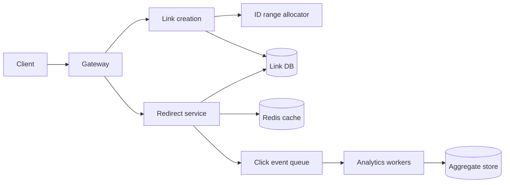

映射按 `(domain, code)` 分片；创建和重定向独立扩容。统计不能阻塞重定向，允许的事件丢失率需要单独定义；有精确计费要求则必须增加可靠日志。

### 4）核心用例与 Deep dive / Low level design

**本题核心用例：**用户创建短链接；用户打开短链接。

#### 核心用例 1：用户创建短链接

**LLD：**校验目标URL、所有者配额和请求幂等键；从数据库已永久分配的号段取ID并Base62编码，与自定义alias共用唯一命名空间。先在请求分片持久绑定CreateRequest与预分配code，再到该code所属分片唯一插入Link/outbox，最后记录请求完成并返回。两步之间崩溃用原code继续，不重新分配；缓存失败不回滚链接。

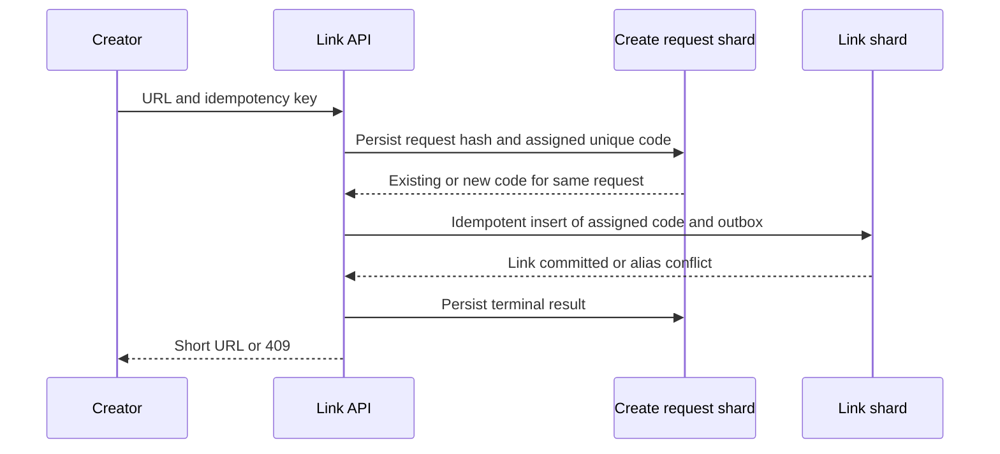

#### 核心用例 2：用户打开短链接

**LLD：**按domain/code查缓存，读取expiry并检查撤销政策；miss回源权威分片。有效才返回配置了Cache-Control的302；不存在404，过期/禁用410。默认点击采集为best-effort，异步队列已接收的事件可按event_id去重重放，但响应后入队前仍可能丢失。

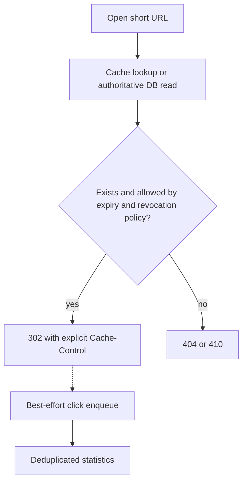

#### 关键机制与权衡

**短码生成：**数据库原子分配一段整数号段，服务在内存中递增并 Base62 编码，减少每次创建的中心协调。宕机浪费未用号码可以接受，不能重新发放。`62^6 ≈568 亿`；Snowflake 的时间、worker 和序列组合可独立生成 ID，但不能随意截断位数仍宣称唯一。哈希截断必须靠唯一插入和冲突重试兜底，“先查不存在再插入”不防并发。

**缓存与新写可读：**缓存项包含过期时间与版本，每次命中仍判断是否过期。数据库成功后填缓存，并清除先前对该code的负缓存；复制延迟时首次读回源主库。修改用版本化失效事件和有界 TTL，严格禁用需求另查 authoritative deny 状态。热点用进程缓存/边缘缓存减压；负缓存短 TTL，防止刚创建的链接长时间 404。

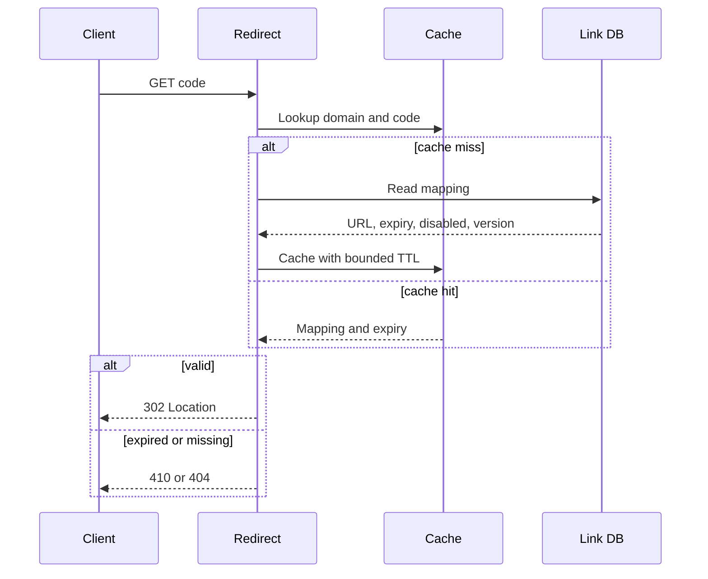

**重定向取舍：**301 可能被浏览器长期缓存；需要修改目的地或观测点击时使用 302 并明确 Cache-Control，不能仅凭状态码保证不缓存。过期短码谨慎复用，避免旧链接指向新用户内容。监控 p99、缓存命中率、失效传播时延和 ID 分配失败率。

### 5）面试官追问：设计依据与故障验证

**访问与分片：**重定向按 `(domain,code)` 点查并哈希分片；所有者列表另建 `(owner_id,created_at,code)` 索引或投影，不能扫描全部分片。创建幂等记录按owner/request_key路由，Link按domain/code路由，两者通常不在同片。因此先持久绑定请求与code，再幂等插入Link，最后标完成；恢复始终复用绑定的code。单库可合为一个事务，分片后不能继续声称跨键天然ACID。同键不同URL返回409，alias冲突由Link唯一约束裁决。

**容量落点与演进：**116k 峰值读 QPS、99% 缓存命中时约1,160 QPS回源；缓存全部失效则直接放大100倍，需要请求合并、预热及回源并发预算。单个爆款链接靠边缘/进程缓存分流，增加 DB 分片无法拆开同一个热 key。对失效传播延迟和404突增告警。

**问：禁用后为什么还能访问？高分回答：**“命中缓存时只能检查缓存里的旧 disabled，不能知道最新修改。我会与面试官约定例如5秒的撤销窗口；若要求立即撤销，必须在重定向路径读取线性一致的撤销状态，分区时拒绝或承担不可用。用户已缓存的永久跳转无法由服务端收回。”

**问：返回302后宕机，点击会丢吗？高分回答：**“会，进程内异步发送不是可靠日志。本方案承认这段丢失窗口；若统计用于收费，先持久化访问事件再响应，接受新增延迟和日志不可用时的策略。即使先记日志，也只能证明服务端接收请求，不能证明用户最终打开目标页面。”

**验证场景：**创建提交后响应丢失，重试应返回同一 code；失效事件先到、旧回源后到时以版本水位拒绝旧缓存回填，不能仅删除一次缓存。

**补充检查点：**哈希截断不能保证唯一，实际码空间的生日碰撞必须由唯一约束和冲突重试兜底；缓存不是事实来源，禁用/过期必须读时复核；需要修改目的地或逐次统计时用 302 并设置 Cache-Control，不能笼统说 301 更快。

## 02 · 票务预订（BookMyShow）

[视频](https://youtu.be/uamf0wRMx5o) · [课程笔记](https://www.interviewwithbunny.com/systemdesign/02) · 分类 A

**课程主线：**Elasticsearch 检索活动，Redis 展示占座状态，事务数据库持有并确认预订，幂等支付，Kafka 异步通知。

### 1）Requirement

**面试开场与取舍：**聚焦固定座位场次，保留发现选座、预订取票、管理订单三个用户目标。先确认多人连座、占座时长和退款政策；自由站席、转售、动态定价作为扩展。本方案在同一 show 分片完成座位、hold、booking、ticket 和 outbox 的事务。

- **Functional：**按城市、日期、名称搜索活动，查看座位图，多座位临时预留，付款出票，查询/取消/退款。
- **Non-functional：**同场次同座位不可重复售出；同一订单多座位全成功或全失败；搜索允许滞后，结算必须重新检查。搜索目标 p99 <300ms；付款耗时受外部通道影响。
- **Scale（假设）：**1 亿次浏览/天 ≈1,157 QPS；100 万订单/天 ≈11.6 QPS，但热门开售可出现单场次 10k 次预留请求/秒，平均流量不能代表锁竞争。

### 2）Entity & API

| Entity | Key fields | PK / UK |
|---|---|---|
| Show | show_id, event_id, venue_id, starts_at | PK show_id |
| ShowSeat | show_id, seat_id, state, hold_id, hold_expires_at, version | PK `(show_id, seat_id)` |
| Hold | hold_id, user_id, show_id, state, expires_at | PK hold_id；座位关联表 PK `(hold_id, seat_id)` |
| Booking | booking_id, hold_id, user_id, amount_minor, currency, status, price_snapshot, policy_version, version | PK booking_id；UK hold_id |
| Ticket | ticket_id, show_id, seat_id, booking_id, status | PK ticket_id；有效票部分UK `(show_id,seat_id)` |
| Payment | payment_id, booking_id, attempt_id, provider, provider_ref, idempotency_key, amount_minor, currency, status | PK payment_id；UK `(provider,provider_ref)`、`(provider,idempotency_key)` |

API：`GET /v1/shows?city=&date=&q=` → 活动游标页；`GET /v1/shows/{id}/seats` → 座位状态与 `as_of`；`POST /v1/holds {show_id, seat_ids}` → `201 {hold_id, expires_at, amount}`；`POST /v1/bookings {hold_id, payment_token}` → `202 {booking_id, status}`；`GET /v1/bookings/{id}` → 当前状态；`POST /v1/bookings/{id}/cancel` → 取消/退款进度。

### 3）High level design

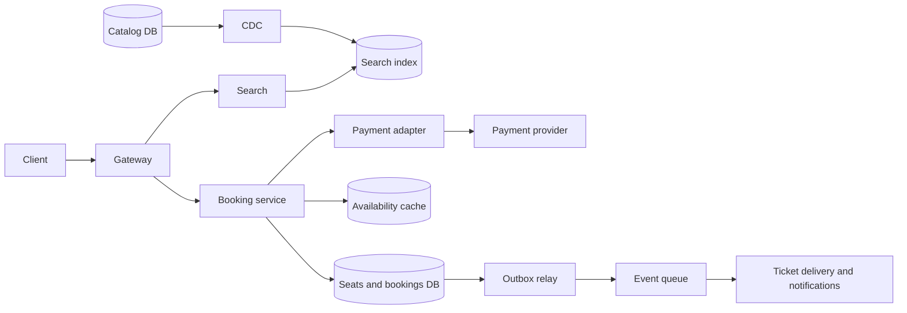

目录和搜索独立扩容；库存事实由 ShowSeat 决定，Redis 座位图只供展示。将同场次库存放到可原子更新的事务边界内。

### 4）核心用例与 Deep dive / Low level design

**本题核心用例：**用户发现活动并选择座位；用户预订并取得电子票；用户查看、取消订单或申请退款。

#### 核心用例 1：用户发现活动并选择座位

**LLD：**用户按城市/日期/影片搜索 → 查看场次详情和版本化座位图 → 客户端展示可售状态与价格。搜索/座位图允许短暂滞后，但下单时必须重新读取 authoritative 座位行。

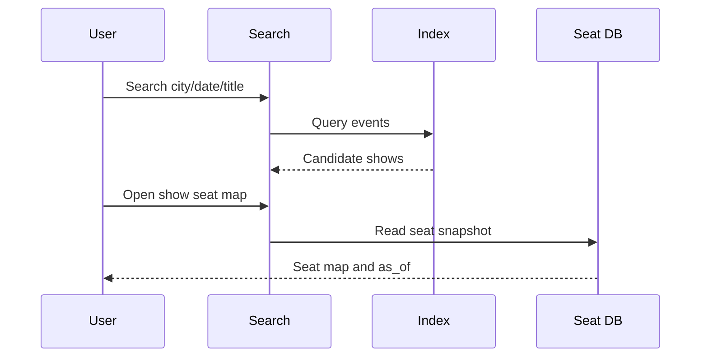

#### 核心用例 2：用户预订并取得电子票

**LLD：**选座以固定顺序锁行，全部可用才一次创建hold；用户发起结算时，在hold有效且仍拥有全部座位的条件下转PAYMENT_PENDING并写稳定支付attempt/outbox。事务外调用支付；最终扣款成功后，在同一show分片提交SOLD、CONFIRMED、有效Ticket与outbox，用户查询即可取票。支付超时返回处理中，晚到成功只能确认仍持有的座位，否则退款。

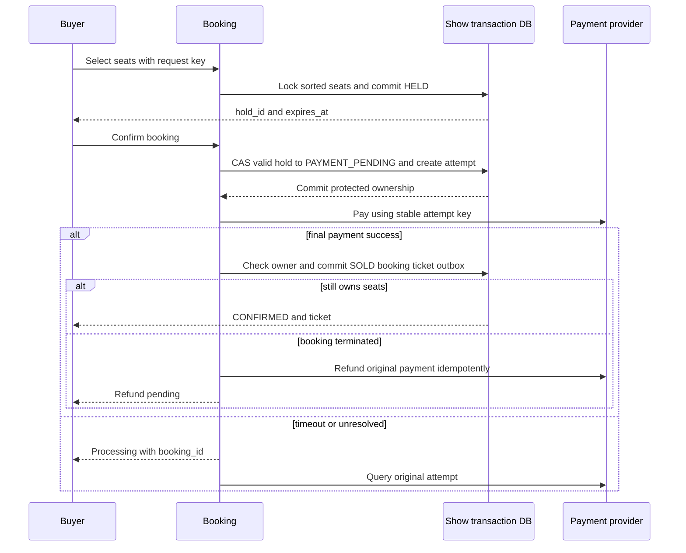

#### 核心用例 3：用户查看、取消订单或申请退款

**LLD：**读取本人订单与退款状态；取消请求依据购买时policy_version和当前履约阶段校验，以booking version竞争出票/取消。接受取消后事务作废有效票、按政策释放可重新销售座位并创建唯一refund intent/outbox。取消成立与退款到账分别展示，退款失败持续重试/人工处理，不恢复已作废票。

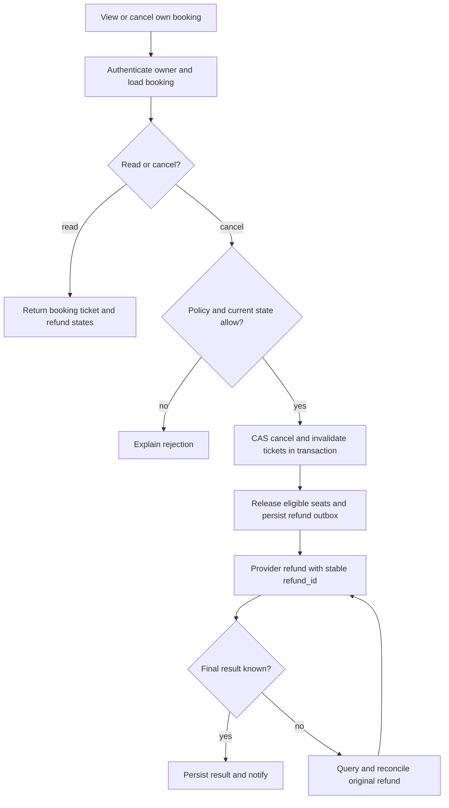

#### 关键机制与权衡

**占座事务：**按 seat_id 固定顺序锁行，使用数据库时间判断 `AVAILABLE` 或旧 hold 已过期；只有全部座位可用才写 Hold 和 ShowSeat，设置相同过期时间。锁排序减少死锁；超时重试要有预算。不能仅靠 Redis TTL 保证不重复出票。

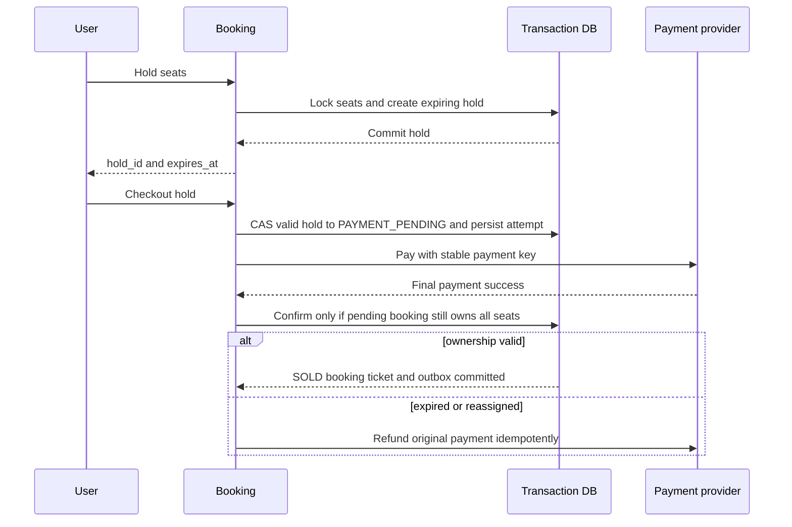

**过期与付款竞态：**HELD到PAYMENT_PENDING的迁移与普通过期释放竞争同一状态、owner、version和数据库时间；进入支付处理后由独立恢复流程接管，不再按原hold TTL释放。支付成功后只确认仍拥有全部座位的非终止订单。支持authorize/capture的通道可以分两步完成支付，但授权不等于扣款成功；本方案在最终成功后才确认出票。超过处理期限释放后出现迟到成功，必须退款，不能抢回座位。

**热点：**开售前排队、每用户限额和限流；缓存座位快照，冲突时刷新。订单和 Outbox 同事务，消费者按 booking_id 去重。关注占座冲突率、锁等待、超时支付与退款未完成数量。

### 5）面试官追问：设计依据与故障验证

**补全模型与边界：**Booking 增加 `policy_version, price_snapshot, version`；Payment 增加 `provider, attempt_id, idempotency_key, amount_minor, currency`；Ticket 保存 `ticket_id,show_id,seat_id,booking_id,status`，PK ticket_id，并用部分唯一约束限制同一 `(show_id,seat_id)` 只有一张有效票。预订历史可以多条，不能给所有历史订单设置永久座位唯一约束。用户订单列表索引 `(user_id,created_at,booking_id)`；权威详情路由原 show 分片。

**状态与成功边界：**`HELD → PAYMENT_PENDING → CONFIRMED`；只有 HELD 由普通过期任务回收。进入 PAYMENT_PENDING 前用数据库时间检查有效期并锁定所有座位；外部调用在事务外执行。支付成功与 owner 校验后，事务将座位置 SOLD、出票并写 outbox。PAYMENT_PENDING 有独立处理截止时间：到期后查询/撤销原支付；若按政策终止并释放库存，后续成功扣款只能退款。通知延迟不影响已生成的电子票。

**容量落点与演进：**单场次10k预留请求/秒首先撞上热点座位锁，而非全站CPU。排队准入令牌绑定用户和场次、设有效期与限次；提交仍做权威库存校验。限制一次最多购票数和事务时长，压测最后几座的竞争，监控锁等待、占座转化率、PAYMENT_PENDING年龄及待退款金额。

**问：支付成功但座位已经卖给别人？高分回答：**“正常支付处理中保留原所有权；如果处理超时已终止释放，旧回调不能重新确认。我保存这笔成功扣款事实并幂等退款，用户看到退款处理中。数据库与支付渠道之间没有跨系统原子提交，必须明确补偿结果。”

**问：取消成功是否意味着退款到账？高分回答：**“不是。我先冻结取消决策并作废有效票，再按政策决定座位是否重新可售；退款有自己的 PENDING/SUCCEEDED/FAILED 状态。重复请求复用 refund_id，累积已退与在途退款不得超过已支付金额。核验也必须检查票的有效状态，不能只验证二维码签名。”

**验证场景：**同时购买相交座位集合、占座到期瞬间发起支付、扣款后进程崩溃、取消与出票并发；断言任何时刻一个座位最多一张有效票，所有成功扣款最终能对应有效订单或退款。

**补充检查点：**并发买最后一张票依靠行锁/条件更新而非缓存锁；过期释放与支付回调通过 owner+version 条件转换，旧回调不能夺回座位；搜索索引允许滞后，结算必须回源库存；取消和退款必须保存 policy_version，避免政策变化重算历史订单；运营下线不能删除已售事实，而应进入迁座/退款状态机；通知失败不能回滚已确认出票。

## 03 · 电商平台（Amazon / Flipkart）

[视频](https://youtu.be/-wJuExkI97s) · [课程笔记](https://www.interviewwithbunny.com/systemdesign/03) · 分类 A

**课程主线：**商品目录与搜索分离，购物车缓存，库存控制，checkout 编排支付与订单，事件驱动履约。

### 1）Requirement

**面试开场与取舍：**聚焦买家结算与收货/退货，先确认是否允许部分下单、拆包裹和缺货延期。本方案不允许未经用户同意部分结算；允许履约拆包。购物车价格与库存只是预估，订单保存结算快照。

- **Functional：**检索/筛选商品、详情与评论、购物车、结算、支付、订单查询、发货和退货；支持限量库存。
- **Non-functional：**浏览可用性优先；库存非负、支付不重复、订单可恢复；购物车价格不是最终成交价格，结算需校验价格版本和库存。
- **Scale（假设）：**1 亿 SKU、10k 搜索 QPS、100 订单/秒、平均3个商品 →约300个库存预留/秒；SKU 元数据平均2KB则约200GB，图片另计。大促热点集中在少数 SKU。

### 2）Entity & API

| Entity | Key fields | PK / UK |
|---|---|---|
| Product / SKU | product_id, sku_id, seller_id, seller_sku, attributes, price_version | PK sku_id；UK `(seller_id, seller_sku)` |
| CartItem | cart_id, sku_id, quantity | PK `(cart_id, sku_id)` |
| Inventory | warehouse_id, sku_id, on_hand, reserved, version | PK `(warehouse_id, sku_id)`；约束 `0 <= reserved <= on_hand` |
| Reservation | reservation_id, order_id, warehouse_id, sku_id, quantity, expires_at, status | PK reservation_id；UK `(order_id, warehouse_id, sku_id)` |
| Order / OrderItem | order_id, user_id, state, total_minor；line_id, sku_id, quantity, unit_price_minor | PK order_id；明细 PK `(order_id, line_id)`；价格快照不可随目录变动 |

API：`GET /v1/products?q=&cursor=` → 商品页；`PUT /v1/carts/{id}/items/{sku} {quantity}` → 购物车版本；`POST /v1/checkouts {cart_id, cart_version, address_id, payment_token}` → `202 {order_id}`；`GET /v1/orders/{id}` → 分包履约与付款状态；`POST /v1/orders/{id}/returns {line_ids, reason}` → 退货单。Checkout 服务端重新计价，价格变化需用户确认。

### 3）High level design

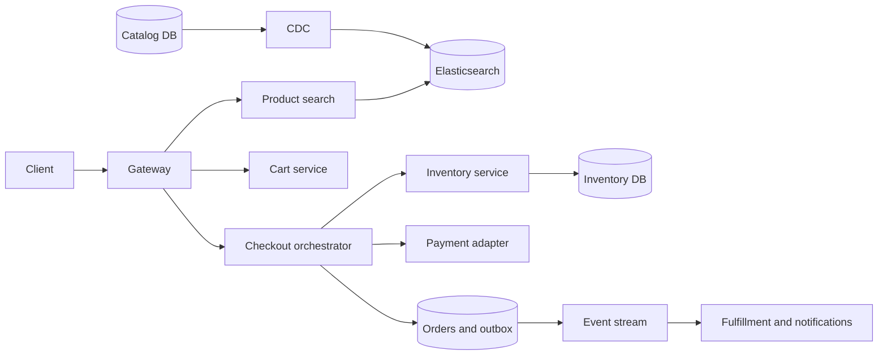

### 4）核心用例与 Deep dive / Low level design

**本题核心用例：**用户结算下单；用户查看订单并收货或退货。

#### 核心用例 1：用户结算下单

**LLD：**读取购物车并冻结价格/税费快照；创建幂等checkout，逐个库存分片提交条件预留。同库多行一次事务，跨库Saga保存每步reservation_id；任一失败补偿已成功项。全部库存承诺后发起支付；成功提交订单确认，未知返回处理中。每次重试查询原checkout，不能因为客户端超时再创建第二笔订单。

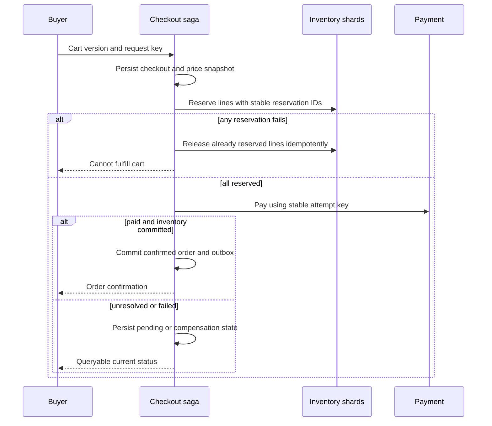

#### 核心用例 2：用户查看订单并收货或退货

**LLD：**用户按订单号查看各包裹履约时间线；物流事件先校验来源并按shipment/event_id去重，合法推进包裹状态。退货请求检查原订单政策、可退数量和历史退货；验收结果决定可售/不可售库存，退款按原分摊实付金额建立独立intent。用户看到退货、退款与物流各自进度。

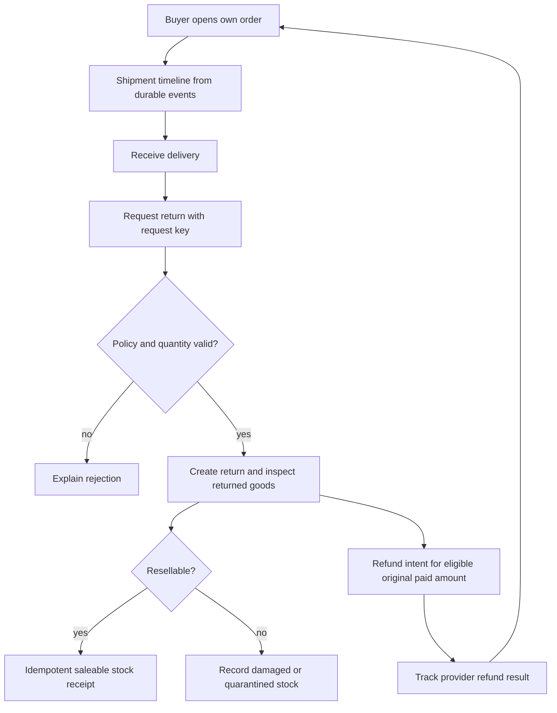

#### 关键机制与权衡

**库存原子性：**预留执行 `UPDATE inventory SET reserved=reserved+q WHERE on_hand-reserved>=q`，同时记录唯一 reservation。购物车不占库存。发货将 on_hand 与 reserved 同减；取消只释放 reserved；每次转换均检查当前状态，防重复释放。

**跨仓多商品：**单数据库可本地事务；跨分片采用 Saga，失败释放已成功预留项，不能声称跨库天然 ACID。订单状态持久化并记录每个步骤结果，重启从未完成步骤恢复。

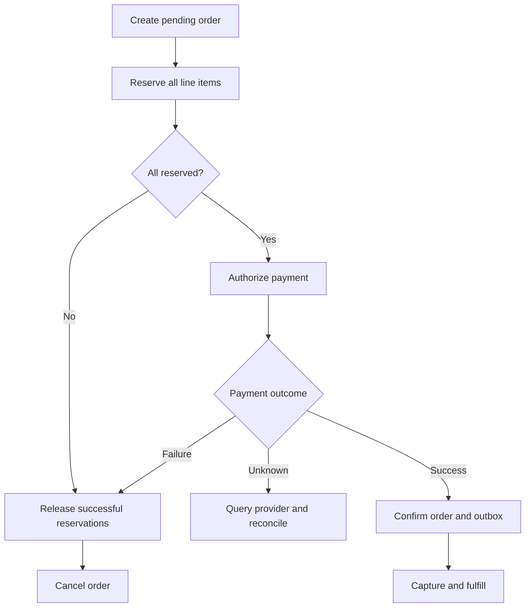

**库存热点与索引：**SKU/仓库分片，热门库存可分配有上限的配额桶，每桶售出量不得超配额；不能简单增加缓存副本实现强库存。CDC 处理版本号、防旧事件覆盖；搜索返回的“有货”仅是提示。退货只有验收后再增加可售库存；退款和库存回补独立追踪。监控预留泄漏、补偿积压、支付/订单差异。

### 5）面试官追问：设计依据与故障验证

**访问与分片：**库存按 `(warehouse_id,sku_id)` 唯一行条件预留；Reservation 增加 `checkout_id,line_id,qty,state,expires_at,version`，UK `(checkout_id,line_id,warehouse_id)`。订单按 order_id 分片、买家订单按 `(buyer_id,created_at,order_id)` 建投影；OrderLine 保存 sku、实付单价、促销/税/运费分摊和可退数量，避免退款重新查现价。

**事务与状态：**同库存库的多行预留一起提交或回滚；跨仓服务由持久 Saga 记录每步结果，全部成功才请求支付，任一步失败按 reservation_id 释放已成功预留。重复 release 只能从 RESERVED 迁移一次。支付未知时不能自动释放后直接确认旧回调；迟到成功进入补偿。履约只有在支付和库存承诺都满足后启动。

**容量落点与演进：**假设峰值2k结算/秒、每单5条商品，就是至少10k库存条件写/秒，另有释放和售出更新。按 SKU 分片仍挡不住单 SKU 抢购；先准入限流，必要时分配总和不超过库存的子配额，明确回收协议。监控预留泄漏、Saga积压和支付成功但订单未完成的年龄。

**问：消息发出而订单事务回滚？高分回答：**“订单和 outbox 在同一本地事务，relay 只读已提交记录。relay发送成功但标记失败会重发，所以履约消费者以 order_id+step 去重，并把去重记录与业务变化同事务提交。”

**问：退货就能增加可售库存？高分回答：**“不能。退款审批、货物验收和回补库存是独立事实；损坏商品进入不可售库存。每个 return_line 有数量上限，退货验收事件幂等，避免同一件商品重复退款或入库。”

**补充检查点：**Redis lock 只能降低竞争，最终必须靠库存条件写和 fencing；支付成功而订单写失败进入 UNKNOWN/COMPENSATING，通过 provider 查询和对账恢复；价格变化用 price_version 返回冲突或要求确认。

## 04 · OTT 视频平台（Netflix / Prime）

[视频](https://youtu.be/NH-f955mvGg) · [课程笔记](https://www.interviewwithbunny.com/systemdesign/04) · 分类 C

**课程主线：**上传、转码、多码率清单、对象存储/CDN 和自适应播放，外加订阅、历史记录与分析。

### 1）Requirement

**面试开场与取舍：**先限定点播，不把直播低延迟混入同一设计。两个用户目标是观众授权播放、内容方上传发布；推荐模型和订阅计费仅保留接口。先问目标地区、最高分辨率和版权保护要求。

- **Functional：**内容上传、片库搜索、订阅权益、不同清晰度播放、字幕、续播；本题以点播为主，直播需另设计实时转码与时延预算。
- **Non-functional：**播放启动目标 <2s、低卡顿、全球可用；片源持久可靠；付费与地域授权必须服务端校验；视频发布不能暴露不完整清单。
- **Scale（假设）：**1,000 万 DAU，平均每天看1小时，平均并发≈417k；按5Mbps平均码率，流量约2.08Tbps。1万部 ×1小时 ×总码率20Mbps /8 ≈90TB转码内容，不含原片与副本。

### 2）Entity & API

| Entity | Key fields | PK / UK |
|---|---|---|
| Video | video_id, title, duration_ms, rights_region, publish_status, media_version | PK video_id |
| Rendition | video_id, media_version, profile, codec, bitrate, manifest_key | PK `(video_id, media_version, profile)` |
| TranscodeTask | task_id, video_id, media_version, profile, state, attempt | PK task_id；UK `(video_id, media_version, profile)` |
| Entitlement | user_id, plan_id, status, valid_until | PK `(user_id, plan_id)` |
| WatchProgress | user_id, video_id, position_ms, session_id, seq, updated_at | PK `(user_id, video_id)` |

API：`POST /v1/videos/uploads {metadata}` → 上传会话/签名URL；`POST /v1/videos/{id}/publish` → `202 {job_id}`；`GET /v1/videos?q=` → 片库；`POST /v1/playback-sessions {video_id, device}` → `{manifest_url, license_url?, expires_at}`；`PUT /v1/progress/{video_id} {session_id, seq, position_ms}` → 已接收版本。

### 3）High level design

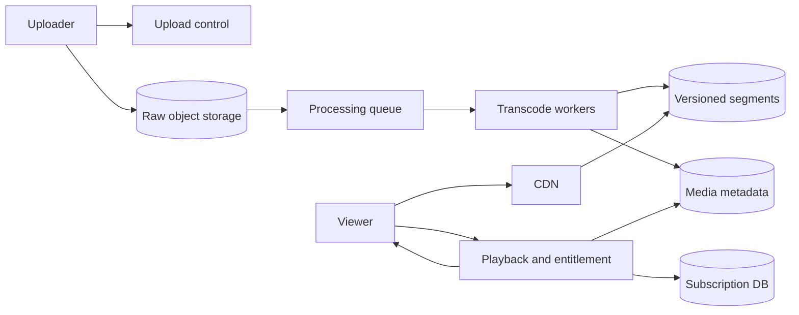

### 4）核心用例与 Deep dive / Low level design

**本题核心用例：**观众开始播放并继续观看；内容方上传并发布视频。

#### 核心用例 1：观众开始播放并继续观看

**LLD：**校验订阅权益、地域与设备限制，创建播放会话并返回短期授权manifest/许可；边缘先验授权再提供不可变segment，播放器按带宽和缓冲选择码率。进度在同一session内按seq去旧，多设备由服务端会话版本决定续播位置；续播位置允许用户主动后退。权限拒绝时不发媒体签名。

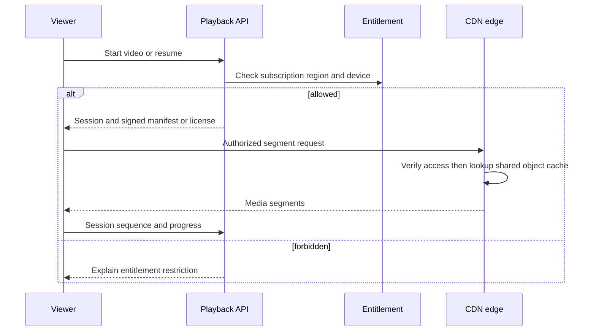

#### 核心用例 2：内容方上传并发布视频

**LLD：**内容方创建upload session并直传片源；服务验证大小/checksum后提交不可变source version和转码工作。各profile任务以asset version/profile/pipeline version幂等，失败重试不覆盖其他版本。预先规定的必需rendition、字幕及质检齐备后，CAS发布指针；发布失败继续保留完整旧版本。

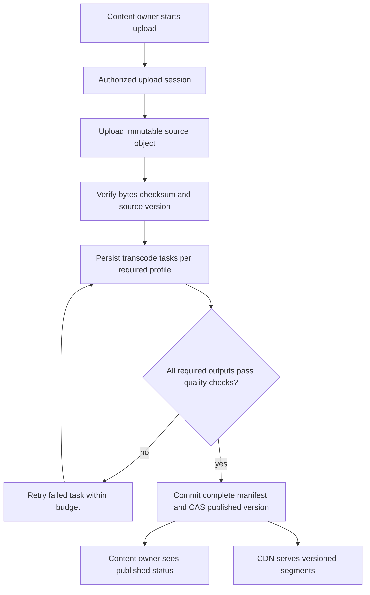

#### 关键机制与权衡

**处理流水线：**上传完成校验 → 解析媒体 → 按 profile 转码 → 生成分片与字幕 → 质检 → 原子发布新 manifest 版本。任务幂等键包含源文件版本与转码参数；失败仅重跑失败 rendition；处理完成前不可标为可播放。

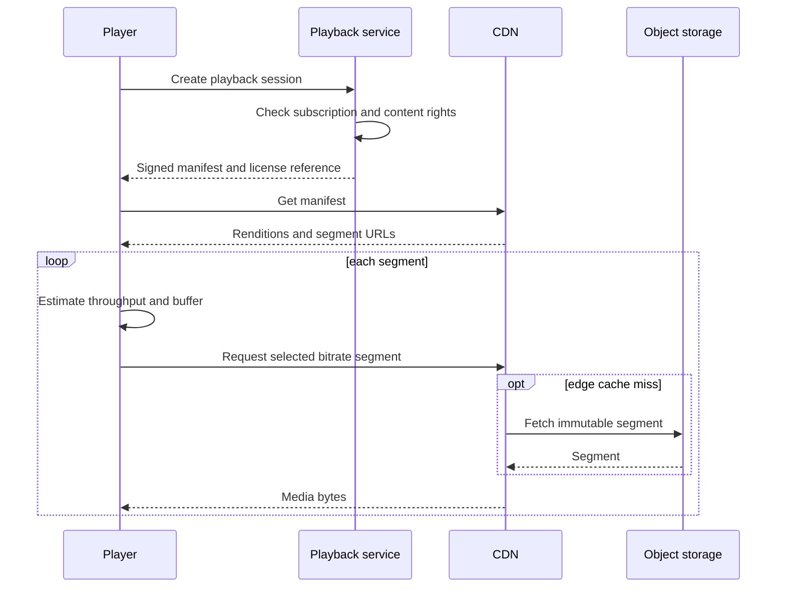

**ABR 与 CDN：**码率选择依据保守带宽估计和缓冲水位，降档比升档更积极，避免反复切换。短分片启动快但请求开销高；长分片缓存好但切换慢。segment 路径含版本，长缓存；授权用签名 cookie/URL，缓存 key 要避免每用户 token 打碎命中率，但边缘仍须校验权限。

**故障：**origin shield 和热门片预热降低回源洪峰；转码重试不能覆盖已发布版本；进度异步落库并防乱序。DRM licence 服务独立扩容。用启动时延、rebuffer ratio、播放失败率和 CDN 回源字节量评估用户体验。

### 5）面试官追问：设计依据与故障验证

**访问与模型：**AssetVersion 保存 source_key、checksum、status；TranscodeTask 以 `(asset_version,profile,pipeline_version)` 唯一，保存 attempt 和输出对象引用。发布 manifest 指向不可变分片；发布所需的最低 rendition 集必须预先定义，额外4K可另一个版本发布。播放会话记录 entitlement_version、设备和有效期，播放授权与每片媒体传输分开扩容。

**容量落点：**新增假设100万并发观看×平均4Mbps≈4Tbps出口；98%字节命中率仍有约80Gbps回源。不能用“CDN命中率高”代替带宽预算；热门首播预热、多层缓存及origin shield降低突发回源。观测首帧p95、卡顿时长占比、播放失败率，按地区/ISP/设备分组。

**问：签名URL怎么兼顾安全与缓存？高分回答：**“在边缘先验证签名和有效期，再用不含用户身份的不可变对象路径共享字节缓存；不能仅删除签名参数却不验证权限。撤销一般受签名有效期约束；需要更快撤销就缩短许可或增加在线校验。DRM密钥许可单独鉴权，签名本身不防录屏。”

**问：转码一半失败能否上线？高分回答：**“只有本版本必需的分片、字幕与质检全部达标，才能CAS切换published_version。失败任务重试写自己的不可变输出，旧worker不能覆盖新任务结果；观众在完整旧版本或完整新版本之间切换。”

**验证场景：**对象已上传但发布事务失败产生孤立对象，可在宽限期后清理；发布成功后不能删除仍被manifest引用的对象。单CDN故障切换须重新处理签名、缓存预热与播放进度。

**补充检查点：**视频数据面放对象存储/CDN，DB 保存元数据和授权；签名 URL/cookie 不能被 CDN key 误缓存为公共内容；转码只重试失败 task，永不覆盖已发布版本。

## 05 · 酒店预订（Airbnb / Booking.com）

[视频](https://youtu.be/mH2Ye3_vErw) · [课程笔记](https://www.interviewwithbunny.com/systemdesign/05) · 分类 A，关联 B

**课程主线：**地理与条件检索酒店，查询日期库存，分布式互斥控制预订，支付确认及取消、动态价格和通知。

### 1）Requirement

**面试开场与取舍：**先区分“酒店房型每天若干间”与“唯一民宿整套房”。本方案采用房型逐晚库存、入住含当天而退房不占当天；实体房号分配在入住阶段处理，不能把房型预订误写成固定房号永久唯一。

- **Functional：**按地点、入住/退房日期和人数搜索，查看房型、报价、预订、支付、修改、取消、评价。
- **Non-functional：**同一资源每晚不可超卖，多晚预订必须整体成立；搜索可最终一致，确认重新验证；报价有版本和有效期，日期按酒店当地时区定义。
- **Scale（假设）：**1 亿搜索/天≈1,157 QPS，100 万预订/天≈11.6 QPS；每单平均3晚 →约35次 room-night 预留/秒。1,000万房间 ×365天≈36.5亿个逐房逐日记录，适合房型日库存聚合而非无条件展开。

### 2）Entity & API

| Entity | Key fields | PK / UK |
|---|---|---|
| Property | property_id, host_id, location, timezone, amenities | PK property_id |
| RoomType | room_type_id, property_id, capacity, name | PK room_type_id |
| NightInventory | room_type_id, stay_date, total, reserved, sold, version | PK `(room_type_id, stay_date)`；`reserved+sold <= total` |
| Reservation | reservation_id, user_id, room_type_id, check_in, check_out, status, expires_at, quote_id | PK reservation_id |
| NightAllocation | reservation_id, stay_date, quantity, state | PK `(reservation_id, stay_date)` |
| Quote | quote_id, price_breakdown, currency, policy_version, valid_until | PK quote_id |

API：`GET /v1/properties?lat=&lon=&check_in=&check_out=&guests=` → 候选；`POST /v1/quotes {room_type_id, dates, guests}` → `{quote_id, total, valid_until}`；`POST /v1/reservations {quote_id}` → 临时预订；`POST /v1/reservations/{id}/confirm {payment_token}` → 处理状态；`POST /v1/reservations/{id}/cancel` → 取消及退款金额。

### 3）High level design

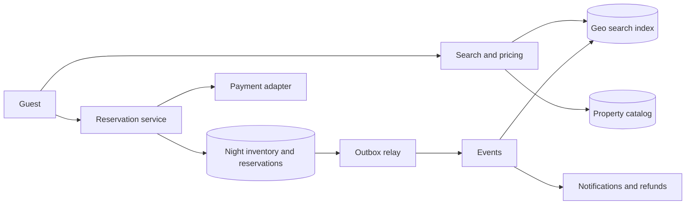

### 4）核心用例与 Deep dive / Low level design

**本题核心用例：**用户搜索并预订房间；用户修改或取消预订。

#### 核心用例 1：用户搜索并预订房间

**LLD：**按地点和日期搜索候选房型，结算回源重新报价。将半开区间内全部夜晚排序锁定，在同一酒店分片一次预留；带稳定支付键进入受保护的支付处理中。支付成功且仍拥有全部夜晚后确认；未知结果继续查询，终止释放后的迟到扣款走退款。

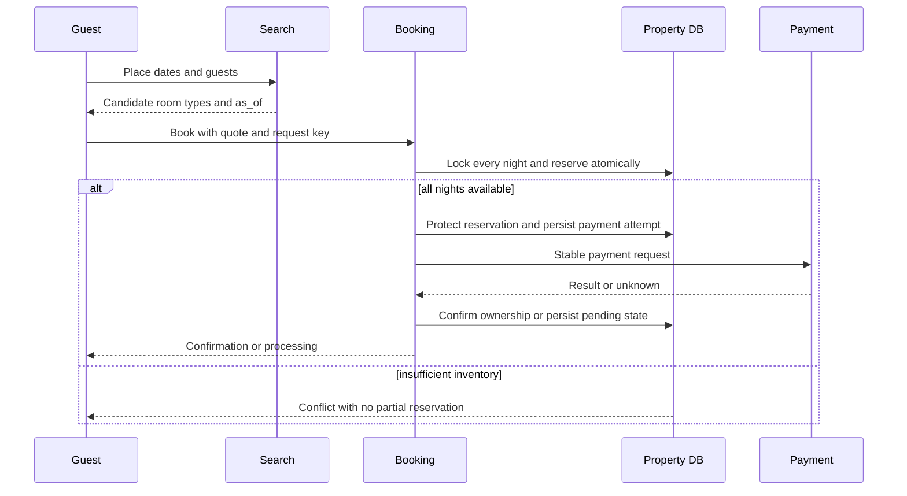

#### 核心用例 2：用户修改或取消预订

**LLD：**修改先按新旧日期集合差预留新增夜晚，重叠夜晚复用自己的库存；确认差价后事务切换预订明细并释放移除夜晚。失败保持旧订单。取消直接按原policy_version条件作废预订并释放库存，退款另有持久状态；不能让取消经过新日期预留流程。

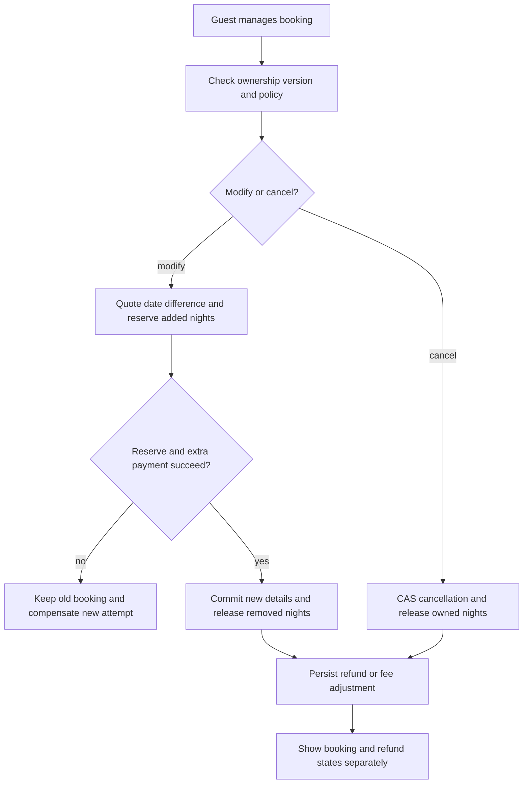

#### 关键机制与权衡

**区间库存：**入住区间用半开区间 `[check_in, check_out)`，退房日不占一晚。按日期升序锁定所有 NightInventory 行，验证每晚余量并原子增加 reserved。只锁“入住日”或把 `(房型, 入住日, 退房日)` 设唯一不能防止重叠区间超卖。独栋房源可用逐日唯一分配或数据库排斥约束。

```mermaid
flowchart TD
  A[Validate quote and dates] --> L[Lock all nights in date order]
  L --> C{Every night has capacity?}
  C -->|No| R[Rollback whole reservation]
  C -->|Yes| H[Reserve every night and set expiry]
  H --> P[Authorize payment]
  P --> V{Still valid and owns nights?}
  V -->|Yes| F[Move reserved to sold]
  V -->|No| X[Release reservation and compensate payment]
```

**修改预订：**保留旧预订，先尝试新日期差额，再在事务/Saga 中切换，失败恢复旧状态，不能先取消再期待新房间仍在。取消价格根据购买时保存的 policy_version，而非当前政策计算。

**扩容与恢复：**按 property_id 分片使多晚同事务；大酒店热点独立隔离。预留释放依赖持久化状态扫描，Redis TTL 只加速展示。索引延迟以 `availability_as_of` 告知，监控房型日库存不变量和未补偿付款。

### 5）面试官追问：设计依据与故障验证

**访问与分片：**以 property_id 共置 `(room_type_id,date)` 的 NightInventory 和预订明细；固定排序锁定所有晚，检查 `sold+reserved+qty<=capacity` 后一起提交。价格快照逐晚保存税费、币种和policy_version。搜索走地理/日期索引，权威可订性回源，日期最多允许预订多少晚要设上限以控制锁集合。

**修改语义：**同酒店同库修改先计算新旧日期的集合差，只预留新增夜晚、保留重叠夜晚；否则满房时客人连自己的原夜晚都无法保留。额外费用确认后一次切换明细并释放删去的夜晚。跨酒店改订按新订单Saga处理，新预订失败保留旧订单；取消是独立分支，不经过新日期预留。

**容量落点与演进：**假设1k预订/秒、平均4晚，至少4k夜库存更新/秒；假日同一酒店的日期行才是热区。搜索缓存可降低读负荷，不能缓解最后一间的写冲突。监控逐晚不一致、支付等待年龄、持有到期释放延迟与索引新鲜度。

**问：为什么不能只给日期区间加唯一索引？高分回答：**“唯一约束只能防完全相同的键，两个不同区间仍可能重叠。本设计把区间展开成逐晚数量；如果是唯一房源，也可用排斥约束阻止区间交叠，但不能直接套到多间房型库存。”

**问：外部酒店也在卖，内部锁能保证不超卖吗？高分回答：**“只能保证本平台已分配的配额不超卖。必须与渠道经理约定独占配额或原子确认接口；若供应商只是最终一致同步，需承认拒单/替代住宿补偿，不能声称全渠道强一致。”

**补充检查点：**搜索的有房只是候选并带 `availability_as_of`；预留到期由持久扫描条件释放；不能先取消旧房再赌新房仍可用。

## 06 · 外卖（Zomato / Swiggy / Uber Eats）

[视频](https://youtu.be/rZyAgZuuZiA) · [课程笔记](https://www.interviewwithbunny.com/systemdesign/06) · 分类 B，关联 A/E

**课程主线：**附近餐厅检索、菜单购物车、订单与支付、餐厅接单、骑手匹配，以及 WebSocket 实时跟踪。

### 1）Requirement

**面试开场与取舍：**保留顾客下单到餐厅接单、顾客跟踪配送到收餐。先确认多商家购物篮、骑手拼单和支付扣款时点。本方案先做单餐厅一单、单骑手一单，拼单作为容量模型的扩展。

- **Functional：**附近餐厅/菜品搜索、购物车和优惠、下单付款、餐厅接单与备餐、派骑手、实时位置、送达及评价。
- **Non-functional：**订单、价格和支付可靠；只分配符合容量的骑手；位置允许几秒滞后，订单转换必须合法；商家不接单和无骑手时有超时政策。
- **Scale（假设）：**1,000万订单/天≈116单/秒；峰值取5倍≈579单/秒。20万活跃骑手每5秒上报 →40k位置更新/秒。注意100k单/小时约28单/秒，不能同时称作此规模的峰值。

### 2）Entity & API

| Entity | Key fields | PK / UK |
|---|---|---|
| Restaurant / MenuItem | restaurant_id, location, hours；item_id, price_minor, available, menu_version | PK restaurant_id / item_id |
| FoodOrder | order_id, user_id, restaurant_id, address_snapshot, amount, state, version | PK order_id |
| OrderItem | order_id, line_id, item_id, options, price_snapshot, quantity | PK `(order_id, line_id)` |
| DeliveryTask | task_id, order_id, driver_id, assignment_token, status | PK task_id；UK order_id |
| DriverState | driver_id, active_load, capacity, version, last_seen | PK driver_id |
| LocationEvent | driver_id, session_id, seq, lat, lon, observed_at | PK `(driver_id, session_id, seq)` |

API：`GET /v1/restaurants?lat=&lon=&q=` → 餐厅页；`GET /v1/restaurants/{id}/menu` → 带版本菜单；`POST /v1/orders {restaurant_id, items, menu_version, address_id, payment_token}` → `202 {order_id}`；`POST /v1/orders/{id}/accept` → 商家接单；`POST /v1/deliveries/{id}/accept {assignment_token}` → 骑手认领；`WS /v1/orders/{id}/tracking` → `{seq, state, location, observed_at}`。

### 3）High level design

```mermaid
flowchart LR
  C[Customer] --> S[Restaurant search]
  S --> E[(Geo and menu index)]
  C --> O[Order orchestrator]
  O --> D[(Order DB and outbox)]
  O --> P[Payment]
  D --> Q[Order events]
  Q --> R[Restaurant app]
  Q --> M[Dispatch]
  M --> G[(Driver geo index)]
  M --> DS[(Driver capacity DB)]
  Driver[Driver app] --> L[Location ingress]
  L --> G
  L --> W[Tracking gateway]
  W --> C
```

### 4）核心用例与 Deep dive / Low level design

**本题核心用例：**用户下单并等待餐厅接单；顾客跟踪配送并确认收餐。

#### 核心用例 1：用户下单并等待餐厅接单

**LLD：**锁定 menu_version/address snapshot → order pending+outbox → payment authorization 幂等 → 餐厅 deadline 内接受；超时撤销授权/退款，订单与支付是两个状态机。

```mermaid
sequenceDiagram
  participant U as Customer
  participant O as Order
  participant P as Payment
  participant R as Restaurant
  U->>O: Submit menu version and address
  O->>P: Authorize payment
  O->>R: Request acceptance
  R-->>O: Accept or reject
  O-->>U: Order state
```

#### 核心用例 2：顾客跟踪配送并确认收餐

**LLD：**餐厅接单后，派单按新鲜位置召回并以ETA排序；骑手接受offer时原子确认订单与骑手的活跃assignment。取餐、送达分别校验操作人、assignment token和订单版本，提交持久事件。顾客查看订单快照与最新位置，重连按事件水位补齐；坐标可合并，送达状态不能丢弃。

```mermaid
flowchart TD
  O[Restaurant accepts order] --> M[Fresh courier candidates ranked by ETA]
  M --> F[Persist offer with token and deadline]
  F --> A{Courier accepts valid offer?}
  A -->|no or expired| M
  A -->|yes| T[Commit unique order and courier assignment]
  T --> P[Authenticated pickup event committed]
  P --> L[Latest location with timestamp]
  L --> U[Customer follows delivery map]
  P --> D[Validate and commit delivered event]
  D --> U
  U --> S[Reconnect with snapshot and event cursor]
```

#### 关键机制与权衡

**订单 Saga：**采用 `PENDING → RESTAURANT_ACCEPTED → PREPARING → PICKED_UP → DELIVERED`，另有 `CANCELLED`；派单和付款为独立子状态，避免组合成几十个总状态。商家拒绝、超时或无法履约时，按所处阶段释放预留/撤销授权/退款。

```mermaid
sequenceDiagram
  participant O as Order service
  participant R as Restaurant
  participant M as Dispatch
  participant D as Driver state DB
  participant A as Driver app
  O->>R: Request acceptance with deadline
  R-->>O: Accepted and ready estimate
  O->>M: Need delivery
  M->>M: Nearby candidates ranked by pickup ETA
  M->>D: Reserve capacity with version and lease
  D-->>M: assignment_token
  M->>A: Offer task and expiry
  A->>M: Accept token
  M->>D: Commit only current unexpired reservation
  M-->>O: Driver assigned
```

**匹配：**先空间召回，再按预计出餐时间、到店 ETA、可用容量、已有路线算增量成本；最近不等于最快。支持拼单时不应强制骑手只能有一单，而要原子校验 capacity；超时认领用 token 拒绝。

**跟踪：**driver_id 分区，session+seq 排除旧会话乱序位置，last_seen 超时剔除；坐标流保留最新值即可，订单事件必须持久化。客户端重连先拿状态快照再续订，慢连接合并坐标更新。监控接单率、派单耗时、ETA误差、坐标陈旧率和退款积压。

### 5）面试官追问：设计依据与故障验证

**模型与访问：**Order 增加 menu_version、地址/费用快照、restaurant_deadline、version；DispatchOffer 保存 order_id、courier_id、token、expires_at、state。订单按城市+order_id路由，单城市派单库对 order_id 和 courier_id 分别约束唯一活跃 Assignment；若跨库，先持久预留骑手容量，再由订单CAS确认，以Saga补偿，不能只检查骑手缓存。

**容量落点：**假设10万在线骑手每3秒上报位置，约33k位置写/秒；它与餐厅接单事务分开限流和存储。定位更新可合并为最新值；餐厅接单、取餐、送达必须持久化、验身份和状态。地图推送积压时丢弃旧位置并展示last_updated，不把旧坐标画成实时。

**问：餐厅接单与顾客取消同时发生？高分回答：**“都条件更新相同order version，数据库确定唯一结果。若接单先成功，就按已接单阶段政策决定是否允许取消和费用；支付授权撤销、退款和通知在事务外幂等执行。”

**问：最近骑手为什么不是最好骑手？高分回答：**“空间距离只召回候选，排序还需路网ETA、取餐准备时间和骑手容量。我对位置设新鲜度阈值，过时位置不参与强承诺。接单仍检查offer token及截止时间，不能靠推送送达表示接单成功。”

**验证场景：**骑手已经接单但ACK丢失时重试返回原assignment；服务切换后旧offer不能占用新的骑手任务。配送中失联转人工/再调度须先结束原assignment并记录交接状态。

**补充检查点：**骑手接受和顾客取消竞争同一order version；同一骑手不重复派单依靠持久assignment唯一约束与状态CAS，而不是一把会过期的分布式锁；位置可丢，订单事件不可丢。

## 07 · Proximity Search（附近搜索）

[视频](https://youtu.be/6K6ihHNkO_0) · [课程笔记](https://www.interviewwithbunny.com/systemdesign/07) · 分类 B

**课程主线：**比较 QuadTree、Geohash、PostGIS、Elasticsearch 和 Redis Geo，先做空间候选过滤，再计算距离。

### 1）Requirement

**面试开场与取舍：**两个目标分别是用户查附近地点、用户找附近可用服务者。先明确“附近”按直线距离还是到达时间、位置更新频率、是否要求精确Top-N。静态POI用持久空间索引，实时服务者用可重建热索引；这两条数据路径不要强行共用TTL策略。

- **Functional：**给定坐标与半径，返回附近 POI；支持类别筛选、距离排序和 Top-N；支持位置增删改。
- **Non-functional：**目标 p99 <100ms；明确球面距离近似与椭球精度需求；不得因网格边界漏结果；移动目标需要新鲜度窗口。
- **Scale（假设）：**1,000万静态 POI，10k次查询/秒；若有100万移动实体每5秒更新，则写入200k次/秒。静态 POI 与司机热位置不必采用相同存储路径。

### 2）Entity & API

| Entity | Key fields | PK / UK |
|---|---|---|
| Place | place_id, source, source_id, name, category, location, updated_at | PK place_id；UK `(source, source_id)`；location 建空间索引 |
| LiveLocation | entity_id, location, region_id, session_id, seq, last_seen | PK entity_id；热索引按 region_id 分区 |
| GeoCellMembership | cell_id, entity_id, version | PK `(cell_id, entity_id)`；迁移可短暂多单元存在，查询去重 |

API：`GET /v1/nearby?lat=&lon=&radius_m=&category=&limit=` → `{items:[{id,distance_m}], as_of}`；`PUT /v1/locations/{id} {lat,lon,session_id,seq,observed_at}` → 当前版本；半径和 limit 有上限，非法经纬度拒绝。频繁移动结果若分页，需固定快照或接受分页不稳定并明确语义。

### 3）High level design

```mermaid
flowchart LR
  W[POI writes] --> D[(PostGIS source of truth)]
  D --> CDC[CDC indexer]
  CDC --> ES[(Text and geo index)]
  M[Moving objects] --> L[Location ingress]
  L --> R[(Regional Redis Geo)]
  C[Client] --> Q[Nearby query router]
  Q --> ES
  Q --> R
  Q --> D
  Q --> F[Freshness filter and exact distance ranking]
```

### 4）核心用例与 Deep dive / Low level design

**本题核心用例：**用户搜索附近地点；用户获取附近实时服务者。

#### 核心用例 1：用户搜索附近地点

**LLD：**求查询圆覆盖的全部 cell/空间索引 → 候选去重 → 属性过滤 → 精确球面/椭球距离 → 排序 Top-N。bounding box 只是预过滤。

```mermaid
sequenceDiagram
  participant U as User
  participant Q as Nearby API
  participant G as Geo index
  participant R as Ranker
  U->>Q: Radius and filters
  Q->>G: Query covering cells
  G-->>Q: Candidates
  Q->>R: Exact distance and filters
  R-->>U: Ranked places
```

#### 核心用例 2：用户获取附近实时服务者

**LLD：**位置带 session+seq 写区域热索引和 last_seen → 查询过滤陈旧成员 → 返回候选后再做路网 ETA；静态 POI 与司机热位置不共用同一持久策略。

```mermaid
flowchart LR
  U[User request] --> G[Geo candidates]
  G --> F[Freshness and capability filter]
  F --> E[Route ETA ranking]
  E --> U
```

#### 关键机制与权衡

| 方法 | 适用条件 | 关键代价 |
|---|---|---|
| QuadTree | 内存中按密度细分空间，游戏/区域服务 | 数据偏斜、分裂合并、持久化和跨分区查询需要另外设计；不是永远 O(log N) |
| Geohash | 简单层级 cell 路由、前缀召回 | 必须覆盖查询圆相交的全部 cell，邻居数取决于精度和半径，不能永远固定9格 |
| PostGIS + GiST | 需要关系查询、事务和复杂空间条件 | geography 的 ST_DWithin 使用米；索引筛选后再准确计算距离 |
| Elasticsearch | 全文、属性与 geo 组合查询 | 搜索索引不是最新位置或库存事实；关注索引延迟 |
| Redis Geo | 高频移动目标、内存热集合 | 区域热点、内存、成员新鲜度；整个 key 的 TTL 不等于每个成员 TTL |

```mermaid
flowchart TD
  A[Point and radius] --> B[Choose covering cells or spatial index]
  B --> C[Query every intersecting region]
  C --> D[Deduplicate entities]
  D --> E[Filter stale locations and attributes]
  E --> F[Compute geographic distance]
  F --> G[Keep within radius and rank]
  G --> H[Return Top N and freshness]
```

**边界和精度：**经度每度对应距离随纬度变化，不能经纬度都机械使用 `radius/111`。需要处理跨日期变更线、极区及不同坐标顺序。附近搜索给出直线距离，派单还要地图路网 ETA。PostGIS 的 `geography` 与 `geometry` 单位不同，参见 [ST_DWithin 文档](https://postgis.net/docs/ST_DWithin.html)。

**更新与扩容：**城市/区域分片，热区进一步细分；跨格移动先写新 cell，再删旧 cell，版本去重避免漏查。Redis ZSET 的 stale 成员通过独立 last_seen 索引清理；查询仍需复核。空结果也可能正确，不能无条件把“没找到”当作索引故障回源全表。

### 5）面试官追问：设计依据与故障验证

**模型与查询：**POI 保存坐标、营业时区、类别、status、version；空间索引用于半径召回，属性索引按查询选择组合。DriverLocation 增加 session_epoch、seq、received_at；更新只接受当前session中更大的seq，用服务端接收时间过滤陈旧成员。跨cell移动需要版本化更新和去重，旧cell迟到事件不能覆盖新位置。

**容量落点：**假设每秒5k查询、每次2k候选，就是每秒1,000万候选过滤；限制最大半径、逐级扩大搜索并细分热点cell。截断候选能控成本，但必须声明召回可能不完整。精确距离Top-N只有在未搜索区域的距离下界大于当前第N名时才可停止；不能把该结论直接套到路网ETA排序。

**问：跨网格边界为什么漏人？高分回答：**“中心cell只是存储分区，查询圆可能与任意数量cell相交。我覆盖全部交集、去重、精确距离过滤，并测试反经线、极区、边界和米/角度单位。固定九宫格只能在特定半径和网格尺度下成立。”

**问：查到可用司机就保证能叫到吗？高分回答：**“不能。结果包含as_of与新鲜度，只是发现候选；实际预订由派单系统重新检查状态并抢占容量。搜索服务不会因为地图显示available就作出库存承诺。”

**验证与降级：**用小规模全量距离计算作为oracle验证召回；空间索引不可用时限制服务半径或返回明确不可用，不能返回空集合冒充附近确实无人。

**补充检查点：**Geohash 必须查所有相交 cell，不能永远查中心前缀或固定 9 格；Redis Geo 的集合 TTL 不是每成员 TTL；直线距离可做召回，派单要用路网 ETA。

## 08 · 聊天（WhatsApp / Messenger）

[视频](https://youtu.be/3HXFy_7M12E) · [课程笔记](https://www.interviewwithbunny.com/systemdesign/08) · 分类 D

**课程主线：**WebSocket 长连接、消息队列/Redis Streams、Cassandra 历史存储、在线状态心跳、群聊与消息回执。

### 1）Requirement

**面试开场与取舍：**保留发送消息、跨设备阅读与补齐历史；先界定单聊/群聊规模、留存、端到端加密和设备数。本方案保证会话内顺序，发送成功表示服务端持久接收，送达和已读是不同状态。

- **Functional：**单聊、群聊、媒体消息、历史分页、离线同步、送达/已读状态、在线状态；端到端加密若纳入需求，应单独处理密钥与多设备协议。
- **Non-functional：**接受确认后的消息持久化；会话内有序而非全站全序；至少一次传输配合去重；在线投递目标 p99 <200ms，不承诺离线用户及时收到。
- **Scale（假设）：**100亿消息/天≈116k消息/秒，5倍峰值≈579k；每条1KB →10TB/天。1,000万并发连接、每连接20KB状态约200GB聚合内存，尚未计操作系统缓冲和副本。

### 2）Entity & API

| Entity | Key fields | PK / UK |
|---|---|---|
| Conversation | conversation_id, type, created_at, current_seq | PK conversation_id |
| Membership | conversation_id, user_id, role, joined_seq, left_seq | PK `(conversation_id, user_id)` |
| Message | conversation_id, bucket, seq, message_id, sender_id, client_message_id, body_ref, sent_at | PK `(conversation_id,bucket,seq)`；逻辑 UK `(conversation_id,sender_id,client_message_id)`由路由分区落实 |
| DeviceCursor | user_id, device_id, conversation_id, delivered_seq, read_seq | PK `(user_id,device_id,conversation_id)` |

API：`POST /v1/conversations {member_ids}` → 会话；`WS /v1/chat` 上行 `{client_message_id,conversation_id,payload}` → 持久化后 `ack {message_id,seq}`；`GET /v1/conversations/{id}/messages?before_seq=&limit=` → 历史；`POST /v1/conversations/{id}/receipts {device_id,delivered_seq,read_seq}` → 单调游标；媒体预签名上传，消息只存对象引用。

### 3）High level design

```mermaid
flowchart LR
  A[Sender] --> W[WebSocket gateways]
  W --> R[Conversation router]
  R --> L[Durable ordered message log]
  L --> H[(History store)]
  L --> F[Delivery workers]
  F --> P[(Presence and device routes)]
  F --> W
  W --> B[Recipient devices]
  F --> N[Offline push]
  A --> O[(Media object storage)]
```

### 4）核心用例与 Deep dive / Low level design

**本题核心用例：**用户发送消息；用户断线后恢复历史。

#### 核心用例 1：用户发送消息

**LLD：**按conversation路由并校验成员权限；在同一事务中检查会话内sender/client_message_id唯一键，锁定current_seq、分配序号、插入Message和outbox。提交后返回持久ACK；投递worker发送到收件设备，设备回执另行记录。发送者重试返回原message_id和seq，不能生成第二条消息。

```mermaid
sequenceDiagram
  participant U as Sender
  participant S as Conversation service
  participant D as Conversation shard
  participant R as Recipient device
  U->>S: Message and client_message_id
  S->>D: Validate membership and transactionally dedup allocate append
  alt new or previously committed message
    D-->>S: Durable message_id and seq
    S-->>U: Accepted ACK
    S->>R: Deliver from durable outbox
    R-->>S: Delivered receipt after local persistence
  else no membership
    S-->>U: Permission denied
  end
```

#### 核心用例 2：用户断线后恢复历史

**LLD：**设备保存 cursor → 重连提交 cursor → 服务端返回缺口 → 客户端按 seq 应用并单调更新 delivered/read。离线 push 只是提示，日志才是可靠源。

```mermaid
flowchart LR
  U[Reconnect with cursor] --> S[Sync service]
  S --> L[Replay missing sequence]
  L --> U
  U --> A[Advance delivered/read cursor]
```

#### 关键机制与权衡

**持久化 ACK：**按 conversation_id 路由到具有 fencing 的顺序处理者，生成 seq、检查 client_message_id 去重并持久化，再 ACK。客户端超时重发相同 ID，不能产生第二条消息。权威Message表是事务日志；大规模历史可异步投影到Cassandra，但实时补齐必须读到刚确认的事务表尾部。

```mermaid
sequenceDiagram
  participant S as Sender
  participant C as Conversation leader
  participant L as Durable log
  participant R as Receiver
  S->>C: Send with client_message_id
  C->>L: Deduplicate and append next seq
  L-->>C: Durable commit
  C-->>S: Accepted message_id and seq
  C->>R: Deliver message
  R-->>C: Delivered cursor
  opt reconnect or sequence gap
    R->>C: Sync after last durable cursor
    C-->>R: Missing messages
  end
```

**顺序与扩容：**大群 fanout 写放大会很大，可共享会话日志、按成员读游标拉取；不要给每个成员复制媒体正文。历史按会话和时间桶避免无限分区。连接网关无业务持久状态，迁移后设备重新注册，心跳失效不代表消息丢失。

**回执与权限：**read_seq/delivered_seq 取 max 防倒退，但序号缺口未补齐前不能越过缺失消息。退群后历史可见范围由 joined_seq/left_seq 决定；每条发送操作复核成员资格。Redis Pub/Sub 可做低延迟提示，不能单独承担离线可靠消息存储。监控 ACK 时延、离线积压和序号缺口。

### 5）面试官追问：设计依据与故障验证

**原子写入选择：**以conversation_id共置 Message、去重记录和Conversation.current_seq。在事务中锁定会话计数行，检查 `(conversation_id,sender_id,client_message_id)` 唯一键，分配seq并插入Message/outbox，再ACK；Kafka可用于异步投递，不能让独立序号DB和Kafka双写共同充当未定义的原子日志。成员权限检查需与会话ACL版本一致。

**访问与容量：**历史按conversation和确定的时间bucket范围定位，再按seq范围读；DeviceCursor PK `(user_id,device_id,conversation_id)`，区分delivered/read。新增假设1万成员大群每秒10条消息，会产生最多10万次通知/秒；群日志只存一份，在线网关分组广播、离线设备拉取，附件走对象存储。热会话顺序写有上限，不能承诺加分片就提高同会话串行吞吐。

**问：设备先收到102再收到101怎么办？高分回答：**“先缓冲102并补拉缺口，持久应用连续消息后才把cursor推进到102。read只在用户实际读到时上报；不能把收到最大的seq直接当所有消息都读过。已经删除或无权看的消息用协议明确跳过范围。”

**问：端到端加密和服务端搜索能同时直接实现吗？高分回答：**“服务端只能保存密文和必要路由元数据，全文检索主要在终端。多设备需密钥分发和历史访问策略；踢人后轮换后续消息密钥，无法撤回对方已解密的旧消息。”

**验证场景：**事务提交后ACK丢失、重连消息与实时推送交错、成员撤销与发送并发；重试只产生一个业务消息，设备最终获得连续且授权的历史。

**补充检查点：**只承诺会话内顺序，不追求全局顺序；WebSocket 断线不丢消息的前提是 ACK 在 durable commit 后发送；大群共享日志按 cursor 拉取，避免 per-recipient 复制大媒体。

## 09 · 分布式任务调度（Airflow / Temporal / Celery 类题）

[视频](https://youtu.be/hLvB2haod5w) · [课程笔记](https://www.interviewwithbunny.com/systemdesign/09) · 分类 E

**课程主线：**持久化任务定义，调度器扫描到期任务，经队列交给执行器，处理 DAG 依赖、重试、取消、监控和补跑。这些产品能力不同，下面是共同问题的参考设计，不是声称三者实现相同。

### 1）Requirement

**面试开场与取舍：**用户是定义作业的开发者/运营，两个目标是创建并运行定时任务、查看失败并发起重跑。先确认DAG、cron时区、最大延迟、重叠运行政策；本题设计有界任务调度器，不声称完整复现Temporal持久工作流语义。

- **Functional：**立即/一次性/cron 任务、DAG、状态查询、取消、重试、失败记录、错过执行的 backfill。
- **Non-functional：**持久化接受后不静默丢任务；至少一次执行，副作用需幂等；调度目标延迟 <2s，任务运行时长单独度量；租户资源隔离。
- **Scale（假设）：**1,000万任务/天≈116次派发/秒，峰值10倍≈1,157次/秒。平均任务耗时30秒则平均并发≈3,472，Worker 数取决于并发槽位，不能由派发 QPS 直接推断。

### 2）Entity & API

| Entity | Key fields | PK / UK |
|---|---|---|
| JobDefinition | job_id, tenant_id, schedule, timezone, payload_ref, retry_policy, version | PK job_id |
| JobRun | run_id, job_id, scheduled_at, definition_version, trigger_type, rerun_of, request_key, status | PK run_id；自动调度行部分UK `(job_id,scheduled_at,definition_version)`；手动请求UK `(job_id,request_key)` |
| Attempt | run_id, attempt_no, worker_id, lease_until, fencing_token, state | PK `(run_id, attempt_no)` |
| Dependency | workflow_id, upstream_node, downstream_node | PK 三字段组合；提交时检验无环 |

API：`POST /v1/jobs {schedule,timezone,payload,retry_policy}` → job_id；`POST /v1/jobs/{id}/runs` → run_id；`GET /v1/runs/{id}` → 步骤/尝试状态；`POST /v1/runs/{id}/cancel` → 取消意图；`POST /v1/jobs/{id}/backfills {from,to,policy}` → 补跑计划。内部 `heartbeat(run_id, attempt_no, token)` 续租，`complete(..., token)` 校验所有权。

### 3）High level design

```mermaid
flowchart LR
  C[Client] --> API[Job API]
  API --> D[(Definitions runs and outbox)]
  S[Sharded schedulers] --> D
  D --> O[Outbox relay]
  O --> Q[Ready queues]
  Q --> W[Worker pools]
  W --> D
  W --> X[External side effects]
  R[Lease reaper and retry scheduler] --> D
  D --> DAG[DAG dependency resolver]
```

### 4）核心用例与 Deep dive / Low level design

**本题核心用例：**用户创建并运行定时任务；用户查看失败并重新运行任务。

#### 核心用例 1：用户创建并运行定时任务

**LLD：**用户保存有版本的作业定义、cron时区和并发政策；scheduler按分片扫描next_run_at，用唯一逻辑时间槽创建JobRun/outbox并推进下次时间。DAG依赖满足才生成ready事件，worker用lease epoch领取并执行。用户查询持久run状态；保存调度成功不代表某次执行已经成功。

```mermaid
sequenceDiagram
  participant U as Job owner
  participant A as Job API
  participant S as Scheduler
  participant D as Schedule and run DB
  participant W as Worker
  U->>A: Definition timezone and policy
  A->>D: Commit versioned schedule
  D-->>U: Schedule saved
  S->>D: Scan due shard and create unique run with outbox
  D-->>W: Ready event after dependencies satisfied
  W->>D: Claim attempt with lease epoch
  W->>W: Execute with business idempotency key
  W->>D: Commit result if epoch still valid
  U->>A: Query run history
  A-->>U: Current persisted run state
```

#### 核心用例 2：用户查看失败并重新运行任务

**LLD：**用户查看run及各attempt日志，可请求取消、重跑或补跑时间区间。自动重试沿用run_id增加attempt；显式重跑创建新run_id与rerun_of，API请求键防重复点击。执行器检查lease epoch，目标业务用自己的幂等键保护不可重复副作用；取消只能停止后续工作，不能撤销已经发生的动作。

```mermaid
flowchart TD
  U[Inspect run history] --> A{User action}
  A -->|rerun| R[New run_id with rerun_of and request key]
  A -->|backfill| B[Validate time range and existing-run policy]
  B --> R
  A -->|cancel| C[Persist cancel request and signal worker]
  R --> O[Commit run and outbox]
  O --> W[Worker claims attempt with lease epoch]
  W --> E{Retryable failure within budget?}
  E -->|yes| T[Same run_id and next attempt]
  T --> W
  E -->|no| F[Persist final result for user]
  C --> F
```

#### 关键机制与权衡

**到期发现：**索引 `(status,next_run_at,partition)`；多个扫描器用 `FOR UPDATE SKIP LOCKED` 领取候选，在事务中插入唯一 JobRun 和 Outbox，再推进 next_run_at。扫描器崩溃后重新扫描，不依赖仅存在 Redis 的 last_polled_time；队列不应负责永久保存调度定义。

```mermaid
sequenceDiagram
  participant S as Scheduler
  participant D as Run DB
  participant W as Worker
  participant X as External service
  S->>D: Insert unique run and dispatch outbox
  W->>D: Claim run with lease and new fencing token
  D-->>W: attempt and token
  W->>X: Execute with run_id idempotency key
  loop while running
    W->>D: Renew lease if token matches
  end
  W->>D: Complete only if token is current
  opt lease expired
    S->>D: Schedule retry attempt with higher token
  end
```

**租约不等于只执行一次：**旧 Worker 可能暂停后恢复，必须用 token 拒绝旧状态写；外部系统若不验证 fencing，需要业务幂等键。以 run_id 而非 attempt_no 标识同一业务副作用。取消是协作协议，已经完成的扣款不能靠“取消进程”撤销。

**DAG 和时间：**依赖满足后才派发，重复完成事件不可多减依赖计数；采用完成边的唯一记录。cron 保存 IANA 时区，明确夏令时重叠/跳过、misfire 是跳过还是补跑；backfill 限流避免淹没当前任务。重试使用指数退避、jitter、截止时间和最大次数，最终进入可人工重放的失败队列。监控 scheduling lag、lease timeout、队列最老年龄和重试比例。

### 5）面试官追问：设计依据与故障验证

**模型与索引：**JobDefinition的version即definition_version，另存timezone、misfire_policy、concurrency_policy；按 `(scheduler_shard,next_run_at)` 索引扫描到期任务。自动JobRun以 `(job_id,scheduled_at,definition_version)` 唯一；Attempt以 `(run_id,attempt_no)` 唯一，保存lease_epoch。依赖完成事件去重后更新持久就绪计数，不能因重放把依赖计数减到负数。

**容量落点：**假设每分钟100万到期任务，平均16.7k入队/秒；若都在整点，瞬时洪峰远大于平均。按到期时间和分片分散扫描，只有在用户允许的启动误差内加jitter；运行配额按租户隔离，监控scheduled-to-start延迟、队列年龄和worker利用率。

**问：自动重试和用户重新运行是同一个ID吗？高分回答：**“自动重试保留run_id，增加attempt，以同一业务幂等键抑制重复副作用。用户要求重新执行通常是新run_id，并记录rerun_of与请求幂等键；业务是否重复发薪等仍要由目标系统的业务唯一键约束。backfill还需明确是否替换已有逻辑时间槽。”

**问：lease过期就一定安全接管吗？高分回答：**“旧worker可能还在运行。新attempt取得更大epoch，提交结果和支持fencing的目标写入必须检查epoch；不支持fencing/幂等的外部副作用无法承诺只执行一次。取消是协作停止，已经发生的操作只能补偿。”

**验证场景：**暂停旧worker直至租约过期，启动新worker后恢复旧进程；旧结果必须被拒绝。保存UTC执行时刻与IANA时区规则，DST重复/缺失时刻依据明确政策生成run。

**补充检查点：**至少一次执行无法靠队列变成 exactly-once，必须 fencing+业务幂等；cron 保存 IANA 时区并定义 DST/misfire；任务事实先落 DB/outbox，队列可重建。

## 10 · 实时协同编辑（Google Docs / Notion）

[视频](https://youtu.be/-eMtcFqj8vI) · [课程笔记](https://www.interviewwithbunny.com/systemdesign/10) · 分类 D

**课程主线：**WebSocket 同步操作，OT/CRDT 处理并发冲突，追加操作日志，定期对象存储快照，并支持游标、版本历史和离线恢复。

### 1）Requirement

**面试开场与取舍：**本方案选中心化OT，先实现纯文本insert/delete；富文本、表格和复杂撤销需要扩展操作代数。用户目标是多人编辑、离线恢复与版本恢复。CRDT只作为对比选项，不能在流程中写“OT/CRDT merge”代替算法选择。

- **Functional：**创建/分享文档，多人编辑，光标/presence，自动保存，断线续传，历史版本与恢复。
- **Non-functional：**本地输入立即反馈，在线远端更新目标 <300ms；收到相同操作集合后收敛；确认保存的操作可恢复；权限撤销不能依赖陈旧缓存。
- **Scale（假设）：**10万活跃文档，平均每文档2个编辑者、每人合并后2个操作/秒 →400k操作/秒。热点文档100人 ×2次/秒 ×99个接收者≈19,800次广播/秒，是单文档瓶颈。

### 2）Entity & API

| Entity | Key fields | PK / UK |
|---|---|---|
| Document | doc_id, owner_id, title, head_revision, acl_version | PK doc_id |
| Permission | doc_id, principal_id, role | PK `(doc_id, principal_id)` |
| Operation | doc_id, revision, actor_id, client_op_id, base_revision, payload | PK `(doc_id, revision)`；UK `(doc_id, actor_id, client_op_id)` |
| Snapshot | doc_id, revision, object_key, checksum | PK `(doc_id, revision)` |

API：`POST /v1/documents {title}` → doc_id；`GET /v1/documents/{id}?after_revision=` → 快照或日志增量；`WS /v1/documents/{id}/edit` 发送 `{client_op_id,base_revision,operation}` → `{accepted_revision,transformed_operation}`；`POST /v1/documents/{id}/restore {revision}` → 新 head；`PUT /v1/documents/{id}/permissions/{principal} {role}` → acl_version。

### 3）High level design

```mermaid
flowchart LR
  A[Editor A] --> W[WebSocket router]
  B[Editor B] --> W
  W --> L[Per-document collaboration leader]
  L --> ACL[(Metadata and ACL DB)]
  L --> O[(Durable operation log)]
  L --> P[Ephemeral presence]
  O --> S[Snapshot worker]
  S --> BLOB[(Snapshot storage)]
  BLOB --> R[Recovery loader]
  O --> R
  R --> L
```

### 4）核心用例与 Deep dive / Low level design

**本题核心用例：**用户多人同时编辑文档；用户离线后同步并恢复历史版本。

#### 核心用例 1：用户多人同时编辑文档

**LLD：**客户端乐观应用insert/delete并提交base_revision、client_op_id；文档leader依据已提交操作执行OT，事务验证epoch、head和权限后写canonical操作。提交完成后ACK及广播；客户端转换远端操作与本地pending操作，收到重复确认不重复应用。

```mermaid
sequenceDiagram
  participant A as Editor A
  participant S as OT leader
  participant D as Document shard
  participant B as Editor B
  A->>S: Insert X at 0 based on rev 7
  S->>D: Commit op head dedup with epoch check
  D-->>S: Revision 8 durable
  S-->>A: Saved at revision 8
  B->>S: Insert Y at 0 based on rev 7
  S->>S: Transform Y against committed X
  S->>D: Commit transformed op at rev 9
  D-->>S: Revision 9 durable
  S-->>A: Canonical operation 9
  S-->>B: Missing operation 8 and own ACK 9
  B->>B: Transform local pending operations
```

#### 核心用例 2：用户离线后同步并恢复历史版本

**LLD：**重连提交已确认revision及尚未确认的本地操作，历史仍保留则回放并OT转换；超出保留窗口返回rebase-required，保留本地草稿并提示合并。历史恢复带expected_head，在当前版本后追加新revision，不倒退head；快照验证checksum后才用于恢复。

```mermaid
flowchart TD
  U[Reconnect with revision and local draft] --> H{Required history retained?}
  H -->|yes| O[Replay missing operations and transform pending edits]
  H -->|no| S[Fetch snapshot and preserve local draft]
  S --> M[Explicit merge or conflict copy]
  O --> D[Current document]
  M --> D
  V[User selects historical version] --> C[Restore request with expected_head]
  C --> E{Head and permissions valid?}
  E -->|yes| N[Commit restore as new revision]
  E -->|no| R[Reload and ask user to resolve conflict]
  N --> D
```

#### 关键机制与权衡

**OT 参考方案：**每个文档一个逻辑顺序处理者；客户端先乐观应用本地操作，上传 base_revision，服务器对其后已提交操作做转换，在事务中确定并持久化 revision，提交后再广播。客户端还要将远端操作与本地 pending 操作双向转换，不能只在服务器改位置。

```mermaid
sequenceDiagram
  participant A as Editor A
  participant S as Document leader
  participant L as Operation log
  participant B as Editor B
  A->>S: Insert X at 0 based on revision 7
  S->>L: Persist transformed operation at revision 8
  L-->>S: Committed
  S-->>A: Ack revision 8
  B->>S: Insert Y at 0 based on revision 7
  S->>S: Transform against revision 8 with tie rule
  S->>L: Persist revision 9
  S-->>A: Broadcast revision 9
  S-->>B: Missing operations and ack revision 9
```

**OT vs CRDT：**OT 适合中心协调，但操作种类增加时转换矩阵复杂；序列 CRDT 用稳定元素 ID、确定排序规则与因果上下文支持离线合并，代价是元数据、tombstone 和垃圾回收。不能随意混用二者算法；富文本标记、撤销和表格操作需要额外语义定义。示例同位置插入必须有确定 tie-break，否则两端可能得到 XY/YX。

**恢复与版本：**快照保存 revision R 和校验和，回放 `R+1..head`；快照落对象存储成功并提交元数据后才能截断足够老日志，同时照顾离线客户端所需历史。恢复旧版本应生成新的文档操作/版本，不能倒退 revision。presence 允许丢弃；文档操作不能按 TTL 清掉就算保存。领导者切换使用 epoch/fencing，旧 leader 不得继续提交。监控日志持久化延迟、重连补齐量和快照恢复时间。

### 5）面试官追问：设计依据与故障验证

**原子提交与访问：**Document.head_revision、Operation和去重记录按doc_id共置；事务检查leader_epoch、ACL版本和expected_head后提交新操作与新head。revision先选定、提交成功后才可对外可见；旧leader写入条件失败必须重载，不能只靠WebSocket连接唯一。历史查询使用 `(doc_id,revision)`。

**算法例子：**空文本上A和B都基于revision7在位置0插入X/Y；按服务器canonical顺序，A先提交为X，B的位置经transform变为1，结果XY。B本地可能先显示Y，必须把远端X与自己的pending Y双向转换；双方收到确认后都为XY。还要测试重叠delete、重复op和insert落在被删除区间，转换规则不能靠一个插入例子证明全部正确。

**容量与恢复：**原假设热点文档约19,800次广播/秒，优先操作合并、网关广播树、presence降频；同文档canonical顺序仍有串行上限。快照频率以最大可接受回放时间决定，监控保存确认p99、客户端待确认数量和恢复耗时。

**问：离线半年，日志已经清理怎么办？高分回答：**“不能把旧base_revision直接套在当前文本。我返回rebase-required，下载当前快照并保留本地草稿，做有明确冲突提示的三方合并或导入新版本。需要无限期离线无损合并时，应重新选择具备对应历史/元数据保留策略的协议。”

**问：恢复旧版本会覆盖别人的新编辑吗？高分回答：**“恢复请求带expected_head，在当前head上生成一个新的替换操作；若head变化就要求重新确认或按已定义规则转换，不倒退revision。撤权后拒绝新写入，但无法让对方忘记已下载内容。”

**补充检查点：**OT 与 CRDT 选一种并说明操作模型，不能只画名词；旧 leader 用 epoch/fencing 不能提交；presence 可丢，文档操作必须可重放。

## 11 · 打车（Uber / Lyft）

[视频](https://youtu.be/twUz_hWw2T8) · [课程笔记](https://www.interviewwithbunny.com/systemdesign/11) · 分类 B

**课程主线：**地理召回司机、报价、ZooKeeper 协调派单、司机接受、WebSocket 位置跟踪、行程结束支付和评价。

### 1）Requirement

**面试开场与取舍：**两个目标是乘客叫到车、乘车到完成结算；司机接单嵌在第一个目标中。先做单人行程，不在主设计中加入拼车。报价是有版本和有效期的估算，最终费用依据行程规则保存快照。

- **Functional：**输入上下车地点、车型与报价、请求行程、派单/接受/取消、跟踪司机、开始/结束行程、付款和评分。
- **Non-functional：**普通非拼车模式下司机最多一个有效行程；状态转换可审计；匹配计算目标 <1s，但用户等待司机接受是另一指标；位置3–5秒更新。
- **Scale（假设）：**100万在线司机每4秒上报≈250k更新/秒；1,000万行程/天≈116次请求/秒，10倍峰值≈1,157。位置流远大于叫车流量，需要单独扩容。

### 2）Entity & API

| Entity | Key fields | PK / UK |
|---|---|---|
| Driver | driver_id, vehicle_id, state, active_ride_id, assignment_version | PK driver_id |
| Ride | ride_id, rider_id, driver_id, pickup, dropoff, state, fare_quote_id, version | PK ride_id |
| Offer | offer_id, ride_id, driver_id, token, expires_at, state | PK offer_id；同 ride/driver 的有效 offer 需条件约束 |
| FareQuote | quote_id, route, base_minor, surge_factor, currency, expires_at | PK quote_id |
| Location | driver_id, session_id, seq, lat, lon, last_seen | PK driver_id（最新状态） |

API：`POST /v1/fare-quotes {pickup,dropoff,vehicle_type}` → 报价；`POST /v1/rides {quote_id}` → `202 {ride_id}`；`POST /v1/offers/{id}/accept {token}` → assignment；`POST /v1/rides/{id}/transitions {action,expected_version}` → 新状态；`WS /v1/rides/{id}/tracking` → 坐标和行程事件。

### 3）High level design

```mermaid
flowchart LR
  R[Rider] --> API[Ride API]
  API --> F[Fare and route service]
  API --> M[Matching service]
  M --> GEO[(Regional geo index)]
  M --> D[(Driver and ride state)]
  M --> Z[Coordination leases]
  Driver[Driver app] --> L[Location ingress]
  L --> GEO
  M --> Driver
  D --> Q[Outbox events]
  Q --> P[Payment and notifications]
  L --> W[Tracking gateway]
  W --> R
```

### 4）核心用例与 Deep dive / Low level design

**本题核心用例：**乘客叫车并等待司机接单；用户查看行程并完成支付。

#### 核心用例 1：乘客叫车并等待司机接单

**LLD：**用户提交上车点、目的地与报价版本，幂等创建ride；matcher按新鲜位置召回、路网ETA排序并持久化offer token。司机接受时，在城市调度分片事务内检查ride/driver状态、token和截止时间，写双方状态与唯一assignment后确认。无人接单则有界扩大召回或明确超时，不无限等待。

```mermaid
sequenceDiagram
  participant U as Rider
  participant M as Matcher
  participant D as City dispatch DB
  participant R as Driver
  U->>M: Ride request with quote and request key
  M->>D: Persist ride and valid driver offer
  M->>R: Offer with token and deadline
  R->>M: Accept token
  M->>D: Transaction check ride driver and offer then assign
  alt unique assignment committed
    M-->>U: Driver assigned
    M-->>R: Assignment confirmed
  else stale offer or another winner
    M-->>R: Offer no longer available
  end
```

#### 核心用例 2：用户查看行程并完成支付

**LLD：**状态转换带 expected_version → 保存路线/里程快照 → fare_version 计算 → payment intent 幂等扣款；扣款失败进入待支付，不篡改已完成行程。

```mermaid
flowchart LR
  R[Rider] --> T[Trip state and location]
  T --> C[Trip completed with fare snapshot]
  C --> P[Idempotent payment]
  P --> R
```

#### 关键机制与权衡

**召回不等于占用：**Redis Geo 找候选，过滤位置过旧/不符合车型者，再调用路网 ETA 排序。先以 CAS 将司机 `AVAILABLE → OFFERED(token, expiry)`，司机接受后同事务/协调协议将 offer、driver 和 ride 转为已匹配。每条更新同时验证 token 和版本。

```mermaid
flowchart TD
  R[Ride request] --> G[Geo candidates and ETA ranking]
  G --> C{CAS driver availability}
  C -->|Conflict| G
  C -->|Reserved| O[Send offer with token and deadline]
  O --> A{Driver response}
  A -->|Accept| V{Current token and active ride?}
  V -->|Yes| M[Commit matching]
  V -->|No| X[Reject stale offer]
  A -->|Reject or timeout| F[Release only same token]
  F --> G
```

**协调服务：**课程的 ZooKeeper 临时节点可帮助竞争互斥，但会话过期后的旧进程仍可能运行，所以最终写入必须验证 fencing/token。只画一把分布式锁不构成完整正确性证明。

**取消竞态：**司机接受与乘客取消争用 ride.version；只允许一个转换胜出。行程结束只触发一次账单意图，付款失败不回滚真实行程，另追缴费状态。位置序号在司机会话内有序，跨区迁移避免双重有效 assignment。高峰可扩大匹配半径和降级 ETA 精度，但不放宽“一司机一行程”。关注匹配成功率、重复派单、陈旧坐标及取消费用争议记录。

### 5）面试官追问：设计依据与故障验证

**派单原子性：**Ride、DriverAvailability、Assignment在同一城市调度分片事务更新；活跃Assignment对ride_id与driver_id各有唯一约束。接受offer同时检查token、截止时间和ride version，更新双方状态后才向乘客确认。不能先把ride标ASSIGNED再赌driver更新成功。跨城市司机迁移需释放旧区域所有权并提升epoch。

**访问与容量：**位置按城市cell召回、按driver_id保存最新值；行程事件按 `(ride_id,event_seq)` 持久。假设50k在线司机每2秒上报，是25k位置写/秒，与每秒数百次配对事务分流；不对每次坐标都广播所有附近乘客。观测匹配p95、过期offer率、重复分配约束冲突和位置年龄。

**问：同时向多个司机发offer会重复接单吗？高分回答：**“offer不是assignment。多司机接受时竞争同一ride状态，只有一个事务获胜；失败者释放自己仍持有的预留。司机端也只能有一个有效assignment。推送ACK只能表示收到邀请。”

**问：行程完成但扣款失败是否回滚行程？高分回答：**“不会。COMPLETED是已经发生的服务事实，Payment独立处于PENDING/UNKNOWN/FAILED；使用原支付键查询或重试，生成应收款和用户通知。重复完成事件不能重复计算最终票价或发起第二笔扣款。”

**验证场景：**乘客取消与司机接受并发、旧offer延迟接受、司机跨区时双区域同时派单；必须保持一车一活跃行程。GPS异常通过速度/时间规则标记，不能直接把异常里程变成账单。

**补充检查点：**锁服务不是最终约束，数据库写要验证 fencing；支付超时保持 UNKNOWN 并查询原 intent；位置按区域/司机分区只保留最新热值，历史批量持久化。

## 12 · 股票券商交易（Zerodha / Groww）

[视频](https://youtu.be/W5FJnSywmLE) · [课程笔记](https://www.interviewwithbunny.com/systemdesign/12) · 分类 F，关联 D/G

**课程主线：**行情流经时间序列存储和 WebSocket，订单经验证、队列和交易所网关送往外部撮合系统，成交回报更新持仓及通知。

### 1）Requirement

**面试开场与取舍：**这是券商接单与账户系统，撮合在外部交易所。两个用户目标是下单/撤单、查看成交和持仓；先限制现货限价单。保证金、衍生品和裸卖空会改变风控及结算模型，不能含糊地纳入。

- **Functional：**账户与资金、行情/watchlist、市场/限价单、撤单、订单查询、成交记录和组合损益。本题是券商接入，不是在内部重建交易所撮合引擎。
- **Non-functional：**不能重复发单、重复记账或超用可用资金；同账户资金修改强约束；订单接受目标 <100ms，成交时刻由外部市场决定；行情可合并，成交不可丢。
- **Scale（假设）：**10万委托/分钟≈1,667单/秒；50万行情更新/秒、平均100B →50MB/秒进入行情流水线，向100万订阅客户端 fanout 后带宽会大幅增加。

### 2）Entity & API

| Entity | Key fields | PK / UK |
|---|---|---|
| TradingAccount | account_id, user_id, currency, available_cash, reserved_cash, version | PK account_id |
| Order | order_id, account_id, client_order_id, symbol, side, type, qty, limit_price, filled_qty, state | PK order_id；UK `(account_id, client_order_id)` |
| Execution | venue, execution_id, order_id, qty, price, trade_time | PK `(venue, execution_id)` |
| Position | account_id, symbol, quantity, reserved_quantity, cost_basis | PK `(account_id, symbol)` |
| LedgerEntry | transaction_id, line_no, account_id, amount_minor, currency, execution_ref | PK `(transaction_id,line_no)`；同执行记账意图唯一 |

API：`POST /v1/orders {client_order_id,symbol,side,type,qty,limit_price?}` → `202 {order_id,state}`；`POST /v1/orders/{id}/cancel` → 撤单请求已受理，非保证撤单成功；`GET /v1/orders/{id}` → 部分成交与剩余数量；`GET /v1/positions` → 持仓；`WS /v1/market-data` 订阅 symbol，返回带 source_seq 和 timestamp 的行情。

### 3）High level design

```mermaid
flowchart LR
  U[Trader] --> O[Order API and risk checks]
  O --> D[(Orders funds and outbox)]
  D --> Q[Order dispatch]
  Q --> X[Exchange gateway]
  X --> EX[External exchange]
  EX --> X
  X --> E[Execution ingestion]
  E --> L[(Ledger and positions)]
  EX --> M[Market data ingestion]
  M --> T[(Time series store)]
  M --> W[Subscription fanout]
  W --> U
```

### 4）核心用例与 Deep dive / Low level design

**本题核心用例：**用户下单买卖股票；用户查看成交和持仓。

#### 核心用例 1：用户下单买卖股票

**LLD：**`client_order_id` 去重 → 账户事务冻结资金/可卖数 → order+outbox durable → 稳定 external ID 发送 → 断线为 SUBMIT_UNKNOWN 并查询原单。

```mermaid
sequenceDiagram
  participant U as Trader
  participant O as Order service
  participant X as Exchange
  U->>O: Place client order ID
  O->>O: Risk check and reserve funds
  O->>X: Submit stable external ID
  X-->>O: Accepted or unknown
  O-->>U: Current order state
```

#### 核心用例 2：用户查看成交和持仓

**LLD：**接收交易所回报，按venue/execution_id及会话序号去重补缺；在账户事务内追加Execution/Journal并更新order、reserve和持仓投影，成功后才发布用户通知。查询按账户授权并返回as_of；行情驱动的浮动盈亏标记价格时间，不能把最新行情当成交成本。

```mermaid
flowchart TD
  X[Exchange execution report] --> G[Validate identity and detect sequence gaps]
  G --> T[Account transaction dedup execution and append balanced journal]
  T --> P[Update order reserves and position projection]
  P --> C[Commit with outbox]
  C --> N[Notify trader of committed execution]
  U[Trader requests portfolio] --> A[Authorize account]
  A --> R[Read positions with accounting watermark]
  R --> V[Value using timestamped market prices]
  V --> U
```

#### 关键机制与权衡

**下单资金约束：**在账户事务内验证可用金额并冻结，卖单冻结可卖数量，写入订单和 Outbox。市场买单需要有边界的价格保护/资金预算，而不是按屏幕上的最后成交价假定足够。价格用精确 decimal/tick 单位，不用浮点计算资金。

```mermaid
sequenceDiagram
  participant U as Trader
  participant O as Order service
  participant D as Account DB
  participant E as Exchange
  U->>O: Place client_order_id
  O->>D: Deduplicate, reserve funds, persist order and outbox
  D-->>O: Committed
  O-->>U: Accepted order_id
  O->>E: Submit stable exchange client ID
  E-->>O: Partial fill with execution_id
  O->>D: Unique execution and ledger transaction
  U->>O: Request cancellation
  O->>E: Cancel remaining quantity
  E-->>O: More fill or cancel acknowledgement
  O->>D: Apply valid state and release only remaining reserve
```

**外部不确定性：**网关发送后断连，订单可能已被交易所接受；保留 `SUBMIT_UNKNOWN` 并查询/恢复会话，不生成新订单 ID 重发。成交回报可能重复或乱序；按 venue+execution_id 去重，状态允许 `PARTIALLY_FILLED → FILLED`，撤单请求不等于取消成功。交易所成交报告是事实，行情提示不是成交确认。

**行情与账本隔离：**行情按 symbol 分区、序号检查缺口并补快照；慢订阅者合并价格，但不能合并丢失订单回报。账户账本为事实，持仓/损益是可重建投影。每日及盘中与外部报表对账，关注未决委托、冻结资金泄漏、回报缺口和订单端到端时延。

### 5）面试官追问：设计依据与故障验证

**事务与模型：**按account_id共置Order、资金/证券Reservation、Execution、Journal和余额投影；执行回报UK `(venue,execution_id)` 的去重需路由到唯一账户所有者或使用持久venue入口去重。order记录qty、filled_qty、remaining_qty、limit_price、venue_order_id、version。买入预留限价×数量+费用缓冲，卖出预留可卖数量；账本每个币种借贷平衡，股份另用证券数量账。

**容量与优先级：**假设开盘峰值20k订单/秒，交易所通道每秒配额可能比DB更早成为瓶颈；订单与撤单用不同队列预算，行情扇出不能挤占交易回报。用户看到的SUBMIT_PENDING必须带持久订单号；监控最老未确认订单、回报序号缺口与账实差异。

**问：撤单之后又收到成交怎么办？高分回答：**“撤单请求不是最终事实。CANCEL_PENDING仍可部分或全部成交；按execution_id记账并更新filled_qty，交易所确认取消的剩余量才能释放冻结。先后到达与实际交易顺序不同，需要交易所序号和查询补齐。”

**问：订单超时能换ID重发吗？高分回答：**“不能，原单可能已经成交。我保留SUBMIT_UNKNOWN，用稳定客户订单标识查询/恢复会话；无法确认前不释放风险预留，也不创建另一笔同意图订单。回报可重放，账户更新和去重同事务。”

**验证场景：**部分成交后撤单、重复回报、成交先于订单接受回报、断线补报；对账核验初始资产+全部分录=当前资产，投影可重建但不能静默篡改原分录。

**补充检查点：**交易所提交超时不是失败；撤单请求不等于撤单成功，只有交易所确认剩余量取消才释放冻结；持仓是可重建投影，账本分录是事实。

## 13 · 社交平台与 Feed（Facebook / Instagram）

[视频](https://youtu.be/MQOz1yZaC54) · [课程笔记](https://www.interviewwithbunny.com/systemdesign/13) · 分类 D

**课程主线：**社交关系、帖子和媒体分离存储，普通作者写扩散，名人读时拉取，Redis 缓存 Feed，CDN 分发媒体。

### 1）Requirement

**面试开场与取舍：**保留发布内容、浏览与互动。先问时间序还是推荐排序、关注上限和隐私模型；本方案采用混合fanout、会话内稳定候选分页，推荐模型视为外部打分接口。

- **Functional：**关注/取关、发帖、图片视频、Feed、点赞评论、分页与通知；可扩展检索和推荐排序。
- **Non-functional：**Feed 目标 p99 <500ms；互动计数可最终一致；删除、屏蔽、私密权限在阅读路径检查；发帖持久化成功后可在作者主页读到。
- **Scale（假设）：**1亿帖子/天≈1,157写/秒；若平均向200个活跃关注者分发，则约231k Feed 插入/秒。5亿 DAU 每人刷20页 →100亿页/天≈116k读/秒。

### 2）Entity & API

| Entity | Key fields | PK / UK |
|---|---|---|
| Follow | follower_id, followee_id, created_at, version | PK `(follower_id,followee_id)`；反向索引 `(followee_id,follower_id)` |
| Post | post_id, author_id, text, media_refs, visibility, created_at, deleted_at | PK post_id；作者时间索引 |
| FeedItem | user_id, bucket, post_id, rank_key, fanout_version | PK `(user_id,bucket,post_id)` |
| Like | user_id, post_id, created_at | PK `(user_id,post_id)` |
| Comment | comment_id, post_id, author_id, parent_id, body | PK comment_id |

API：`POST /v1/posts {text,media_refs,visibility}` → post_id；`PUT /v1/me/following/{user_id}` / `DELETE` → 关系状态；`GET /v1/feed?cursor=&limit=` → `{items,next_cursor,snapshot_id}`；`PUT /v1/posts/{id}/likes/me` → 幂等点赞；`POST /v1/posts/{id}/comments {body,parent_id?}` → comment_id。

### 3）High level design

```mermaid
flowchart LR
  U[Client] --> P[Post service]
  P --> D[(Posts and outbox)]
  D --> Q[Post events]
  Q --> F[Fanout workers]
  F --> G[(Follower graph)]
  F --> C[(Feed ID cache)]
  U --> R[Feed service]
  R --> C
  R --> A[Celebrity timelines]
  R --> V[Ranking and visibility check]
  V --> D
  U --> CDN[Media CDN]
```

### 4）核心用例与 Deep dive / Low level design

**本题核心用例：**用户发布内容；用户浏览 Feed 并互动。

#### 核心用例 1：用户发布内容

**LLD：**媒体上传/扫描 → Post+outbox 同事务 → normal author fanout 写 Feed ID，celebrity 只写 author timeline；fanout 按 `(user,post)` 幂等。

```mermaid
flowchart LR
  U[User creates post] --> M[Media upload and scan]
  M --> P[Post commit]
  P --> F[Fanout or author timeline]
  F --> R[Followers see post]
```

#### 核心用例 2：用户浏览 Feed 并互动

**LLD：**合并个人 Feed、名人时间线和推荐候选 → 稳定 `(rank_key,post_id,snapshot_id)` 游标 → 返回前检查 block/visibility/tombstone；Like 关系唯一、计数异步。

```mermaid
sequenceDiagram
  participant U as User
  participant F as Feed service
  participant V as Visibility checker
  U->>F: Cursor page request
  F->>V: Check blocks and tombstones
  V-->>U: Feed page
  U->>F: Like/comment
  F-->>U: Idempotent interaction result
```

#### 关键机制与权衡

**混合 fanout：**普通作者发帖后异步写关注者 Feed，仅保存 post_id 和排序信息；大粉丝作者保存作者时间线，读 Feed 时拉取合并。切换阈值由粉丝数量、活跃比例、发帖频率和写预算决定，不把5,000粉丝当硬规则。冷用户可按需生成，避免对长期不活跃账户写入。

```mermaid
flowchart TD
  P[Post committed] --> C{Expected fanout cost}
  C -->|Within budget| F[Batch fanout to active followers]
  F --> I[Per-user feed IDs]
  C -->|Too large| A[Author timeline]
  R[Read feed] --> M[Merge feed IDs and followed celebrity posts]
  I --> M
  A --> M
  M --> D[Deduplicate and rank]
  D --> V[Recheck visibility and blocks]
  V --> O[Hydrate and return cursor page]
```

**排序和分页：**时间序使用 `(created_at,post_id)`；推荐分变化时使用 snapshot/ranking version，避免 offset 导致重复/漏项。分发重试按 user+post 幂等；取关后陈旧 Feed ID 不能绕过读取权限。

**失效与热度：**删除先写 tombstone，读取立即过滤，异步移除各 Feed；热点点赞采用唯一关系为事实、分桶计数投影，不直接让同一计数行承受所有写。社交图简单一跳查询可以关系/KV 反向索引，不必一开始用图数据库。监控 fanout lag、Feed 填充率、读放大和过滤掉的无权限条目。

### 5）面试官追问：设计依据与故障验证

**访问与模型：**Post按post_id存事实，AuthorTimeline索引 `(author_id,created_at,post_id)`；FeedItem以 `(user_id,bucket,post_id)` 为PK，其中bucket由post的不可变时间确定，列表排序索引另存rank_key。Follow/Block/Like以双方ID唯一。写帖事务带outbox，作者自己的read-your-writes通过作者时间线合并实现，不等待所有粉丝的fanout结束。

**容量落点：**假设普通账号10k发帖/秒×平均200粉丝，就是200万feed插入/秒；一个千万粉丝作者单帖即可再增加千万写。因此阈值应按粉丝活跃度、发帖率和实时成本调整，不能只硬编码一个粉丝数。冷用户可读时生成，监控fanout lag、候选不足和每页成本。

**问：推荐分数持续变化，cursor就不会漏吗？高分回答：**“只有稳定排序才成立。我在短期feed session固定候选/分数版本，用snapshot_id+rank_key+post_id分页；刷新开启新session。若采用实时重排，就只能承诺去重和尽力稳定，不能同时声称完整快照遍历。”

**问：删帖或拉黑后旧feed缓存怎么办？高分回答：**“缓存只保存候选，返回内容前依照权威可见性版本过滤；撤销事件清理投影只为效率。若承诺立即隐藏，ACL查询不可用时必须保守拒绝。删除产生tombstone直到下游消费水位越过，不能先抹掉唯一删除事实。”

**验证场景：**fanout重放、分页期间删除/拉黑、关注关系变化；分页结果不得暴露已禁止内容。点赞关系先保证唯一和自身可读，聚合计数可延迟并定期重算。

**补充检查点：**不能全量 fanout 名人；删除先 tombstone 并在读路径过滤；offset 分页会重复/漏项，必须用稳定游标和 as_of。

## 14 · Top-K 排行榜与 Trending

[视频](https://youtu.be/KOvDWEGVXec) · [课程笔记](https://www.interviewwithbunny.com/systemdesign/14) · 分类 G

**课程主线：**分数事件入队，Redis ZSET 实时排名，时间序列/持久化存储保留历史，组合时间窗口、地域分类和近似统计。

### 1）Requirement

**面试开场与取舍：**先在“精确比赛积分榜”和“近似热门内容榜”中选定语义。本方案讲精确积分/固定事件窗口聚合，用户目标是完成计分活动、查询名次。内容Trending的衰减和近似算法作为扩展，不能与比赛结算混用。

- **Functional：**写入合法分数/播放事件，查询 Top-K、单实体排名、日/周榜、地域榜和历史榜；热榜可定义时间衰减。
- **Non-functional：**读取目标 <100ms，更新延迟目标 <1s；先明确分数是累加、最高分还是覆盖；比赛奖金榜要求准确，内容热榜可允许近似。
- **Scale（假设）：**100万事件/秒、200B/事件 →200MB/秒、17.28TB/天。1亿实体的 ZSET 若估100B/实体约10GB，真实 Redis 开销需压测；单 key 更新吞吐通常先成为瓶颈。

### 2）Entity & API

| Entity | Key fields | PK / UK |
|---|---|---|
| ScoreEvent | event_id, entity_id, delta, event_time, source, region | PK event_id |
| BoardDefinition | board_id, metric, window_type, region, category, tie_rule | PK board_id；UK 维度和指标定义组合 |
| Score | board_id, window_start, entity_id, score, version | PK `(board_id,window_start,entity_id)` |
| BoardSnapshot | board_id, as_of, entries_ref | PK `(board_id,as_of)` |

API：`POST /v1/score-events {event_id,entity_id,delta,event_time}` → `202`，服务端验证来源；`GET /v1/boards/{id}/top?k=&window=` → `{entries,as_of,accuracy}`；`GET /v1/boards/{id}/rank/{entity_id}` → 分数/排名或明确“近似不可提供精确名次”。

### 3）High level design

```mermaid
flowchart LR
  E[Validated score events] --> K[Partitioned event log]
  K --> F[Dedup and window aggregation]
  F --> R[(Sharded Redis ZSET)]
  K --> H[(Historical event storage)]
  H --> B[Rebuild and batch correction]
  B --> R
  C[Client] --> Q[Ranking query]
  Q --> R
  Q --> M[Merge shard Top K]
```

### 4）核心用例与 Deep dive / Low level design

**本题核心用例：**用户提交分数/播放行为；用户查看排行榜与个人名次。

#### 核心用例 1：用户提交分数/播放行为

**LLD：**用户完成计分活动，由可信业务服务验证后发出稳定event_id；按entity分区将去重与聚合进度同一可恢复提交，版本化更新榜单投影。按业务约定处理event-time窗口和迟到数据，不能接受客户端任意自报高分。

```mermaid
flowchart LR
  U[User action] --> E[Validated score event]
  E --> D[Deduplicate and window aggregate]
  D --> Z[Ranking projection]
```

#### 核心用例 2：用户查看排行榜与个人名次

**LLD：**查询携带榜单、窗口、过滤条件和limit；协调器使用相同watermark/version从各entity分片读取Top-K，以score及entity_id统一排序合并，返回as_of和是否final。个人全局名次需要额外统计所有分片中排序在该用户之前的实体数量；部分分片失败时返回不可用或明确partial结果，不能冒充完整榜单。

```mermaid
sequenceDiagram
  participant U as User
  participant Q as Ranking API
  participant S as Entity score shards
  U->>Q: Board window and top K
  Q->>S: Candidates at agreed version and filters
  alt all required shards available
    S-->>Q: Local top K and watermark
    Q->>Q: Merge by score and stable entity tie rule
    Q-->>U: Global top K with as_of and final flag
  else missing shard
    Q-->>U: Unavailable or explicitly partial ranking
  end
  opt user requests own rank
    Q->>S: Count entities ahead of user score and tie key
    S-->>Q: Counts at compatible watermark
    Q-->>U: One plus sum of counts
  end
```

#### 关键机制与权衡

**去重与窗口：**重复 `ZINCRBY` 会重复加分，必须把事件去重与分数更新放到一致的处理语义内，或输出幂等的 `(entity,window,version,total)` 覆盖结果。日榜按明确时区自然日；滚动24小时不能只设置整个榜 key TTL，需要分桶扣减过期贡献，或事件时间窗口计算。

```mermaid
flowchart TD
  A[Score event] --> V[Validate and deduplicate]
  V --> P[Partition by entity ID]
  P --> W[Aggregate event-time window]
  W --> S[Write versioned total to shard ZSET]
  Q[Top K query] --> T[Read local Top K from all shards]
  S --> T
  T --> M[Merge with consistent tie rule]
  M --> R[Global Top K and as_of]
```

**分片 Top-K 条件：**在同一已发布快照内，上述按 entity_id 分片，某实体完整分数只在一个分片，取各片 Top-K 再合并可得全局 Top-K。若同实体分数散在多个时间/地域分片，仅合并局部 Top-K **不保证正确**：它可能在每片都不进榜，但总和第一。必须先按实体聚合，或使用有误差界的候选算法再精算。

**准确与近似：**ZSET 提供有序集合读写；全局精确 rank 还需统计所有分片中分数更高的数量。Count-Min Sketch 估频但不直接给候选实体，需要候选集合/Space-Saving 配合；不能把 HyperLogLog 当频次排名算法。同分按稳定 entity_id 或明确定义的达分时间排序，避免浮点塞时间戳损失精度。迟到事件经水位线和补算修正，监控 lag、重复率与近似误差。

### 5）面试官追问：设计依据与故障验证

**模型与原子性：**ScoreEvent保存source、event_id、entity_id、delta、event_time；客户端动作先经可信游戏/业务服务确认，不能相信客户端自报分数。按entity_id分区，把已处理事件/offset和聚合状态放进同一可恢复提交边界，再以aggregate_version幂等更新榜单投影。单独“先写去重表再ZINCRBY”在崩溃时会丢计分，反过来会重复计分。

**容量落点：**假设64片、K=100，精确全局Top100需合并最多6,400候选；前提是每实体总分只在一片，所有片使用相同过滤条件和tie-break。任意用户全局名次需要各片统计比其更高的数量，不能仅靠Top100候选计算；频繁名次查询需缓存/分层聚合或独立索引。

**快照实现：**不能只在当前ZSET旁保存version就声称能读历史水位。本方案按epoch生成不可变榜单分片快照，协调器在所有片完成同一输入checkpoint（含各日志分区offset向量）后发布snapshot manifest，查询只读该epoch的分片。低延迟实时榜可读取各片最新值但标记非一致快照；奖金结算只读已封存版本。积分采用可精确表示的整数并限制范围；超过ZSET双精度整数精确范围时使用支持精确整数/decimal排序的存储。

**问：迟到数据会改变已发布冠军吗？高分回答：**“先约定截止时间、允许迟到窗口和finalization政策。watermark是处理进度估计，不能证明再无迟到事件；榜单带window与version，截止前可修订，截止后异常事件进入审核或下一版本，不能悄悄改已结算奖励。”

**问：每片取Top-K再合并总正确吗？高分回答：**“实体单片持有总分时成立；若同一视频播放分散在多片，每片都可能不进Top-K但总和第一，必须先按实体全局聚合。读各片时还要约定一致水位，否则只得到带时间偏差的实时视图。”

**验证场景：**重放同一事件、sink写成功后checkpoint失败、窗口到期删除与迟到增加并发；与小数据全量排序结果比对，并固定并列时entity_id顺序。

**补充检查点：**ZSET 只直接提供单片排序；Count-Min Sketch 估频但不产生实体候选；比赛榜和内容热榜分别定义准确性、延迟和重算政策。

## 15 · 通知系统（SMS / OTP / Email / Push）

[视频](https://youtu.be/Yv9q8d11Y7k) · [课程笔记](https://www.interviewwithbunny.com/systemdesign/15) · 分类 E

**课程主线：**模板、用户偏好、Outbox、优先级队列、多渠道供应商、送达状态和失败重试。

### 1）Requirement

**面试开场与取舍：**两个用户目标是业务调用方发送并查询通知、接收者管理通知偏好。失败重试只是发送内部机制。先区分OTP、交易通知与营销，约定截止时间、退订例外及“送达”证据，不能把provider accepted当用户看见。

- **Functional：**按模板发短信、邮件、push、站内信；用户订阅/免打扰；定时发送；优先级、状态查询、回调及报表。
- **Non-functional：**持久化后至少一次调度；OTP 目标数秒内到达且超过有效期不再发；营销不可拖慢验证码；供应商接受不等于用户收到。
- **Scale（假设）：**1亿通知/天≈1,157个意图/秒，10倍峰值≈11.6k；平均1.5个渠道 →峰值17.4k次投递/秒。供应商额度与延迟比内部队列吞吐更可能约束扩容。

### 2）Entity & API

| Entity | Key fields | PK / UK |
|---|---|---|
| Template | tenant_id, template_id, version, channel, body_schema | PK `(tenant_id,template_id,version,channel)` |
| Preference | user_id, category, channel, enabled, quiet_hours, timezone, version | PK `(user_id,category,channel)` |
| Notification | notification_id, tenant_id, dedupe_key, recipient_id, template_version, priority, deadline | PK notification_id；UK `(tenant_id,dedupe_key)` |
| Delivery | delivery_id, notification_id, channel, recipient_id, state, provider_message_id, preference_version | PK delivery_id；UK `(notification_id,channel,recipient_id)` |
| Attempt | delivery_id, attempt_no, provider, next_retry_at, error_code | PK `(delivery_id,attempt_no)` |

API：`POST /v1/notifications {dedupe_key,recipient_id,template_id,variables,channels,priority,deadline}` → `202 {notification_id}`；`GET /v1/notifications/{id}` → 各渠道状态；`PUT /v1/me/notification-preferences` → 偏好；`POST /v1/provider-callbacks/{provider}` → 验签、去重后接收。

### 3）High level design

```mermaid
flowchart LR
  A[Business applications] --> N[Notification API]
  N --> T[(Templates and preferences)]
  N --> D[(Notification and outbox DB)]
  D --> O[Outbox relay]
  O --> Q[Queues by priority and channel]
  Q --> W[Channel workers]
  W --> P[SMS Email Push providers]
  P --> C[Verified callbacks]
  C --> D
  W --> R[Retry scheduler and dead letters]
  R --> Q
```

### 4）核心用例与 Deep dive / Low level design

**本题核心用例：**业务调用方发送通知并查询结果；接收者管理通知渠道与订阅偏好。

#### 核心用例 1：业务调用方发送通知并查询结果

**LLD：**调用方提交幂等通知意图，服务冻结模板版本并为各recipient/channel创建独立Delivery和outbox。worker检查截止时间、最新偏好和渠道配额，再以稳定delivery键提交provider；回调先验签、去重持久化，随后更新渠道状态。调用方通过GET /v1/notifications/{id}查询accepted、provider accepted与delivered等不同证据。

```mermaid
sequenceDiagram
  participant A as Product client
  participant N as Notification API
  participant D as Notification DB
  participant W as Channel worker
  participant P as Provider
  A->>N: Intent with request key
  N->>D: Commit intent deliveries and outbox
  D-->>A: Accepted with notification_id
  D-->>W: Durable delivery work
  W->>D: Check preference deadline and claim attempt
  W->>P: Send stable delivery key
  P-->>N: Signed status callback
  N->>D: Persist deduplicated callback and apply state
  A->>N: Query notification_id
  N-->>A: Per-channel observed result
```

#### 核心用例 2：接收者管理通知渠道与订阅偏好

**LLD：**用户按渠道/类别设置开关和安静时段，鉴权后CAS写preference_version；待发营销在真正派发前复核并取消不允许的Delivery。交易/安全通知是否允许退订需在产品政策中明确，不能绕过用户选择。已交给外部provider的消息可能无法撤回，偏好页面说明生效边界。

```mermaid
sequenceDiagram
  participant U as Recipient
  participant A as Preference API
  participant D as Preference store
  participant W as Sender
  U->>A: Disable marketing with expected_version
  A->>D: CAS preference and commit version
  D-->>U: Saved with effective boundary
  W->>D: Recheck latest preference before dispatch
  alt not yet submitted and disabled
    W->>W: Mark delivery suppressed
  else already submitted externally
    W->>W: Retain provider status and audit decision
  end
```

#### 关键机制与权衡

**优先级隔离：**OTP、交易通知、营销分别有队列、并发额度和限流预算；仅一个 Kafka topic 中给消息打 priority 标签不能保证高优先级先处理。截止时间在入队和真正发送前均检查，过期 OTP 不重试；免打扰按用户时区计算并在发送时复核最新退订。

```mermaid
flowchart TD
  E[Notification intent] --> D[Persist intent and outbox]
  D --> Q[Priority and channel queue]
  Q --> V{Preference permits and before deadline?}
  V -->|No| S[Suppressed or expired]
  V -->|Yes| P[Send with stable delivery key]
  P --> O{Provider result}
  O -->|Accepted| A[Await delivery callback]
  O -->|Retryable| R[Backoff with jitter and retry budget]
  R --> Q
  O -->|Permanent failure| F[Failed and inspectable]
```

**外部投递语义：**供应商扣费/发送成功后连接断开时，结果未知。优先查询原 provider_message_id，供应商支持幂等时重复使用同键；盲目切到第二家可能发送两条。OTP 可重发同一个仍有效的 challenge，但验证端限制尝试次数且不能记录明文验证码。

**状态与恢复：**`QUEUED → PROVIDER_ACCEPTED → DELIVERED`，另有 FAILED/EXPIRED；不把所有回调按到达顺序覆盖，同一提供商事件 ID 去重。DLQ 保存失败原因、模板版本和重放策略，重放仍走相同去重约束。监控各优先级 oldest age、供应商错误率、实际送达延迟和退订处理。

### 5）面试官追问：设计依据与故障验证

**模型与访问：**Notification保存tenant_id、dedupe_key（请求键）、request_hash、template_version、deadline；Delivery PK delivery_id，UK `(notification_id,recipient_id,channel)`；Attempt另存provider、attempt_no、external_ref和结果。偏好API `PUT /v1/me/notification-preferences {channel,category,enabled,expected_version}` 返回version；发送前记录实际采用的preference_version。按recipient/channel调度便于安静时段与频控，OTP队列预留独立资源。

**容量落点：**假设一次营销触达100万用户、通道每秒2,000次，理想排空也要500秒，重试会更久；用户要求一分钟内送完时，必须降低规模或提高签约配额。监控最老消息年龄、截止前成功率、单次触达费用，不能只看队列长度。

**问：超时为什么不能立即换短信供应商？高分回答：**“原渠道可能已发送。先用原external_ref或幂等键查询；若供应商既不支持查询也不支持幂等，只能在重复风险和丢失风险间选择明确策略，不能承诺exactly-once。OTP重发还要统一有效挑战，避免两个验证码互相覆盖。”

**问：退订成功后已排队的营销会发出吗？高分回答：**“发送前复核最新偏好，取消未发送delivery。已提交外部供应商的消息通常无法撤回，UI与协议明确这一边界。若要求退订与派发有严格先后序，则用同一recipient派发所有者序列化决策；不能依赖长TTL缓存。”

**验证场景：**回调重复/乱序、provider accepted后本地崩溃、退订与worker提取并发。状态按渠道的合法迁移图更新，未知事件保留审计，不能用一个通用数字大小比较所有渠道状态。

**补充检查点：**accepted 不等于 delivered；每渠道独立状态才能表达不同重试/费用；发送前复核 preference，处理退订与队列竞态。

## 16 · 分布式日志平台（Splunk / Logstash 类题）

[视频](https://youtu.be/cqs5t7zqzCk) · [课程笔记](https://www.interviewwithbunny.com/systemdesign/16) · 分类 G

**课程主线：**Agent/文件采集进入 Kafka，Flink 解析和处理，日志存储及 Elasticsearch 索引，实时 tail、告警和热温冷数据分层。

### 1）Requirement

**面试开场与取舍：**用户是发送日志的应用团队和检索故障的工程师，保留可靠接入、搜索/tail两个目标。先区分审计日志与调试日志：前者不能静默丢弃，后者可按明确策略采样；定义保留时间、可搜索延迟和租户隔离。

- **Functional：**HTTP/gRPC/Agent 批量采集，结构化解析、时间范围检索、全文搜索、实时 tail、告警、保留和归档策略。
- **Non-functional：**采集与索引解耦，持久接收后可重放；目标新日志 <5s 可查；租户隔离、敏感字段脱敏；审计日志和可丢采样日志有不同策略。
- **Scale（假设）：**100万日志/秒、平均500B →500MB/秒，43.2TB/天；14天热数据原始体积604.8TB，45天累计1.944PB，索引和副本另算，不能用“无限冷存储”代替预算。

### 2）Entity & API

| Entity | Key fields | PK / UK |
|---|---|---|
| TenantSource | tenant_id, source_id, schema_version, quota, retention_policy | PK `(tenant_id,source_id)` |
| LogEvent | tenant_id, source_id, boot_id, seq, event_time, ingest_time, severity, trace_id, body | PK/去重键 `(tenant_id,source_id,boot_id,seq)` |
| ArchiveManifest | tenant_id, time_partition, object_key, checksum, record_count | PK `(tenant_id,time_partition,object_key)` |
| AlertRule | tenant_id, rule_id, query, window, threshold, cooldown | PK `(tenant_id,rule_id)` |

API：`POST /v1/logs:batch {source_id,boot_id,events}` → 持久接收水位/逐项错误；`POST /v1/logs:search {query,from,to,cursor}` → 结果和 next_cursor；`GET /v1/logs:tail?filter=&after=` 使用 SSE；`POST /v1/alerts {query,window,threshold}` → rule_id。查询的 tenant_id 从身份获取，不能相信客户端传值。

### 3）High level design

```mermaid
flowchart LR
  A[Agents with local spool] --> I[Ingestion gateways]
  I --> K[Replicated Kafka log]
  K --> F[Parse redact and enrich]
  F --> E[(Hot search index)]
  F --> S[(Warm log store)]
  K --> B[Archive writer]
  B --> O[(Cold objects and manifests)]
  U[User] --> Q[Query and tail service]
  Q --> E
  Q --> S
  Q --> O
  F --> R[Alert evaluator]
```

### 4）核心用例与 Deep dive / Low level design

**本题核心用例：**用户/服务发送日志并获得持久接收确认；工程师搜索或实时查看日志。

#### 核心用例 1：用户/服务发送日志并获得持久接收确认

**LLD：**Agent 本地 spool/batch → gateway 验证 source seq → Kafka 复制后 ACK → processor 解析/脱敏/去重 → checkpoint。下游变慢先增加lag；缓冲耗尽必须背压，并按日志等级执行拒绝或显式丢弃政策。

```mermaid
sequenceDiagram
  participant A as Agent
  participant I as Ingest
  participant K as Durable log
  A->>I: Batch with source sequence
  I->>K: Replicate batch
  K-->>I: Durable ACK
  I-->>A: Accepted watermark
```

#### 核心用例 2：工程师搜索或实时查看日志

**LLD：**鉴权后强制tenant和时间范围过滤，查询热索引并返回可搜索水位；冷历史由异步查询任务按对象manifest读取且有扫描预算。tail使用摄取分区/offset游标重连，服务端多分区合并时说明不保证全局event-time顺序。热索引不可用显示降级状态，不用空结果表示没有日志。

```mermaid
flowchart TD
  U[Engineer searches or tails logs] --> A[Authorize tenant and validate scan budget]
  A --> Q{Query mode}
  Q -->|hot search| H[Read time shards and searchable watermark]
  Q -->|cold history| C[Async object scan with verified manifest]
  Q -->|tail| T[Resume ingestion cursors across partitions]
  H --> R[Return results with freshness or explicit partial flag]
  C --> R
  T --> D[Deduplicate stable event IDs and stream]
  D --> U
  R --> U
```

#### 关键机制与权衡

**背压：**Agent 本地磁盘缓冲、批量压缩和指数退避；服务端在复制日志达到指定持久性条件后 ACK。下游 Elasticsearch 慢时 Kafka lag 增长，不能阻塞业务线程同步等待索引。达到容量上限后按租户返回429、降低非关键日志采样或暂停，明确哪类数据允许丢弃。

```mermaid
sequenceDiagram
  participant A as Agent
  participant I as Ingest
  participant K as Durable log
  participant F as Processor
  participant S as Search index
  A->>I: Batch with source sequence
  I->>K: Replicate batch
  K-->>I: Durable acknowledgement
  I-->>A: Accepted watermark
  F->>K: Consume from checkpoint
  F->>S: Idempotent bulk index
  alt indexing succeeds
    F->>F: Advance recoverable checkpoint
  else overloaded
    F->>F: Backoff and retain replay position
  end
```

**写读模型：**时间分区配租户路由，全文索引只存必要字段；高基数字段不要全部做昂贵聚合。事件时间和接收时间都保存，迟到日志允许入旧时间段但不无限回溯告警。稳定 `_id` 或 ingest 去重避免批量重试重复索引。

**归档与查询：**压缩列式文件按租户/日期分区，写对象、校验与 manifest 成功后再删热数据；冷查询走异步任务和扫描字节预算。SSE tail 用可恢复 cursor；告警用规则+窗口唯一触发键和 cooldown，避免重放造成风暴。监控采集 ACK、积压字节、索引可见延迟、丢弃计数和归档校验失败。

### 5）面试官追问：设计依据与故障验证

**模型与确认：**事件唯一标识为 `(tenant_id,source_id,boot_id,seq)`，boot_id为此次agent运行epoch，避免agent重装后序号复用；batch ACK只推进连续持久接收水位。索引document_id使用稳定事件ID，并检查保留时间内幂等覆盖。原始归档先在采集边界脱敏；不能只在索引脱敏却把密钥留在冷存储。

**容量落点：**新增假设1TB/天原始日志≈11.6MB/秒，峰值10倍≈116MB/秒；30天就是30TB原始数据，三副本、索引膨胀和压缩分别计算。队列缓冲应按“峰值速率×最长索引停机”估算，Agent磁盘也是有界的，不能说下游慢只增加lag而没有极限。

**问：索引坏了，日志会丢吗？高分回答：**“接入ACK在复制日志持久化后发出，索引可从保留日志重建。若停机超过Kafka保留期，需要冷归档回放；所以归档进度、消费水位和清理策略必须协调。ACK的持久性还受复制配置、故障域和备份策略约束。”

**问：磁盘满了怎样背压？高分回答：**“接入对超额租户返回可重试错误与限速提示，agent按优先级spool；调试日志可采样并记录丢弃计数，审计流则阻塞/拒绝产生动作或切换专用持久通道，具体由业务约定。不能无限重试把同一故障扩散到所有租户。”

**验证场景：**索引重建与新数据同时写入、重复batch、乱序event_time、冷归档写入一半失败；热数据删除只在归档manifest已提交且校验通过后执行。tail cursor是摄取位置，不是event_time排序游标。

**补充检查点：**全链路 exactly-once 不现实，稳定 event ID 可把重复控制住；索引挂了靠 Kafka replay；保存 event_time/ingest_time，用 watermark 处理迟到日志。

## 17 · 支付网关（Stripe / PayPal 类题）

[视频](https://youtu.be/7EnqCwQOddY) · [课程笔记](https://www.interviewwithbunny.com/systemdesign/17) · 分类 F

**课程主线：**PaymentIntent、临时 checkout session、tokenization、支付通道路由、状态回调与对账。本节讨论系统架构，不把课程中的产品举例当作实际支付机构内部实现。

### 1）Requirement

**面试开场与取舍：**聚焦商户收款和退款，支付网关负责意图、通道编排与内部账务，银行实际清算在外部。先限定一种币种和支付方式，授权、扣款、退款与结算明确区分；结算对账是这两个用户流程的恢复机制。

- **Functional：**商户发起支付、checkout、授权/扣款、查询、撤销、部分退款、webhook、结算对账。
- **Non-functional：**金额精确、幂等、账务可追溯；超时结果可恢复；敏感支付凭证与普通业务隔离。内部受理目标 <200ms，银行授权和额外用户认证不计为必达时延。
- **Scale（假设）：**10k支付/秒，平均每天持续则8.64亿笔；每笔基础数据1KB≈864GB/天，账本、尝试、回调还会放大。不同商户、币种和通道要独立配额。

### 2）Entity & API

| Entity | Key fields | PK / UK |
|---|---|---|
| PaymentIntent | payment_id, merchant_id, merchant_order_id, amount_minor, currency, status, version | PK payment_id；商户逻辑支付键 UK `(merchant_id,merchant_order_id)`，是否允许多 intent 需约定 |
| PaymentAttempt | attempt_id, payment_id, processor, processor_request_id, result | PK attempt_id；UK `(processor,processor_request_id)` |
| CheckoutSession | session_id, payment_id, merchant_id, expires_at, state | PK session_id |
| Refund | refund_id, merchant_id, payment_id, amount_minor, currency, merchant_refund_key, status | PK refund_id；UK `(merchant_id,merchant_refund_key)` |
| LedgerLine | transaction_id, line_no, account_id, currency, debit_minor, credit_minor | PK `(transaction_id,line_no)`；同币种交易借贷总额相等 |
| ProviderEvent | provider, event_id, payment_id, payload_hash, received_at | PK `(provider,event_id)` |

API：`POST /v1/payment-intents {merchant_order_id,amount_minor,currency}` → payment_id；`POST /v1/payment-intents/{id}/confirm {payment_method_token}` → 当前状态/下一步认证；`POST /v1/payment-intents/{id}/capture` → 扣款进度；`POST /v1/refunds {payment_id,amount_minor,merchant_refund_key}` → refund_id；`GET /v1/payment-intents/{id}` → 状态。所有资金写操作独立幂等，退款总额不得超过已扣款可退金额。

### 3）High level design

```mermaid
flowchart LR
  M[Merchant and checkout client] --> G[Authenticated payment API]
  M --> T[Tokenization boundary]
  T --> V[(Secure token vault)]
  G --> O[Payment orchestrator]
  O --> D[(Intents attempts ledger and outbox)]
  O --> R[Processor adapters]
  R --> P[External payment processors]
  P --> C[Verified callback ingress]
  C --> D
  D --> W[Merchant webhook delivery]
  P --> Rec[Reconciliation]
  Rec --> D
```

### 4）核心用例与 Deep dive / Low level design

**本题核心用例：**用户完成一笔支付；用户申请退款并查询进度。

#### 核心用例 1：用户完成一笔支付

**LLD：**`(merchant_id,merchant_order_id)` 幂等创建 → 本地 attempt/outbox → 稳定 processor key → UNKNOWN 查询原 attempt → 事务写账本和状态，金额使用 minor units+currency。

```mermaid
sequenceDiagram
  participant U as Customer
  participant M as Merchant
  participant P as Payment gateway
  participant X as Processor
  U->>M: Confirm checkout
  M->>P: Create/confirm intent
  P->>X: Stable processor request
  X-->>P: Result or unknown
  P-->>M: Current payment state
```

#### 核心用例 2：用户申请退款并查询进度

**LLD：**校验原收款和用户/商户权限，按退款请求键去重；在原payment分片原子预留剩余可退金额、创建Refund/outbox。调用外部退款后未知结果保留在途余额；最终成功才提交退款分录和成功状态，确定失败才释放在途预留。定时对账匹配外部退款与结算，差异进入修复流程。

```mermaid
sequenceDiagram
  participant U as Customer or merchant
  participant G as Refund service
  participant D as Payment ledger shard
  participant P as Processor
  U->>G: Refund amount and request key
  G->>D: Reserve refundable amount and commit refund outbox
  alt balance sufficient
    G->>P: Refund with stable refund key
    alt final success
      G->>D: Commit balanced refund journal and success
    else unknown
      G->>D: Keep pending reservation
      G->>P: Query original refund
    else definitive failure
      G->>D: Mark failed and release refund reservation
    end
    G-->>U: Queryable refund state
  else exceeds refundable amount
    G-->>U: Reject refund
  end
```

#### 关键机制与权衡

**幂等不是“请求只发生一次”：**在本地事务中创建 intent、请求摘要、attempt 和 Outbox，调用外部通道使用稳定请求键。重复请求返回已存在结果；同键不同金额拒绝。供应商幂等键有保留窗口和参数规则，需要按实际接口设计，参见 [Stripe 幂等请求说明](https://docs.stripe.com/api/idempotent_requests)。

```mermaid
sequenceDiagram
  participant M as Merchant
  participant O as Orchestrator
  participant D as Payment DB
  participant P as Processor
  M->>O: Confirm with idempotency key
  O->>D: Persist processing attempt
  O->>P: Charge with stable processor request ID
  alt response received
    P-->>O: Success or terminal decline
    O->>D: Apply result and ledger atomically
  else response timeout
    O->>D: Mark outcome unknown
    O-->>M: Processing, poll same payment_id
    O->>P: Query original request
    P-->>O: Resolved outcome
    O->>D: Apply deduplicated result
  end
```

**禁止盲目通道切换：**超时可能已经扣款；只有确认未执行或得到终局失败才考虑新 attempt/通道。网络“重试”不能通过生成新幂等键变成第二笔支付。授权、capture、refund 是不同状态和操作，不能用单一 paid 布尔值表达。

**账本与回调：**验证签名和重放窗口后持久化回调，再ACK；用条件状态转换避免旧事件覆盖新状态，疑义主动查 provider。资金更新与账本条目同事务，交易以平衡分录表达；退款并发下原子校验剩余可退额。商户 webhook 独立重试，不能影响支付事实。

**对账：**将通道报表按外部引用、金额、币种和结算批次匹配；区分处理中、已交易未结算、手续费差异、漏单和重复。没有 webhook 也能通过扫描未决 intent 和对账恢复。监控 UNKNOWN 年龄、未平账条目和回调积压。安全边界关注最小化凭证暴露、访问审计和密钥管理；具体合规认证需独立验证。

### 5）面试官追问：设计依据与故障验证

**模型与边界：**IdempotencyRecord以 `(merchant_id,operation,key)` 唯一并保存request_hash与持久资源ID，同键不同金额返回409；它不等于PaymentIntent的订单业务唯一键。PaymentAttempt有独立attempt_id、processor、stable_key和UNKNOWN状态。Refund保存amount/currency；在原payment分片内原子预留可退余额，约束 `成功退款+在途退款<=已捕获金额`。

**账务选择：**Journal与Entries追加不可修改，按journal_id关联，每个币种借贷合计为零；状态与对应账务在同一本地事务。跨商户大账不能假装全局单事务，可用分区子账+清算控制账对账；明确每笔分录负责哪个资产/负债，不用一个balance字段表示所有资金状态。

**问：webhook丢了如何知道扣款成功？高分回答：**“定时查询长期非终态attempt，再用清算文件对账；webhook只是低延迟信号。验签并持久保存去重事件后ACK，异步应用合法迁移。浏览器跳转成功页不作为收款成功事实。”

**问：数据库故障切到异地副本继续扣款安全吗？高分回答：**“只有持久意图、幂等键和处理历史满足目标RPO并完成旧主隔离才安全。异步副本可能缺少已发送请求，不能盲目重建新attempt；恢复期间查询原provider并保守暂停不确定支付。可用性不能优先于不重复扣款。”

**容量与验证：**假设峰值1k支付/秒、provider限500次/秒，积压以每秒500笔增长，必须准入与截止预算。监控UNKNOWN最长年龄、未对平金额、退款超期及每渠道成功率；演练扣款后响应丢失和两笔部分退款并发，绝不能超退。

**补充检查点：**超时不换通道，先查询原请求；webhook 验签、持久化、去重后 ACK；本地 paid 字段不是资金事实，账本与 provider settlement 才能审计。

## 18 · 云存储与同步（Google Drive / Dropbox）

[视频](https://youtu.be/Dnp_-xZjNRo) · [课程笔记](https://www.interviewwithbunny.com/systemdesign/18) · 分类 C，关联 D

**课程主线：**初始化上传、分块哈希、预签名上传、版本提交、变更同步和去重。原配套笔记较简短，下面的事务边界、API、配额与垃圾回收属于补充设计。

### 1）Requirement

**面试开场与取舍：**保留用户上传大文件、跨设备同步。先确认文件大小、版本保留和共享目录；二进制冲突保留两份，不声称自动语义合并。目录树与版本元数据走事务库，文件字节走对象存储。

- **Functional：**文件/目录增删改、上传下载、大文件断点续传、共享权限、版本历史、跨设备同步与冲突处理。
- **Non-functional：**成功提交版本必须完整且可恢复；目录和版本指针需要一致更新；对象传输不经过普通 API 服务；同步允许延迟，但不静默覆盖并发编辑。
- **Scale（假设）：**1亿用户每天变更10MB≈1PB/天；平均约11.6GB/秒上传。4MiB块下，1GiB文件有256块。10亿文件 ×500B元数据≈500GB，版本和块映射通常更大。

### 2）Entity & API

| Entity | Key fields | PK / UK |
|---|---|---|
| Entry | entry_id, namespace_id, parent_id, normalized_name, kind, current_version, deleted_at | PK entry_id；活跃项 UK `(namespace_id,parent_id,normalized_name)`，文件和目录共用命名空间 |
| FileVersion | version_id, file_id, size_bytes, created_by, created_at, base_version | PK version_id |
| Chunk | namespace_id, chunk_hash, object_key, size_bytes, state | PK `(namespace_id,chunk_hash)`；去重默认限定租户边界 |
| VersionChunk | version_id, ordinal, namespace_id, chunk_hash | PK `(version_id,ordinal)` |
| UploadSession | upload_id, file_id, owner_id, base_version, reserved_bytes, expires_at, state | PK upload_id |
| ChangeEvent | namespace_id, change_seq, entry_id, version_id, operation | PK `(namespace_id,change_seq)` |

API：`POST /v1/uploads {parent_id,name,size_bytes,base_version?}` → `{upload_id,chunk_size}`；`POST /v1/uploads/{id}/chunks:sign {hashes}` → 已存在块/签名URL；`GET /v1/uploads/{id}` → 已上传块；`POST /v1/uploads/{id}/commit {ordered_chunks,base_version}` → 新 file_version 或409冲突；`GET /v1/files/{id}/download` → 授权 manifest；`GET /v1/changes?cursor=` → 增量和 next_cursor。

### 3）High level design

```mermaid
flowchart LR
  C[Sync client and local index] --> U[Upload control]
  U --> M[(Metadata ACL and upload DB)]
  U --> C
  C --> O[(Chunk object storage)]
  C --> Commit[Commit service]
  Commit --> O
  Commit --> M
  M --> E[Durable change feed]
  E --> N[Sync notification]
  N --> D[Other devices]
  D --> S[Changes API]
  S --> M
```

### 4）核心用例与 Deep dive / Low level design

**本题核心用例：**用户上传大文件并断点续传；用户在多设备同步文件。

#### 核心用例 1：用户上传大文件并断点续传

**LLD：**init检查ACL、base_version和配额，持久upload session后批量签名；客户端直传缺失块并可查询已接收块。commit再次鉴权，校验对象存在、大小/checksum及非DELETING状态，在元数据事务中建立块引用、版本、current_version和change_seq。CAS失败保留上传结果供冲突处理，不静默覆盖别的设备。

```mermaid
sequenceDiagram
  participant U as Device
  participant C as Upload control
  participant B as Blob store
  participant D as Namespace DB
  U->>C: Init file with size and base_version
  C->>D: Reserve quota and upload session
  C-->>U: Signed URLs for missing chunks
  U->>B: Upload or resume immutable chunks
  U->>C: Commit ordered manifest
  C->>B: Verify object size and checksum
  C->>D: Check ACL and GC state then CAS version references and change_seq
  alt metadata transaction committed
    C-->>U: File version and sync cursor
  else concurrent edit or invalid object
    C-->>U: Conflict or validation error with resumable session
  end
```

#### 核心用例 2：用户在多设备同步文件

**LLD：**设备保存 cursor → 拉取 change/tombstone → 二进制并发生成 conflict copy，文本由应用 merge；GC 只回收无版本引用、无活动 session 且过宽限期对象。

```mermaid
flowchart LR
  A[Device A change] --> E[Durable change sequence]
  E --> B[Device B cursor pull/push]
  B --> C{Conflict?}
  C -->|yes| V[Conflict version]
  C -->|no| S[Apply change]
```

#### 关键机制与权衡

**分块上传与提交：**上传控制面先验证权限、预留配额，签名绑定对象key、大小和有效期。块上传完成后服务端验证存在性、校验和及大小，不能相信客户端“已上传”。commit 事务写 version、顺序块映射、current_version 和 ChangeEvent，再确认成功。

```mermaid
sequenceDiagram
  participant C as Client
  participant U as Upload service
  participant B as Blob store
  participant D as Metadata DB
  C->>U: Init with base_version
  U->>D: Reserve quota and upload session
  U-->>C: Signed chunk URLs
  C->>B: Upload missing chunks
  C->>U: Commit ordered chunk manifest
  U->>B: Verify chunks and checksums
  U->>D: CAS base_version and commit new version
  alt current version unchanged
    D-->>U: Version and change event committed
    U-->>C: Success and cursor
  else concurrent modification
    U-->>C: Conflict, preserve both versions
  end
```

**去重与隐私：**固定块简单但前部插入会导致后续块变化；内容定义分块提升相似文件去重，增加客户端成本。hash 命中不代表访问授权，跨租户全局去重可能泄露文件存在性，因此默认租户内去重。加密方式会影响去重能力。

**同步与垃圾回收：**通知只说“有更新”，客户端用 change_seq 拉取事实；游标过旧返回重新同步要求。二进制并发版本保留冲突副本，不能强制 LWW 静默丢数据。删除写 tombstone；GC 只回收无版本引用、无有效上传租约且超过宽限期的块，mark/sweep 或带事务约束的引用计数避免上传中被误删。监控未完成上传占用、冲突率、同步延迟和孤立块比例。

### 5）面试官追问：设计依据与故障验证

**访问与事务：**按namespace_id共置目录、配额、版本和ChangeEvent，列表索引 `(namespace_id,parent_id,normalized_name)`。移动目录需在同事务/命名空间写锁下检查祖先链，避免并发把A移入B、B移入A形成环。change_seq的分配与可见提交顺序一致：锁定namespace计数行到事务结束，不能用先领序号后乱序提交导致客户端跳过迟交事件。

**对象与GC：**commit前验证块并在元数据中登记受保护引用；GC先CAS将零引用、无租约块标DELETING，commit不得引用该状态，只能重新上传/等待。仅“查到无引用→删对象”存在检查后新引用的竞态；宽限期降低风险但不是互斥证明。元数据恢复点必须仍有对应对象，备份分别成功并不保证联合可恢复。

**容量落点：**原假设1PB/天上传使数据面带宽和保留成本主导；按4MiB块约需2.38亿块引用/天（十进制PB），需考虑去重率与版本回收。默认签名批量发放、校验并发有界；不要让1GiB的256次块上传都经过应用服务器。

**问：通知漏了同步怎么办？高分回答：**“通知只是唤醒。设备按持久cursor拉取change feed并定时补拉；cursor早于保留窗口则执行快照+后续增量重同步，快照必须绑定一致水位，避免扫描期间漏掉删除和重命名。”

**问：共享链接撤销后下载立即停止吗？高分回答：**“已签发的URL通常可用到过期，已下载副本也无法撤回。要求快速撤销就缩短URL期限或边缘在线鉴权；commit和新增签名请求仍必须重新校验ACL，而不是信任上传初始化时的权限。”

**补充检查点：**hash 命中仍需权限/租户/大小校验；commit 不能信客户端完成标记；删除不能立即 GC，必须等待版本引用和活动上传安全确认。

## 19 · 在线教育（Udemy / Coursera）

[视频](https://youtu.be/PUf-Q7lNtv8) · [课程笔记](https://www.interviewwithbunny.com/systemdesign/19) · 分类 C，关联 A/E

**课程主线：**讲师上传与转码，CDN 播放，报名支付，批量上报学习进度，测验、评价和结课证书。

### 1）Requirement

**面试开场与取舍：**两个目标是学生报名并学习、完成考核并获证；课程发布与视频处理复用OTT能力。先明确购买的是永久版本还是持续更新课程，证书是否涉及严格考试监考；本方案不以客户端观看事件证明真实注意力。

- **Functional：**讲师发布课程/章节/测验，学生检索报名，受权播放，记录进度，考试评分、证书、评价和退款。
- **Non-functional：**启动播放目标 <2s；报名权益可靠；进度不被旧事件覆盖；不能以一次跳到片尾判断真实完成；课程改版对已有学生有明确规则。
- **Scale（假设）：**10万课程、每课50节、每节10分钟、所有 rendition 总码率10Mbps →约3.75PB视频。10万同时观看者每30秒批量上报≈3,333次进度写/秒，视频带宽另由CDN承担。

### 2）Entity & API

| Entity | Key fields | PK / UK |
|---|---|---|
| Course | course_id, instructor_id, published_version, price_minor, currency, status | PK course_id |
| Lesson | course_id, course_version, lesson_id, position, video_id, completion_policy | PK `(course_id,course_version,lesson_id)`；UK `(course_id,course_version,position)` |
| Enrollment | enrollment_id, user_id, course_id, enrolled_version, payment_id, state | PK enrollment_id；UK `(user_id,course_id)`，本方案每人每课程一条权益 |
| Progress | enrollment_id, enrolled_version, lesson_id, last_position, watched_intervals, completed, version | PK `(enrollment_id,enrolled_version,lesson_id)` |
| QuizAttempt | attempt_id, user_id, quiz_id, quiz_version, answers, score, submitted_at | PK attempt_id |
| Certificate | certificate_id, enrollment_id, user_id, course_id, rule_version, issued_at, revoked_at | PK certificate_id；UK `(enrollment_id,rule_version)` |

API：`POST /v1/courses/{id}/enrollments {payment_token}` → 报名状态；`POST /v1/lessons/{id}/playback-sessions` → 授权manifest；`POST /v1/progress:batch {session_id,events:[{seq,lesson_id,position,watched_interval}]}` → ACK水位；`POST /v1/quizzes/{id}/attempts` → attempt_id/服务端截止时间；`POST /v1/attempts/{id}/submit {answers}` → 分数/待评分；`GET /v1/courses/{id}/completion` → 已满足/未满足条件。

### 3）High level design

```mermaid
flowchart LR
  I[Instructor] --> C[Catalog and media upload]
  C --> T[Transcoding pipeline]
  T --> O[(Versioned media)]
  O --> CDN[CDN]
  U[Student] --> E[Enrollment and payment]
  E --> D[(Enrollment DB)]
  U --> P[Playback entitlement]
  P --> D
  U --> CDN
  U --> Q[Progress event queue]
  Q --> W[Progress aggregation]
  W --> R[(Progress DB)]
  U --> A[Assessment service]
  A --> Cert[Completion and certificates]
  R --> Cert
```

### 4）核心用例与 Deep dive / Low level design

**本题核心用例：**学生报名并开始学习；学生学习、考试并获得证书。

#### 核心用例 1：学生报名并开始学习

**LLD：**幂等创建报名订单，支付最终成功事件驱动Enrollment唯一写入与权益版本。免费课按免费政策直接建立权益。播放会话每次检查Enrollment和课程版本/地域权限后才发短期签名；支付成功但权益消费者尚未完成时显示开通处理中，重放和扫描修复，不让用户重复付款。

```mermaid
sequenceDiagram
  participant U as Student
  participant E as Enrollment
  participant P as Payment
  participant D as Enrollment DB
  participant V as Playback
  U->>E: Enroll with request key
  E->>P: Create original payment intent
  P-->>E: Verified final success event
  E->>D: Dedup event and commit enrollment entitlement
  E-->>U: Enrollment granted
  U->>V: Start course lesson
  V->>D: Check active entitlement and course version
  alt authorized
    V-->>U: Short-lived signed media session
  else missing or revoked
    V-->>U: Processing or access denied
  end
```

#### 核心用例 2：学生学习、考试并获得证书

**LLD：**progress session+seq 去重 → 合并 watched intervals/resume → quiz_version 固定题目和截止时间 → completion policy 全满足后唯一插入 certificate/outbox。

```mermaid
flowchart LR
  U[Watch lesson] --> P[Progress intervals]
  P --> Q[Quiz version and score]
  Q --> C{Completion policy met?}
  C -->|yes| T[Unique certificate]
  C -->|no| U
```

#### 关键机制与权衡

**报名与权益：**支付成功事件幂等 upsert Enrollment，返回处理中的订单不能直接授予付费观看。播放创建 session 前检查 enrollment 状态和课程版本，签名内容URL短期有效。退款撤销权益要处理已发出的签名有效期，而不能只改数据库布尔值。

```mermaid
flowchart TD
  B[Progress batch] --> D[Deduplicate session and seq]
  D --> V[Validate lesson and allowed progress delta]
  V --> M[Merge watched intervals]
  M --> P[Update resume cursor and completion facts]
  P --> C{All required lessons and assessments passed?}
  C -->|No| W[Return remaining requirements]
  C -->|Yes| I[Insert unique certificate and outbox]
```

**进度语义：**`last_position` 用于续播，可以因倒退重看而减小；`max_position` 仅代表访问过的最远时间点，不代表看完。根据课程需求合并观看区间、限制不可信跳跃，并结合服务端会话、有效播放时间与测验判断。设备并发时课程完成事实可单调合并，续播位置采用明确的会话更新时间策略；不能对所有字段一律取 max。

**考试和改版：**考试开始即固定题目/评分规则版本及截止时间，正确答案不随题目API发给客户端；提交幂等，主观题进入人工评分队列。证书唯一插入防重发；课程新增必修章节是否影响旧学员通过 enrolled_version 决定。媒体处理同04，但本题重点是权益与学习状态。监控进度积压、权益延迟和重复发证。

### 5）面试官追问：设计依据与故障验证

**模型与访问：**Enrollment UK `(user_id,course_id)` 保存enrolled_version、payment_id与state；按 `(user_id,state,updated_at)` 列学习清单。QuizAttempt保存quiz_version、attempt_no、started_at、deadline、submitted_at和score，提交幂等且以服务端时钟判截止；Certificate按 `(enrollment_id,rule_version)` 唯一，保存签发和撤销状态。

**进度语义：**watched_intervals做集合合并；resume_position是最近被接受会话的阅读位置，可以后退。跨设备没有共同seq，需要服务端会话版本或用户选择，不把不同设备的本地seq直接比较。离线事件单独标记并校验上限；严格证书应主要依据可信测验、作业审核和明确政策。

**容量落点：**假设10万并发学生每15秒心跳，约6.7k进度写/秒；客户端批量增量、服务端按enrollment聚合，停播/退出再尽力提交。视频出口单独估算，不能用进度QPS代表整个系统。监控权益开通延迟、进度丢失/冲突与证书重复约束冲突。

**问：支付成功而没有Enrollment怎么办？高分回答：**“支付成功事件可重放，权益消费者把事件去重和Enrollment更新同事务。用户看到开通处理中并可查订单；补偿扫描依据支付事实修复，不能让用户重新购买。退款后权益撤销有版本，播放签名遵守撤销窗口。”

**问：课程加了一节，老学生证书失效吗？高分回答：**“依据报名时course_version与completion_policy，不临时改变既有完成标准。若产品允许升级课程，明确迁移哪些进度以及新证书要求；证书撤销是独立、可审计操作。”

**补充检查点：**拖到片尾不等于完成，`max_position` 不足以证明观看；课程版本挂在 Enrollment；进度字段分别定义可回退/单调语义，不能一律取 max。

## 20 · 邮件系统（Gmail / Outlook）

[视频](https://youtu.be/87GhPP3jMp0) · [课程笔记](https://www.interviewwithbunny.com/systemdesign/20) · 分类 E，关联 G

**课程主线：**账户、草稿、发信 Outbox、优先队列、SMTP 外发/收信、反垃圾验证、邮箱存储、搜索与通知。

### 1）Requirement

**面试开场与取舍：**保留发送邮件、接收与搜索邮件。区分本平台用户API与跨域SMTP边界；先约定附件限制、存储配额、搜索延迟和垃圾邮件政策。用户看到已发送表示本地持久受理，不表示所有收件人已读。

- **Functional：**注册唯一地址、草稿/发信/收信、To/Cc/Bcc、附件、文件夹/标签、会话线程、全文检索、垃圾邮件与退信。
- **Non-functional：**接受后的邮件可恢复，外发有截止期限和退信；各收件人状态独立；严格邮箱权限；外部SMTP不可保证端到端 exactly-once 或一定进收件箱。
- **Scale（假设）：**10亿封/天≈11.6k封/秒；平均正文及元数据50KB≈50TB/天，平均1.5个收件人 →17.4k次目标投递/秒，附件独立估算并限制大小。

### 2）Entity & API

| Entity | Key fields | PK / UK |
|---|---|---|
| MailAccount | account_id, normalized_address, quota, status | PK account_id；UK normalized_address（地址规范化策略由服务定义） |
| Message | internal_id, rfc_message_id, sender, subject, body_ref, attachment_refs, received_at | PK internal_id；外部 Message-ID 不假设全局可靠唯一 |
| MailboxItem | account_id, item_id, internal_id, thread_id, labels, read, version | PK `(account_id,item_id)`；内部投递去重键另持久化 |
| Delivery | delivery_id, internal_id, envelope_recipient, attempt_no, state, next_retry_at | PK delivery_id；UK `(internal_id,envelope_recipient)` |
| Attachment | attachment_id, owner_id, object_key, size_bytes, scan_state | PK attachment_id |

API：`POST /v1/drafts {to,cc,bcc,subject,body,attachment_ids}` → draft_id；`POST /v1/messages:send {draft_id,draft_version}` → `202 {message_id}`；`GET /v1/mailbox?label=&cursor=` → 邮箱项；`PATCH /v1/mailbox/{item_id} {labels,read,expected_version}` → 版本；`GET /v1/mail:search?q=&cursor=` → 当前用户可见结果。SMTP 是外部服务器协议，Web REST 不替代SMTP互通。

### 3）High level design

```mermaid
flowchart LR
  U[Web or mobile client] --> C[Compose and mailbox API]
  C --> D[(Messages mailboxes and outbox)]
  C --> B[(Attachment objects)]
  D --> Q[Outbound queues by domain and priority]
  Q --> S[SMTP senders and MX resolver]
  S --> X[External mail servers]
  X --> I[Inbound SMTP and policy checks]
  I --> D
  D --> E[Search indexer]
  E --> ES[(Tenant-scoped search index)]
  U --> Search[Search API]
  Search --> ES
```

### 4）核心用例与 Deep dive / Low level design

**本题核心用例：**用户发送邮件；用户接收并搜索邮件。

#### 核心用例 1：用户发送邮件

**LLD：**冻结 draft_version → Message+每个 envelope Delivery+Outbox → 按目标域 MX/连接池投递 → 每个 RCPT 独立重试/退信，Bcc 只存在 envelope。

```mermaid
sequenceDiagram
  participant U as User
  participant M as Mail service
  participant S as SMTP worker
  participant R as Recipient server
  U->>M: Send frozen draft
  M->>S: Per-recipient delivery
  S->>R: MX/SMTP delivery
  R-->>S: Accepted or recipient result
  S-->>U: Per-recipient status
```

#### 核心用例 2：用户接收并搜索邮件

**LLD：**入站先进行必要的协议/收件人/策略检查，字节与投递任务持久化后才确认接收；深度恶意内容扫描可进入隔离。邮箱投递幂等创建MailboxItem，全文索引异步构建。用户搜索强制mailbox权限，候选回源检查删除与可见状态，并标出搜索水位；新邮件列表不必等待索引。

```mermaid
flowchart TD
  X[Inbound SMTP] --> V[Necessary recipient and policy checks]
  V --> D[Persist MIME object and durable delivery task]
  D --> A[Return final SMTP acceptance]
  D --> S[Deep malware and spam classification]
  S --> M[Commit mailbox item or quarantine item]
  M --> I[Async full text index]
  U[User query] --> P[Authenticate mailbox and constrain query]
  P --> I
  I --> F[Recheck mailbox ACL tombstone and visibility]
  F --> R[Results and searchable watermark]
  R --> U
```

#### 关键机制与权衡

**发送持久性：**冻结草稿版本，写 Message、每个 envelope recipient 的 Delivery 及 Outbox，再返回202。发往同域可以复用连接并按收件域限速；一个域故障不阻塞全部邮件。Bcc 存内部投递列表，不泄露到其他收件人的可见 headers。

```mermaid
sequenceDiagram
  participant W as SMTP worker
  participant DNS as DNS resolver
  participant R as Remote SMTP
  participant D as Delivery DB
  W->>DNS: Resolve recipient MX
  DNS-->>W: Ordered mail exchangers
  W->>R: Connect and EHLO
  W->>R: STARTTLS when supported and policy permits
  W->>R: MAIL FROM and RCPT TO
  R-->>W: Recipient acceptance
  W->>R: DATA and message terminator
  alt final success response
    R-->>W: 250 accepted
    W->>D: Mark remote accepted
  else temporary failure or lost response
    W->>D: Record retry or uncertain outcome
  else permanent rejection
    W->>D: Failed recipient and bounce action
  end
```

**SMTP 语义：**服务器间通常通过目标 MX 的25端口，客户端 submission 常用587，不能把它们随意互换。最终250表示远端承担后续处理责任，不代表用户已读；DATA成功但响应丢失可能重发出副本。4xx 一般重试，5xx 一般永久失败，但以实际回复及策略分类；每个 RCPT 可独立失败。协议语义可参考 [RFC 5321](https://www.rfc-editor.org/rfc/rfc5321)。

**入站与搜索：**SMTP 在持久存储或可靠队列接收成功后才确认；结合SPF、DKIM、DMARC、信誉和内容扫描，它们不能单独保证邮件“安全”。线程使用 References/In-Reply-To 结合本地规则，不能仅用主题合并。全文索引异步更新，删除/权限先在读路径过滤；附件扫描通过才开放下载。监控各域队列年龄、退信率、未知投递状态与搜索延迟。

### 5）面试官追问：设计依据与故障验证

**模型与访问：**Message保存不可变MIME/object_ref及Message-ID，但后者不保证全球唯一，也不能替代本平台请求幂等键。EnvelopeRecipient保存独立delivery_id、RCPT地址、status、attempt和next_retry_at；MailboxItem以 `(account_id,item_id)` 存labels、read、version，其中account_id为本方案邮箱标识，按mailbox+时间范围列信。Bcc不得进入发给收件人的头部或搜索预览。

**确认边界：**入站SMTP在完成必要接收检查、邮件字节持久保存且投递任务可靠入队后，才回DATA最终250。接受后的深度扫描可隔离邮件；对疑似伪造发件人的垃圾邮件避免盲目生成退信导致backscatter。IMAP/多设备标记另有单调变更水位，全文索引不是邮箱唯一事实。

**容量落点：**假设100万用户每天50封、平均100KB，约5TB/天原始正文附件，30天约150TB，副本与索引另算。按目标域控制SMTP连接和重试预算；单大域故障不能堵住其他域。监控最老待投递邮件、永久退信率、索引lag和邮箱配额。

**问：DATA发送完连接断了，能保证不重复吗？高分回答：**“远端可能已提交但250丢失，SMTP无法提供端到端exactly-once。按协议重试并保留稳定Message-ID，收件方可能辅助去重，但不能保证。状态显示不确定/重试中，不能直接标未发送。”

**问：一个收件人失败怎么办？高分回答：**“按envelope recipient保存RCPT和最终DATA结果。永久拒绝单独退信，临时失败按域退避；已接受的其他收件人不重发。用户检索时仍检查mailbox ACL与删除状态，索引候选不能越权。”

**补充检查点：**SMTP 250 只表示远端接受，不代表进收件箱或已读；DATA 后断线结果可能未知，不能声称 exactly-once；一个收件人 4xx 不应阻塞其他收件人。

## 21 · 分布式限流（Rate Limiter）

[视频](https://youtu.be/SfV42UuZEBY) · [课程笔记](https://www.interviewwithbunny.com/systemdesign/21) · 分类 H

**课程主线：**固定窗口、滑动日志/计数、令牌桶与漏桶，Gateway 集成 Redis 原子状态，动态策略和不同客户等级。

### 1）Requirement

**面试开场与取舍：**用户目标是调用受保护API、管理员调整限额。先问这是平滑流量、任意滑动窗口硬上限还是可计费总配额。本主方案用令牌桶做有界突发保护；财务硬额度需要持久一致的独立配额方案，不能把Redis Lua等同强一致账本。

- **Functional：**按用户/API key/IP/租户/接口限速；动态规则；免费和付费等级；超限返回429和 Retry-After；支持请求成本不为1。
- **Non-functional：**目标附加 p99 <5ms；策略必须区分安全限额和近似流量保护；共享配额并发扣减原子；故障时 fail-open/fail-closed 是按路由确定的产品语义。
- **Scale（假设）：**100万请求/秒意味着至少同量级判定；即使每 key 只100B，1,000万活跃 key 原始也约1GB，Redis实际开销更多。每次远端请求带来网络与原子写成本，不能靠只读副本扩展计数写入。

### 2）Entity & API

| Entity | Key fields | PK / UK |
|---|---|---|
| Policy | policy_id, tenant_id, subject_type, route, algorithm, capacity, refill_rate, cost, version | PK policy_id；UK `(tenant_id,subject_type,route,version)`，冲突规则有确定优先级 |
| Client | client_id, tenant_id, api_key_hash, tier | PK client_id；UK api_key_hash |
| BucketState | tenant_id, subject_id, policy_id, tokens, last_refill_ms, policy_version | Redis逻辑 PK `(tenant_id,subject_id,policy_id)` |
| QuotaLease | lease_id, region_id, policy_id, subject_id, allocated, expires_at, epoch | PK lease_id；全局分配器保证租借总额不超预算 |

API：内部 `CheckAndConsume(subject,route,cost,request_id)` → `{allowed,remaining,retry_after_ms,policy_version}`；`PUT /v1/admin/policies/{id} {rule,expected_version}` → 新版本；被保护接口拒绝时返回 `429` 和标准秒数/日期格式 Retry-After，不把毫秒值直接塞入该响应头。

### 3）High level design

```mermaid
flowchart LR
  U[Client] --> G[Gateway authentication]
  G --> L[Local limiter and policy cache]
  L --> R[(Redis shards with atomic scripts)]
  L --> B[Protected backend]
  A[Admin policy API] --> D[(Policy DB)]
  D --> E[Versioned policy distribution]
  E --> L
  Q[Global quota allocator] --> L
```

### 4）核心用例与 Deep dive / Low level design

**本题核心用例：**调用方请求受保护API；管理员调整客户限额。

#### 核心用例 1：调用方请求受保护API

**LLD：**网关先认证subject并校验cost，解析策略版本，路由单桶所有者执行原子补充/扣减。允许才转发业务服务；拒绝返回429与合理Retry-After。Limiter故障按路由采取事先约定的策略，硬限额不能临时fail-open；默认每次网络尝试都计次，与后端业务幂等分开。

```mermaid
sequenceDiagram
  participant U as API client
  participant G as Gateway
  participant L as Bucket owner
  participant B as Backend
  U->>G: Authenticated API request
  G->>L: Consume subject route cost and policy version
  alt allowed
    L-->>G: Deducted and remaining
    G->>B: Forward request
    B-->>U: Business response
  else insufficient quota
    L-->>G: Denied with retry delay
    G-->>U: 429 and Retry-After
  else limiter unavailable
    G-->>U: Route-specific conservative fallback
  end
```

#### 核心用例 2：管理员调整客户限额

**LLD：**管理员提交expected_version并校验额度、补充速率和生效时间；策略事务写新版本/outbox，分发到桶所有者。所有者按旧规则结算到生效点，再迁移并clamp状态，汇报applied_version。管理界面区分已保存和各区域已生效；强制立即降额需要所有消费所有者完成切换或停止旧版本消费。

```mermaid
flowchart TD
  A[Admin submits policy with expected_version] --> V{Authorized and valid?}
  V -->|no| E[Reject with reason]
  V -->|yes| D[CAS policy version and outbox]
  D --> P[Distribute effective_at and new version]
  P --> O[Bucket owner settles old rate then clamps state]
  O --> S[Report applied_version]
  S --> U[Admin sees rollout progress]
  P --> X[Isolate stale owners for strict enforcement]
```

#### 关键机制与权衡

| 算法 | 状态/操作 | 取舍 |
|---|---|---|
| 固定窗口 | 每窗口一个计数，原子 increment+expiry | 内存小；跨边界短时间可接近两倍额度 |
| 滑动日志 | 删除窗外事件、检查数量、加入唯一请求ID | 精确窗口；内存随事件数增长，必须同原子脚本 |
| 滑动计数 | 当前窗+上一窗按覆盖比例加权 | 常数状态；是近似分布假设，不是严格滑动限制 |
| 令牌桶 | tokens、last_refill，按时间补充并扣减 | 容量控制 burst，refill_rate 控制长期速率 |
| 漏桶 | 有界队列以固定速率出队，或等价虚拟时间判定 | 平滑输出但增加等待；队列整形和立即拒绝不是同一响应语义 |

**令牌桶原子步骤：**`tokens = min(capacity, tokens + max(0, now-last_refill)×rate)`；若 `tokens >= cost` 则扣减并允许，否则拒绝；将新 tokens 与时间一起保存。检查、补充、扣减和 TTL 必须一次原子执行，参见 [Redis Lua 原子执行说明](https://redis.io/docs/latest/develop/programmability/eval-intro/)。cost 大于容量时应直接按策略拒绝，不给永远无法满足的等待时间。

```mermaid
flowchart TD
  A[Authenticated subject and request cost] --> P[Resolve versioned policy]
  P --> R[Route bucket key to owner shard]
  R --> L[Atomic refill and check]
  L --> C{Enough tokens?}
  C -->|Yes| D[Deduct cost and update expiry]
  D --> B[Forward request]
  C -->|No| E[Compute wait from deficit and refill rate]
  E --> X[429 with Retry-After]
```

**分布式配额：**按 subject 分片保持单 key 原子；租户+用户+IP多维限制若跨 Redis slot，单个Lua不能自动变成跨片事务。可以分层保守限制或统一配额所有者，明确误差。全球每区各发100 token 会让全局额度变成地区数倍；强配额集中/分配有限租约，近似保护可本地配额并定义最大超额。

**故障与变更：**Redis复制切换可能损失最近计数；安全型接口关闭，或仅消费预先获得且总和有界的本地额度，非关键浏览可放行并告警。策略版本变更不能简单重建满桶让用户反复获得burst；迁移/clamp当前 token，并在 refill_rate 变化时用明确生效时间。TTL至少覆盖空闲至桶恢复满容量的时间。r=0的有限总额度不能靠过期后重建满桶回收状态，必须持久保存已消耗额度或仅在明确新预算周期初始化。监控拒绝率、判定时延、热key、降级次数和跨区额度偏差。

### 5）面试官追问：设计依据与故障验证

**算法边界：**容量B、补充速率r的令牌桶允许任意时段Δt最多约 `B+r×Δt` 的成本，不保证“每个滑动一分钟最多r×60”。计算采用整数微令牌和可信服务端单调时间，保存 `last_refill=max(previous,now)`，时钟回拨不能把计时点退回。r=0、cost>B、负cost和超大cost明确拒绝或返回无可用等待时间。

**策略与容量：**以subject/policy单所有者原子扣减；100万检查/秒，若每批租借100个token，理想全局分配约1万次/秒，但存在未用配额和故障回收成本。策略变更在effective_at先按旧rate结算，再clamp到新capacity；缺失策略默认值必须按路由定义，不因重建状态给满桶反复赠送burst。

**问：Redis执行Lua后主从切换会不会超发？高分回答：**“可能，异步复制丢掉已扣token就会再次放行；Lua只保证所在节点的原子执行。容忍小误差的流控可接受并监测，严格总配额用持久一致所有者或不超预算的租约。即使等待副本ACK也不能直接宣称整个Redis部署变为强一致。”

**问：跨区额度租约到期就能立即重新发吗？高分回答：**“必须保证旧持有者已经不能消费：消费端检查epoch和有效期，定义可信时间与最大时钟误差，协调器经过安全等待再回收；否则旧区域仍用旧额度就重复分配。网络分区期间严格模式只用已获额度，用尽拒绝，不能每区临时新建满桶。”

**验证场景：**主故障回滚计数、时间回拨、策略降额、同一HTTP请求重试、多维额度部分扣减。默认按请求尝试收费token，若要幂等计次则额外保存有界request_id结果；多个维度无法同事务时可保守多扣，但不能违反任何硬上限。

**补充检查点：**Redis 故障按接口风险选择 fail-closed、本地保守额度或 fail-open；每区固定额度会按地域数倍超发，强配额要租约/中心协调；固定窗口边界可近似双倍，严格滑动窗口上限应选精确滑动算法，令牌桶另定义突发上限。

## 面试官的统一高分判定标准

1. **先写不变量：**例如“库存不能为负”“同一 execution 只能记账一次”“一个文档 revision 只能有一个 canonical commit”，再选择数据库约束、CAS、fencing 或幂等键。
2. **区分事实与投影：**DB/账本/日志/对象 manifest 是事实；Redis、搜索、Feed、排行榜、通知状态是可重建投影，必须说明 replay、watermark、cursor 或对账路径。
3. **给出成功边界：**明确 ACK 是在内存、队列、复制日志、事务提交还是外部 provider acceptance 之后；遇到 timeout 一律保留 UNKNOWN 并查询原操作。
4. **把并发写成状态转换：**状态机要列合法前进路径、条件版本、过期 owner 和旧进程 fencing；“加一把分布式锁”本身不是正确性证明。
5. **把容量算到瓶颈：**从业务动作算峰值 QPS、fanout、字节、连接和副本；区分平均与峰值，不能拿 DAU 直接当吞吐。
6. **说清降级：**缓存失效、队列积压、索引不可用、外部超时、跨区网络分区分别如何处理；降级不能突破支付、库存、权限和账本不变量。
7. **承认语义边界：**至少一次投递、最终一致搜索、近似 Top-K、SMTP accepted、司机位置新鲜度都要命名，禁止用“exactly-once/实时/强一致”模糊带过。

## 跨题 Deep Dive 知识清单

| 要回答的问题 | 应给出的证据或实现 | 对应题目 |
|---|---|---|
| 什么绝不能重复？ | 明确业务唯一键、数据库约束和分片边界，而不是只说 UUID | 01、02、03、05、12、17 |
| 什么时刻算成功？ | 区分已受理、已持久化、已外部接受和已完成；标出 ACK 在哪条写入之后 | 08、09、15、16、17、20 |
| DB 与队列如何一致？ | 同事务 Outbox；relay 可重发；consumer 仍需 inbox/唯一键去重 | 02、03、09、15、17 |
| 超时之后怎么办？ | 保留 UNKNOWN，查询原请求、使用稳定幂等键、对账；不能直接当失败 | 02、05、12、15、17、20 |
| 锁失效后旧进程怎么办？ | 数据存储验证 fencing/版本/所有权；Redis/ZooKeeper锁本身不够 | 02、06、09、11 |
| 到底需要怎样的顺序？ | 会话/文档/账户/实体内顺序，序号缺口检测，跨分区不承诺全局序 | 08、10、12、14 |
| 如何处理热点？ | 热作者读时合并、热SKU有界配额、地域细分、entity分片、批量合并 | 03、07、11、13、14、21 |
| 缓存和投影丢了怎么办？ | 标出事实来源、重建路径、游标/水位、失效时限及刚写可读策略 | 01、04、13、14、16、18 |
| 如何删数据又不误删？ | tombstone、版本引用、有效租约、归档校验、宽限期、权限立即复核 | 10、13、16、18、20 |
| 如何做容量估算？ | DAU→业务动作→峰值→fanout→读写/字节→副本；不要只报用户量 | 全部 |

可搭配本站已有工具箱：[幂等](/blog/tech/interview/system-design/toolbox/idempotency/)、[Outbox](/blog/tech/interview/system-design/toolbox/outbox-pattern/)、[Saga](/blog/tech/interview/system-design/toolbox/saga/)、[乐观锁](/blog/tech/interview/system-design/toolbox/optimistic-lock/)、[悲观锁](/blog/tech/interview/system-design/toolbox/pessimistic-lock/)、[Kafka](/blog/tech/interview/system-design/toolbox/kafka/)、[WebSocket](/blog/tech/interview/system-design/toolbox/websocket/)、[对象存储](/blog/tech/interview/system-design/toolbox/object-storage/)。

## 对原配套笔记的校正与使用提醒

这些校正针对可读到的 Refresher 文本，不代表已经确认视频口述也存在同样问题。

1. **CAP 不是整个产品二选一标签。**需要在具体操作和发生网络分区时讨论取舍；搜索、支付、元数据和推送可以采用不同保证。可用性SLO与CAP里的availability也不是同一个定义。
2. **分布式锁不替代业务约束。**过期锁的旧持有者仍可能继续运行；库存、派单和任务提交需要条件写、唯一约束或 fencing。ZooKeeper的普通get+set不能自动实现无丢更新的计数，要版本CAS重试或原子分配协议；其复制协调协议为Zab，不能笼统写成Paxos。
3. **哈希碰撞不能以“大哈希输出空间”掩盖截断。**7位十六进制只有 `16^7≈2.68亿` 种值；100万条随机输入出现至少一次碰撞的概率近乎1。生日近似 `1-exp(-n(n-1)/(2m))` 中m必须是实际短码空间。
4. **Snowflake位数和吞吐需完整算。**41位毫秒时间约69.7年；12位序列是每worker每毫秒4096个，即每秒约409.6万个，1024个worker理论总上限约41.94亿/秒，绝非实际服务压测结果。只保留低42位无法仍保留完整41+10+12位信息。worker身份复用、序列溢出和时钟回拨都必须处理。
5. **Bloom filter容量需按误判率估。**`m=-n ln(p)/(ln2)^2`，1,000万项、1%误判率约需9,585万bit，即约12MB（不含实现开销），不是5MB。异步更新的过滤器不能在新链接尚未加入时权威返回不存在。
6. **“exactly-once”要有边界。**消息重投、外部扣款和SMTP投递可能重复。通常做至少一次传输 + 业务幂等 + 对账；Kafka或Redis的单个原子能力不自动涵盖外部系统。
7. **Redis TTL、HTTP缓存和地理网格都需检查具体语义。**普通GET不会自动续Redis TTL；Geo集合TTL不是成员TTL；302也需配置缓存策略；任意半径的邻域查询不能永远只取同前缀或固定9格。
8. **容量、持久性与延迟不能混用。**视频字节量按时长×码率计算；存储持久性不是系统可用性；外部支付授权、真人接单和SMTP终端送达不能被内部API目标时延保证。

新增机制核对：[PostgreSQL行锁与死锁](https://www.postgresql.org/docs/current/explicit-locking.html)用于校验事务内锁定与排序；[部分唯一索引](https://www.postgresql.org/docs/current/indexes-partial.html)用于约束有效票与自动调度行；[Stripe支付状态](https://docs.stripe.com/payments/payment-intents/verifying-status)用于区分处理中和最终成功；[Redis复制边界](https://redis.io/docs/latest/operate/oss_and_stack/management/replication/)说明异步复制及WAIT不等同强一致；[ZADD分数精度](https://redis.io/docs/latest/commands/zadd/)用于核对排行榜整数范围。具体状态机和故障政策为本文参考设计。

补充核对入口：[ZooKeeper Programmer's Guide](https://zookeeper.apache.org/doc/current/zookeeperProgrammers.html)、[Redis GEOSEARCH](https://redis.io/docs/latest/commands/geosearch/)、[PostgreSQL 并发控制](https://www.postgresql.org/docs/current/mvcc.html)、[RFC 9111 HTTP Caching](https://www.rfc-editor.org/rfc/rfc9111)、[Kafka Delivery Semantics](https://kafka.apache.org/41/design/design/#semantics)。这些用于核对机制和边界；本文具体Schema、容量假设与架构组合仍是参考设计。

## 视频覆盖索引

本文件21题均在各自章节内包含 requirement、entity/API、high level design、2–3个用户核心用例及各自LLD图、关键机制和面试官追问；票务3个用例，其余各2个，共43个核心用例。视频索引编号与原目录一致。

| 原编号 | 主题 | 归类 | 视频 |
|---|---|---|---|
| 01 | 短链接 | H | [观看](https://youtu.be/Y-BO_4XNw8c) |
| 02 | 票务 | A | [观看](https://youtu.be/uamf0wRMx5o) |
| 03 | 电商 | A | [观看](https://youtu.be/-wJuExkI97s) |
| 04 | OTT | C | [观看](https://youtu.be/NH-f955mvGg) |
| 05 | 酒店 | A | [观看](https://youtu.be/mH2Ye3_vErw) |
| 06 | 外卖 | B | [观看](https://youtu.be/rZyAgZuuZiA) |
| 07 | 附近搜索 | B | [观看](https://youtu.be/6K6ihHNkO_0) |
| 08 | 聊天 | D | [观看](https://youtu.be/3HXFy_7M12E) |
| 09 | 任务调度 | E | [观看](https://youtu.be/hLvB2haod5w) |
| 10 | 协同编辑 | D | [观看](https://youtu.be/-eMtcFqj8vI) |
| 11 | 打车 | B | [观看](https://youtu.be/twUz_hWw2T8) |
| 12 | 股票券商 | F | [观看](https://youtu.be/W5FJnSywmLE) |
| 13 | 社交 Feed | D | [观看](https://youtu.be/MQOz1yZaC54) |
| 14 | Top-K | G | [观看](https://youtu.be/KOvDWEGVXec) |
| 15 | 通知 | E | [观看](https://youtu.be/Yv9q8d11Y7k) |
| 16 | 日志 | G | [观看](https://youtu.be/cqs5t7zqzCk) |
| 17 | 支付 | F | [观看](https://youtu.be/7EnqCwQOddY) |
| 18 | 网盘 | C | [观看](https://youtu.be/Dnp_-xZjNRo) |
| 19 | 在线教育 | C | [观看](https://youtu.be/PUf-Q7lNtv8) |
| 20 | 邮件 | E | [观看](https://youtu.be/87GhPP3jMp0) |
| 21 | 限流 | H | [观看](https://youtu.be/SfV42UuZEBY) |
