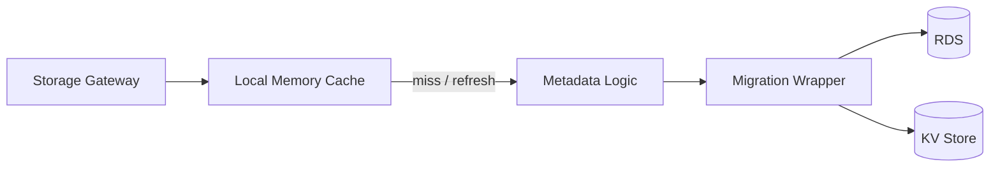
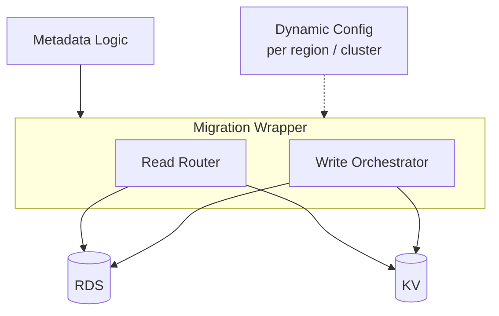
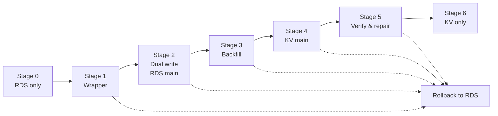
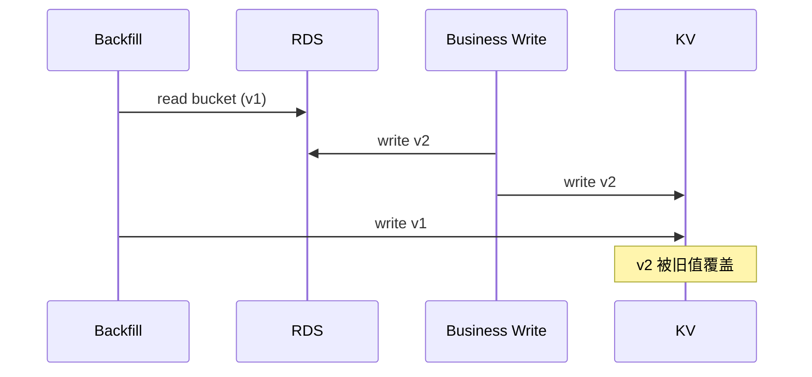
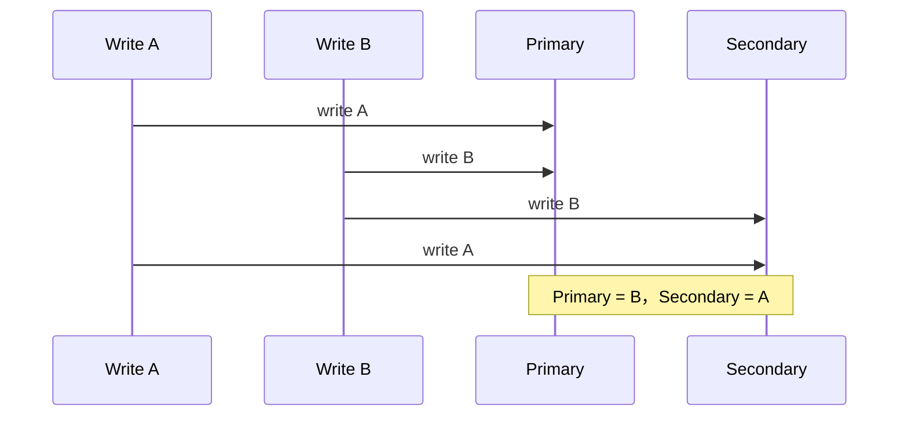

> 对应项目页：[RDS to KV Online Migration](/projects/rds-to-kv-online-migration/)。
> 本文只讨论设计思路和工程取舍，不涉及内部系统细节；文中代码均为示意。

## TL;DR

- **迁什么**：TikTok 对象存储（TOS）的元数据控制面 TMeta，把持久化层从 RDS 换成 KV。
- **难在哪**：TMeta 是每一次对象读写都要经过的关键依赖，不能停机、不能丢数据，而且要在几十个 region 上逐个完成。
- **怎么做**：拆成 6 个阶段 —— 引入迁移 wrapper → 双写（RDS 为主）→ 历史数据 backfill → 切换为 KV 为主 → 基于 `updatedAt` 的一致性校验与修复 → 只保留 KV。
- **核心原则**：旧存储在最后一步之前始终保持完整，所以**每一步都能靠改配置回滚**，不需要发版。
- **结果**：几十个 region 全部完成迁移，零停机，全程保留回滚能力。

---

## 1. 背景：TMeta 是什么

TMeta 负责回答"这个 bucket 是否存在、属于谁、配置是什么、凭证是什么"这类问题。上游的存储网关在处理每一个对象请求之前，都要先拿到 bucket 的元数据。

它的流量特征非常极端：

| 维度 | 特征 |
|---|---|
| 读流量 | 单 region 峰值约 **160k reads/s** |
| 写流量 | **< 1k writes/s**，且对延迟不敏感 |
| 部署 | 几十个 virtual region（美国、东南亚、中国、欧洲） |
| 服务方式 | 本地内存缓存优先，后端存储只在缓存未命中或刷新时访问 |

这两个特征对后面的迁移设计影响很大：

1. **读多写少**：意味着双写的额外成本几乎可以忽略 —— 每秒不到一千次写，多写一份存储不是问题。
2. **缓存优先**：绝大多数读请求根本不会落到后端存储，所以"把读切到新存储"这一步对后端的冲击，比裸读要平滑得多。



---

## 2. 为什么要迁：一次"我一开始反对"的决策

这次迁移的起点，是 RDS 上的几次慢查询导致服务过载。

我最初的判断是：**这是一个慢 SQL 问题，加上正确的索引就能解决，风险远低于换存储。** 从"修复眼前的事故"这个角度看，这个判断没错。

但和 manager 深入讨论之后，我意识到这次决策考虑的范围更大：

- **访问模式本来就是 key-value 的**。TMeta 最主要的查询是"按 bucket name 查元数据"，这是天然的 KV 访问模式。用关系型数据库承载它，等于为用不上的能力付出运维成本。
- **技术栈统一**。ToB 存储产品线的元数据已经跑在 KV 上。两条产品线用同一种存储，运维、工具链、故障处理经验都可以复用，整体的运维复杂度更低。

所以最后的结论是：**加索引可以解决眼前的问题，但迁移到 KV 是更好的长期方向。** 达成共识之后，由我来主导这次迁移的设计和落地。

> 这件事给我最大的启发是：技术分歧很多时候不是谁对谁错，而是**优化的范围不一样**。我在解决眼前的性能问题，而 manager 同时在考虑长期的架构一致性。之后再遇到不同意的技术方案，我会先确认对方要解决的完整问题是什么，再讨论实现。

---

## 3. 约束：这次迁移不能做什么

动手之前先把约束写清楚，后面所有的设计都是被这几条逼出来的：

1. **零停机**。TMeta 挂了，对象存储的读写就全部挂了，没有可以接受的停机窗口。
2. **零数据丢失**。bucket 元数据丢一条，就是一个用户的 bucket 消失。
3. **每一步可回滚**。任何阶段发现问题，都要能退回到上一个已知良好的状态。
4. **不靠发版切流**。几十个 region 逐个推进，如果每次切换都要发版，节奏慢不说，回滚也慢。
5. **按 region 独立推进**。不同 region 可以处在不同的迁移阶段，互不影响。

---

## 4. 为什么不做一次性切换（big-bang）

最直观的方案是：停写 → 导出 RDS → 导入 KV → 改配置指向 KV → 恢复。它的问题很明显：

- **需要停写窗口**，违反约束 1。
- **切换是单向的**：一旦新数据写进 KV，RDS 就已经过时，出了问题没法干净地退回去。
- **所有风险集中在一个时间点**：导入有 bug、KV 性能不达预期、某个边界数据格式不兼容……都只能在切换那一刻暴露出来，而且是在生产流量下。

在线迁移的思路正好相反：**把一次高风险的切换，拆成多次低风险、可观测、可回滚的小步骤。** 代价是流程更长、代码更复杂，但这是这类关键系统值得付出的代价。

> 关键决策：**用流程的复杂度换取迁移的安全性。** 分阶段迁移比一次性切换麻烦得多，但每一步的爆炸半径都可控。

---

## 5. 总体设计：Migration Wrapper + 动态配置

整个迁移的基础，是在业务逻辑和存储之间加一层 **Migration Wrapper**。业务代码只依赖一个统一的存储接口，至于读哪边、写哪边、先写谁，全部由 wrapper 根据动态配置决定。



示意代码大概是这样（省略了大量细节，不是生产代码原样）：

```go
type Mode int

const (
    ModeRDSOnly     Mode = iota // Stage 1：只读写 RDS，wrapper 空转
    ModeDualRDSMain             // Stage 2-3：双写，RDS 为主，读 RDS
    ModeDualKVMain              // Stage 4-5：双写，KV 为主，读 KV
    ModeKVOnly                  // Stage 6：只读写 KV
)

type MigrationStore struct {
    rds, kv BucketStore
    mode    func() Mode // 来自动态配置，按 region / cluster 下发
}

func (s *MigrationStore) Get(ctx context.Context, name string) (*Bucket, error) {
    switch s.mode() {
    case ModeRDSOnly, ModeDualRDSMain:
        return s.rds.Get(ctx, name)
    default:
        return s.kv.Get(ctx, name)
    }
}

func (s *MigrationStore) Put(ctx context.Context, b *Bucket) error {
    b.UpdatedAt = time.Now() // 同一次写入，两边使用同一个时间戳
    primary, secondary := s.writeOrder()
    if err := primary.Put(ctx, b); err != nil {
        return err // 主存储失败 = 这次写入失败
    }
    if secondary != nil {
        if err := secondary.Put(ctx, b); err != nil {
            // 副存储失败的处理策略见第 7 节
            s.onSecondaryFailure(ctx, b, err)
        }
    }
    return nil
}
```

这层抽象带来三个好处：

1. **切换 = 改配置**。读写路由由配置决定，切流和回滚都不需要发版，生效速度以秒计。
2. **按 region 独立**。每个 region / cluster 有自己的模式，可以一个一个推进。
3. **写入顺序可配置**。"先写 RDS 还是先写 KV"本身就是一个配置项，这是第 4 阶段能平滑反转主从关系的前提。

> 关键决策：**用动态配置而不是代码发布来控制流量切换。** 发版是分钟到小时级的，配置是秒级的。在出问题需要回滚的时候，这个差距就是事故大小的差距。

---

## 6. 六个阶段

先看全貌：



| 阶段 | 读 | 写 | 真相源 | 回滚方式 |
|---|---|---|---|---|
| 1. Wrapper | RDS | RDS | RDS | 关掉 wrapper 逻辑即可 |
| 2. 双写 | RDS | RDS → KV | RDS | 停止写 KV |
| 3. Backfill | RDS | RDS → KV | RDS | 停止 backfill 和写 KV |
| 4. KV 为主 | KV | KV → RDS | KV | 读写切回 RDS（RDS 仍在同步） |
| 5. 校验修复 | KV | KV → RDS | KV | 同上 |
| 6. 只用 KV | KV | KV | KV | **不可回滚**（单向门） |

这张表里最重要的一列是"真相源"（source of truth）。**任何时刻都只有一个真相源**，另一个存储只是它的副本。迁移的本质，就是在不中断服务的前提下，把真相源从 RDS 安全地交接给 KV。

### Stage 1：先上线一个"什么都不改变"的 wrapper

第一步只上线 wrapper，模式固定为 `RDSOnly`，所有读写依旧走 RDS。

看起来什么都没做，但它验证了几件事：

- wrapper 本身没有引入性能回退或 bug；
- 动态配置的下发链路是通的，按 region 生效的粒度是对的；
- 后续每个阶段的切换，都只剩"改配置"这一个动作。

**把"引入新代码"和"改变行为"拆成两次变更**，是降低风险最便宜的手段。出了问题，你能立刻知道是新代码的问题还是新行为的问题。

### Stage 2：双写，RDS 为主

开始双写：每次写入先写 RDS，成功后再写 KV。读请求仍然只读 RDS。

这个阶段 RDS 依然是唯一的真相源，KV 只是一个"正在被填充的副本"。它的意义在于：**从这一刻起，所有新产生或被修改的数据都会出现在 KV 里**，后面的 backfill 只需要处理存量。

同时，KV 第一次承接真实的生产写流量，可以观察它的写入延迟、错误率和容量表现，而这些观察完全不影响用户 —— 因为没有人读 KV。

### Stage 3：历史数据 backfill

用一个迁移工具扫描 RDS 的全量数据，写入 KV。这一步有几个容易踩的坑：

**坑 1：backfill 和双写的竞态。** backfill 读到某条记录的旧版本，与此同时业务写入了新版本并双写到 KV，然后 backfill 再把旧版本写进 KV —— 新数据被旧数据覆盖了。



解法是让写入带上版本信息：**backfill 只在 KV 中不存在该记录，或 KV 中的 `updatedAt` 更旧时才写入**（条件写 / compare-and-set）。这样 backfill 永远不会用旧数据覆盖新数据。

**坑 2：backfill 本身成为压力源。** 别忘了这次迁移的导火索就是 RDS 上的慢查询过载。全量扫描如果不限速，backfill 自己就可能把 RDS 打挂。所以扫描要按主键分批、限速，并且避开流量高峰。

**坑 3：中断与重跑。** 全量数据的 backfill 不可能保证一次跑完。工具需要记录进度、支持断点续跑，而且整个过程必须是**幂等**的 —— 同一条记录写一次和写十次，结果一样。

### Stage 4：切换主从，KV 为主

这是整个迁移里最关键的一步：

- **读**从 RDS 切到 KV；
- **写入顺序反转**：先写 KV，成功后再写 RDS。

从这一刻起，KV 成为真相源。但因为 RDS 仍然在被同步写入，它依旧是一份完整、实时的副本 —— 这正是这一步可以回滚的原因：如果 KV 表现异常，把配置切回去，读写回到 RDS，数据一条不少。

为什么写入顺序也要跟着反转？因为**主存储应该是第一个确认写入的那个**。如果读已经切到 KV，写却还是先写 RDS，一旦"RDS 成功、KV 失败"，用户刚写入的数据就读不到了。

这一步按 region 灰度推进：先切流量较小的 region，观察稳定之后再推进到核心 region。得益于缓存优先的架构，读路径切换时绝大多数请求仍由本地缓存承接，后端压力的变化是渐进的，而不是一次性的流量洪峰。

### Stage 5：一致性校验与修复

在关闭 RDS 之前，必须证明两边的数据确实一致。校验工具逐条比较两边的记录：

| 差异类型 | 处理 |
|---|---|
| 两边一致 | 跳过 |
| KV 有、RDS 没有 | 以 KV 为准（KV 已是真相源），补写 RDS 或确认是迁移后新建的数据 |
| RDS 有、KV 没有 | 重点排查：可能是漏迁，也可能是删除没有同步 |
| 两边都有但内容不同 | 比较 `updatedAt`，**以更新的一方为准**修复另一方 |

基于 `updatedAt` 修复成立的前提是：**同一次写入在两边使用同一个时间戳**（见第 5 节代码里的 `b.UpdatedAt = time.Now()`）。如果两边各自生成时间戳，时钟误差就会让比较失去意义。

校验要反复跑，直到差异数量收敛到零、并且保持一段时间不再出现新的差异，才具备进入最后一步的条件。

### Stage 6：只保留 KV

停止写 RDS，KV 成为唯一的存储。

这是六个阶段中**唯一的单向门**：一旦停止同步，RDS 就开始过时，回滚不再是"改个配置"那么简单。所以进入这一步的门槛是最高的 —— 前五个阶段的所有观察指标都要稳定，校验差异为零。

> 一个有用的心法：把迁移里的每个决策分成**双向门**（可以轻松退回）和**单向门**（退不回来）。双向门可以快速推进，单向门要放慢、要有明确的准入条件。好的迁移设计，是把单向门的数量压到最少，并把它推到最后。

---

## 7. 双写的一致性难点

双写听起来简单，真正的难点都在失败场景里。

### 7.1 部分失败

| 主存储 | 副存储 | 结果 |
|---|---|---|
| 成功 | 成功 | 正常 |
| 失败 | 未执行 | 请求失败，两边都没变，安全 |
| 成功 | **失败** | 两边不一致，需要处理 |
| **超时** | ? | 不知道主存储有没有写成功，最麻烦 |

"主成功、副失败"有两种处理策略：

1. **让整个请求失败**：语义最简单，但副存储的抖动会直接变成用户可见的写失败，相当于把新存储的稳定性风险提前暴露给了用户。
2. **请求成功，记录差异，事后修复**：用户无感知，但必须有可靠的修复机制兜底。

这次迁移有第 5 阶段的校验修复作为兜底，加上 TMeta 写流量低、写入对延迟不敏感，第二种策略的代价是可控的。核心思路是：**副存储的失败不应该影响主路径的可用性，但必须被发现、被修复。**

### 7.2 并发写入的乱序

两个并发请求修改同一个 bucket：A 先写主存储，B 后写主存储，但 B 先写完副存储，A 后写完副存储。结果主存储是 B 的值，副存储是 A 的值。



这种不一致在写入时很难完全避免，但带上 `updatedAt` 之后，它可以被检测出来，也可以被正确地修复 —— 副存储的写入同样可以用条件写拒绝更旧的版本。

### 7.3 删除

删除是迁移中最容易被忽略的场景：

- backfill 扫描时读到一条记录，随后用户删除了它，backfill 再把它写进 KV —— **已删除的数据被"复活"了**；
- 校验时发现"RDS 有、KV 没有"，到底是漏迁了，还是删除只同步了一半？

处理删除需要格外谨慎：删除操作同样要双写，backfill 写入前要确认源记录仍然存在，校验阶段对这类差异要单独分类排查，而不是一律"补齐"。

---

## 8. 回滚设计：每一步都要能退回去

"每个阶段都可以回滚"不是一句口号，它依赖一个非常具体的不变量：

> **在进入 Stage 6 之前，旧存储始终是完整、实时的。**

Stage 1–3 中 RDS 是真相源，自然完整；Stage 4–5 中 RDS 虽然不再是主存储，但依然被同步写入。正因为这个不变量一直成立，任何阶段的回滚都只是一次配置变更：把读写切回 RDS。

几个让回滚真正可用的细节：

- **回滚是配置变更，不是代码变更**。在出问题的时候，没人想等一次发版。
- **回滚粒度和推进粒度一致**。按 region 推进，就要能按 region 回滚，一个 region 的问题不应该影响其他 region。
- **回滚之后数据仍然一致**。这就是为什么 Stage 4 必须反转写入顺序、为什么要始终双写 —— 如果回滚之后 RDS 缺了一段数据，那这个回滚就是不可用的。

---

## 9. 在几十个 region 上推进

技术方案只是一半，另一半是怎么把它安全地推到几十个 region 上。这部分我和 SRE 团队紧密协作：

- **先小后大**：先在流量小的 region 走完全流程，验证方案和工具，再推进到核心 region。
- **每一步都有观察期**：切换之后观察核心指标稳定，再进入下一个阶段，而不是一口气推到底。
- **明确的观察指标**：读写错误率和延迟、双写中副存储的失败数、backfill 进度、校验差异数、缓存命中率。
- **明确的准入和回滚条件**：什么情况下进入下一阶段、什么情况下立即回滚，在动手之前就写清楚，而不是出了问题再临时判断。

我负责系统设计和实现，生产环境的上线和 SRE 一起推进，并在整个过程中持续盯系统健康度。

---

## 10. 结果

- 几十个 region 的元数据存储全部从 RDS 迁移到 KV；
- **全程零停机**，迁移过程对上游业务无感知；
- 每个阶段都保留了回滚能力，迁移风险被拆散到多个可控的小步骤里；
- 元数据服务的存储层，换成了更匹配其访问模式、并与 ToB 存储产品线统一的架构。

---

## 11. 复盘：我学到了什么

1. **先定义真相源，再谈一致性。** 迁移过程中任何时刻都只能有一个真相源。想清楚每个阶段谁是真相源，双写、修复、回滚的规则就都自然推出来了。
2. **把单向门压到最少，推到最后。** 六个阶段里只有最后一步不可回滚，前面所有的风险都可以靠改配置撤销。
3. **把"引入代码"和"改变行为"分开。** Stage 1 什么行为都不改，却让后面每一步都只剩下改配置这一个动作。
4. **失败场景比正常路径更重要。** 双写的正常路径十行代码就能写完，真正的设计工作都在部分失败、并发乱序和删除这些边界上。
5. **理解问题的完整范围。** 从"加个索引就行"到"迁移是更好的长期方向"，这个转变本身就是这个项目最有价值的部分之一。

---

## 附：面试版（60 秒）

> "I led a zero-downtime migration of our object-storage metadata service from RDS to a KV store, across dozens of regions. The access pattern was key-based and our ToB storage stack already used KV, so the move reduced operational complexity. Because the service sat on every object request, I avoided a big-bang cutover and designed six stages: a migration wrapper driven by dynamic config, dual-write with RDS as primary, a backfill using conditional writes, flipping KV to primary, timestamp-based verification and repair, and finally KV-only. The key invariant was that RDS stayed complete until the last step, so every stage could be rolled back with a config change. We finished with zero downtime."

常见追问可以从这几个方向准备：

- 双写时副存储失败怎么办？→ 第 7.1 节
- backfill 怎么避免覆盖新数据？→ Stage 3 的条件写
- 为什么 Stage 4 要反转写入顺序？→ 主存储必须第一个确认写入
- 怎么证明两边一致？→ Stage 5 的校验与修复
- 删除怎么处理？→ 第 7.3 节
